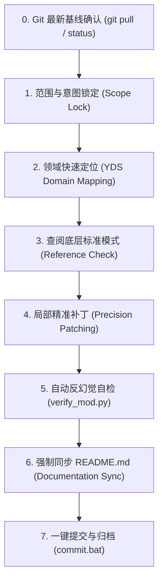

# HOI4 Fast Modifier & Low-Hallucination Updater (极速低幻觉更新技能)

专门针对《钢铁雄心4》模组（尤其是《盐道街之梦》项目）的高精、极速、低幻觉增量开发技能。  
本技能深度整合了 [hoi4skill (hoi4-mod-maker)](../hoi4-mod-maker/SKILL.md) 的底层规范，确保在用户提出任意一个更新需求时，AI Agent 能在**数分钟内以最高代码质量、零引擎语法陷阱、零漏改、且严格与 README.md 保持同步**的方式完成修改。

---

## 核心原则 (Core Tenets)

1.  **范围锁定契约 (Scope Contract)**：用户提出什么，只改动什么。严禁在未经授权的情况下私自重构未提及的系统、私自新建无关国家或文件。
2.  **绝对拒绝语法幻觉 (Zero-Hallucination Syntax Gates)**：
    *   **脚本严禁中文注释**：所有 `.txt` 脚本文件中的注释（`#` 之后）必须全部使用**纯 ASCII / 英文**，严禁夹杂任何中文字符，防止 Clausewitz 引擎在 ANSI 解码时大括号破坏性错位。
    *   **本地化必须带 BOM**：所有 `.yml` 文件必须使用 Python `utf-8-sig` 编码保存，确保首部包含 BOM 头（`\xef\xbb\xbf`），且首有效行为语言作用域（如 `l_simp_chinese:`）。
    *   **国策坐标防遮挡**：主干国策树左侧坐标必须满足 `x >= 9`，规避常驻的“持续性国策”面板遮挡。
    *   **决议与 BOP 严禁套壳**：决议脚本直接以 `category = { ... }` 开头（禁止包裹 `decisions = { }`）；BOP 脚本直接以 `bop_id = { ... }` 开头（禁止包裹 `bop = { }`）。
    *   **省份作用域转移**：领土割让必须使用省份作用域：`STATE_ID = { add_core_of = TAG transfer_state_to = TAG }`。
3.  **文档即代码 (Mandatory README Sync)**：代码一旦改写，必须**立即同步更新 [README.md](../../../README.md)** 中对应的章节（文件目录、机制设定、国策树拆解、避坑指南等），保持文档永久同步。
4.  **Git 版本先决确认 (Git Version Up-to-Date Gate)**：**每次修改前必须确认本地 Git 处于最新版本**。修改前先运行 `git status` 与 `git pull`，确保本地工作区整洁且基线与远程最新提交一致，严禁在陈旧代码上做增量修改；修改验证通过后，运行一键提交脚本（`commit.bat` 或 `python commit.py`）填入修改简介完成归档。

---

## 快速领域映射表 (YDS Domain Map)

收到更新意图后，直接查表定位目标文件，切勿在工程中漫无目的扫描：

| 功能类型 | 脚本文件位置 (Script) | 本地化文件位置 (Loc - UTF-8 BOM) | 美术与界面定义 (GFX / GUI) |
|---|---|---|---|
| **国策树 (Focus)** | `common/national_focus/YDS_focus.txt`<br>*(刘彦: `YDS_liu_yan_focus.txt`)*<br>*(无政府: `YDS_anarchy_focus.txt`)* | `localisation/simp_chinese/YDS_focus_l_simp_chinese.yml` | `interface/YDS_goals.gfx`<br>`gfx/interface/goals/` |
| **剧情与功能事件 (Events)** | `events/YDS_events.txt`<br>*(奥赛: `YDS_olympiad_events.txt`)*<br>*(全国战: `YDS_national_war_events.txt`)* | `localisation/simp_chinese/YDS_events_l_simp_chinese.yml` | `gfx/leaders/YDS/` (事件配图) |
| **决议与危机博弈 (Decisions)** | `common/decisions/YDS_decisions.txt`<br>*(奥赛: `YDS_olympiad_decisions.txt`)*<br>*(学区: `YDS_school_district_decisions.txt`)* | `localisation/simp_chinese/YDS_decisions_l_simp_chinese.yml` | `common/decisions/categories/YDS_decision_categories.txt` |
| **权力平衡 (BOP)** | `common/bop/YDS_class_1_bop.txt`<br>`common/decisions/YDS_bop_decisions.txt` | `localisation/simp_chinese/YDS_decisions_l_simp_chinese.yml` | `gfx/leaders/YDS/portrait_*_bop.png` |
| **国家精神 (Ideas / Buffs)** | `common/ideas/YDS_ideas.txt`<br>`common/ideas/YDS_school_district_ideas.txt` | `localisation/simp_chinese/YDS_ideas_l_simp_chinese.yml` | `interface/YDS_ideas.gfx`<br>`gfx/interface/ideas/` |
| **动态数值 (Dynamic Modifiers)** | `common/dynamic_modifiers/YDS_dynamic_modifiers.txt` | `localisation/simp_chinese/YDS_ideas_l_simp_chinese.yml` | 绑定数值变量 |
| **变量与初始历史 (History/Vars)** | `history/countries/YDS - Yandao.txt` | `localisation/simp_chinese/YDS_core_l_simp_chinese.yml` | 变量显示 Tooltips |
| **成都学区地缘 (District GUI)** | `common/scripted_guis/YDS_school_district_gui.txt`<br>`events/YDS_school_district_events.txt` | `localisation/simp_chinese/YDS_school_district_l_simp_chinese.yml` | `interface/YDS_school_district_gui.gui`<br>`gfx/interface/school_district_gui/` |
| **领袖与特质 (Characters/Traits)**| `common/characters/YDS_characters.txt`<br>`common/country_leader/YDS_traits.txt` | `localisation/simp_chinese/YDS_characters_l_simp_chinese.yml`<br>`YDS_custom_traits_l_simp_chinese.yml` | `interface/YDS_characters.gfx`<br>`gfx/leaders/YDS/` |
| **编制与部队 (OOB / Units)** | `history/units/YDS_civil_war_*.txt` | 纯英文编制名 | `common/names/00_yds_names.txt` |

---

## 七步极速修改流水线 (The 7-Step Rapid Pipeline)



### 步骤 0：Git 最新版本确认 (Git Version Up-to-Date Gate)
*   **每次修改前必须确认 Git 为最新版本**。
*   在动工前运行：
    ```powershell
    git status
    git pull
    ```
*   确保本地分支干净无未解决冲突，且与远程 `main`（或工作分支）完全对齐，严禁在过时基线上进行增量编辑。

### 步骤 1：范围与意图锁定 (Scope Lock)
*   明确用户诉求的核心要素（例如：修改数值？新增一个国策？增加一个决议？调整省份工业？）。
*   严禁擅自触碰与该功能无关的文件。

### 步骤 2：领域快速定位 (YDS Domain Mapping)
*   根据上表查出需要同步修改的一组文件（通常是：脚本文件 + 本地化文件 + 若有图标则加上 GFX 文件）。

### 步骤 3：查阅底层标准模式 (Reference Check)
*   若涉及不熟悉的 Clausewitz 语法、作用域或效果，直接查阅 [hoi4-mod-maker 知识库](../hoi4-mod-maker/references/)：
    *   效果与触发器：`references/scopes-effects-triggers.md`
    *   决议与国家精神写法：`references/decision-idea-cards.md`
    *   事件与选项结构：`references/event-cards.md`
    *   国策排版与互斥：`references/focus-tree-layout.md`
    *   本地化与色彩语法：`references/localisation-translation.md`

### 步骤 4：局部精准补丁 (Precision Patching)
*   使用 `replace_file_content` 对目标文件进行靶向插入或修改，**严禁轻易对大文件进行全量覆盖**。
*   **注释规范**：`.txt` 脚本内如需注释，只写英文，例如：`# Tang Siyi student welfare policy`。
*   **本地化保存规范**：修改 `.yml` 必须确保带有 UTF-8 BOM 头（Python 的 `utf-8-sig`）。

### 步骤 5：自动反幻觉自检 (Automated Verification)
在终端运行本技能内置的自检脚本：
```powershell
python ".agents/skills/hoi4-fast-modifier/scripts/verify_mod.py" "c:\Users\10431\Desktop\HOI4"
```
*   检查 BOM 头缺失。
*   检查大括号匹配对称性。
*   检查 `.txt` 中是否有误输入的中文注释。
*   检查是否有非法 outer wrappers。
*   *(若环境有 `hoi4skill.exe`)*，亦可运行 `hoi4skill validate`。

### 步骤 6：强制同步 README.md (Documentation Sync)
对照修改内容，同步更新项目根目录下的 [README.md](../../../README.md)：
1.  **目录树 (Section 2)**：若有新建/重命名文件，在此登记。
2.  **机制与数值 (Section 3)**：若调整了变量数值、阈值或触发机制，在此更新数值与说明。
3.  **国策树 (Section 4)**：若增减了国策节点，在此更新国策列表与前后置流程图。
4.  **避坑指南 (Section 9)**：若排查出了新底层陷阱，在此追加编号记录。

### 步骤 7：一键提交与归档 (Commit & Archive)
功能与文档同步修改并校验无误后，运行项目根目录下的一键提交脚本完成版本归档与推送（修改简介由操作者填入）：
```powershell
.\commit.bat "修改简介..."
# 或交互式运行（由终端提示输入修改简介并推送）：
python commit.py
```

---

## 常见更新场景速查卡 (Rapid Cheat Cards)

### 场景 A：新增一个国家精神 (New Idea)
1.  在 `common/ideas/YDS_ideas.txt` 的 `country = { ... }` 内部添加定义：
    ```text
    YDS_sample_idea = {
        allowed = { always = yes }
        removal_cost = -1
        modifier = {
            research_speed_factor = 0.05
            stability_factor = 0.05
        }
    }
    ```
2.  在 `localisation/simp_chinese/YDS_ideas_l_simp_chinese.yml` 添加文本（带 BOM 保存）：
    ```yaml
    YDS_sample_idea:0 "精神名称"
    YDS_sample_idea_desc:0 "详细背景故事描述..."
    ```

### 场景 B：新增一个事件 (New Event)
1.  确认文件顶部已有 `add_namespace = yds_event`。
2.  在 `events/YDS_events.txt` 尾部追加（注意纯英文注释）：
    ```text
    country_event = {
        id = yds_event.999
        title = yds_event.999.t
        desc = yds_event.999.d
        picture = GFX_report_event_chinese_officers

        is_triggered_only = yes

        option = {
            name = yds_event.999.a
            add_stability = 0.05
            ai_chance = { base = 100 }
        }
    }
    ```
3.  在 `localisation/simp_chinese/YDS_events_l_simp_chinese.yml` 添加对应的 `.t`, `.d`, `.a` 键值。

### 场景 C：新增一个决议 (New Decision)
1.  在 `common/decisions/categories/YDS_decision_categories.txt` 选定已注册分类（如 `YDS_universal_crisis`）。
2.  在 `common/decisions/YDS_decisions.txt` 对应的分类块内部追加决议，指定 `available`, `cost`, `days_remove`, `remove_effect`。
3.  在 `localisation/simp_chinese/YDS_decisions_l_simp_chinese.yml` 添加名称与描述。

---
*遵循本规范，确保每一次增量更新极速交付、零报错、零幻觉，文档与代码永葆一致！*
