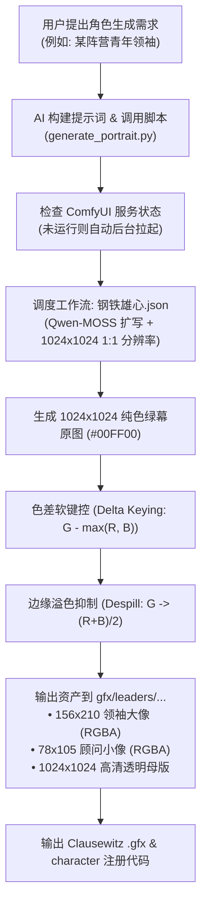

# HOI4 Portrait Generator via ComfyUI & Chroma-Key Despill

自动化《钢铁雄心4》（Hearts of Iron IV）领袖与顾问肖像生成技能。  
通过调用本地部署的 ComfyUI 工作流（`钢铁雄心.json`），生成 **1:1 纯色绿幕底图（#00FF00）**，并经由**影视级色差键控（Chroma Keying）与溢色抑制算法（Despill）**自动消除绿幕与边缘反光，直接输出符合 Clausewitz 引擎规格的标准领袖大头像（156×210）与顾问小头像（78×105），并自动生成游戏脚本绑定代码。

---

## 核心环境与资产路径 (Environment Contracts)

| 项 | 绝对路径 / 配置 | 说明 |
| :--- | :--- | :--- |
| **ComfyUI 根目录** | `C:\Program Files\Comfyui-WF-2026.8.8\Comfyui-WF-2026.8.8` | 秋叶整合包运行根目录 |
| **工作流源文件** | `C:\Program Files\Comfyui-WF-2026.8.8\Comfyui-WF-2026.8.8\ComfyUI\user\default\workflows\钢铁雄心.json` | MOSS-Image + LoRA + QwenExpander 工作流 |
| **ComfyUI 内置 Python** | `C:\Program Files\Comfyui-WF-2026.8.8\Comfyui-WF-2026.8.8\python\python.exe` | 包含 Torch 2.10 (CUDA 13.0)、Pillow、NumPy、Llama-cpp |
| **服务端口** | `http://127.0.0.1:8188` | ComfyUI REST/WebSocket 服务端口 |
| **技能流水线脚本** | `.agents/skills/hoi4-portrait-generator/scripts/generate_portrait.py` | 具备服务自启、工作流驱动与色键抠图全功能脚本 |
| **项目便捷入口** | `tools/generate_portrait.py` | 根目录下等价调用的便捷脚本 |

---

## 执行流水线 (Pipeline Flowchart)



---

## AI Agent 调用规范与命令 (Agent Execution Guide)

任何 AI 助手在需要生成或替换《钢铁雄心4》立绘肖像时，**只需在 PowerShell 中运行以下标准命令**：

### 1. 标准调用命令

```powershell
& "C:\Program Files\Comfyui-WF-2026.8.8\Comfyui-WF-2026.8.8\python\python.exe" .agents/skills/hoi4-portrait-generator/scripts/generate_portrait.py `
  --name "portrait_<TAG>_<character_name>" `
  --prompt "<角色外貌与服饰特征描述>" `
  --outdir "gfx/leaders/<TAG>"
```

### 2. 参数说明

*   `--name`（必填）：输出文件名前缀。建议遵守 HOI4 命名规范：`portrait_<TAG>_<pinyin_or_english_name>`（如 `portrait_YDS_chen_lin`）。
*   `--prompt`（必填）：角色的核心外貌特征、服饰、年龄与神态。脚本会**自动补全并强化**纯色绿幕（#00FF00）、棚拍平光与清晰轮廓指令。
*   `--outdir`（可选）：存放目录，默认为 `gfx/leaders/custom`，模组正式开发请指定对应国家路径，如 `gfx/leaders/YDS` 或 `gfx/leaders/TLB`。
*   `--seed`（可选）：指定随机种子，用于复现固定肖像。

### 3. 高质量提示词撰写模版 (Prompt Formula)

为确保 AI 生成最佳的钢铁雄心立绘质感，`--prompt` 推荐采用以下结构：
```text
一位[年龄与性别]的钢铁雄心风格[阵营/职务]领袖半身肖像，身穿[年代特色服装，如：笔挺的深色中山装/教务制服/校服风衣]，[领口细节或佩戴的勋章/校徽]，正面特写镜头，[神态描述，如：神情果断严谨、目光如炬]，五官轮廓鲜明，棚拍均匀无影平光，清晰平滑边缘
```

---

## 自动生成的输出资产规范 (Asset Outputs)

脚本执行完成后，将在目标文件夹输出四种规格的文件：

| 文件规格 | 尺寸 (像素) | 通道与格式 | 用途 |
| :--- | :--- | :--- | :--- |
| `<name>_156x210.png` | **156 × 210** | **RGBA** (透明底) | **游戏内国家领袖常驻大立绘** |
| `<name>_small_78x105.png` | **78 × 105** | **RGBA** (透明底) | **政治顾问、内阁成员、陆海军将领小头像** |
| `<name>_transparent_1024.png`| **1024 × 1024** | **RGBA** (透明底) | 1:1 高清透明母版，便于二次修图或制作大型宣传海报 |
| `<name>_raw_1024.png` | **1024 × 1024** | **RGB** (绿幕) | ComfyUI 生成的纯色绿幕原始备份 |

---

## 游戏内代码集成闭环 (Clausewitz Mod Integration)

AI 生成完图片后，必须执行以下两步将肖像接入模组：

### 步骤 1：在 `interface/<TAG>_characters.gfx` 中注册材质

在对应国家的 `.gfx` 文件（如 `interface/YDS_characters.gfx`）的 `spriteTypes = { ... }` 内部追加：

```pdx
	spriteType = {
		name = GFX_portrait_<TAG>_<character_name>
		texturefile = "gfx/leaders/<TAG>/portrait_<TAG>_<character_name>_156x210.png"
	}
	spriteType = {
		name = GFX_portrait_<TAG>_<character_name>_small
		texturefile = "gfx/leaders/<TAG>/portrait_<TAG>_<character_name>_small_78x105.png"
	}
```

### 步骤 2：在 `common/characters/<TAG>_characters.txt` 中绑定领袖/顾问

```pdx
characters = {
	<TAG>_<character_name> = {
		name = <TAG>_<character_name>
		portraits = {
			civilian = {
				large = GFX_portrait_<TAG>_<character_name>
				small = GFX_portrait_<TAG>_<character_name>_small
			}
		}
		country_leader = {
			ideology = <ideology_sub_type>
			traits = { <trait_id> }
			expire = "1965.1.1.1"
		}
	}
}
```

### 步骤 3：本地化文本追加 (UTF-8 with BOM 强制)

在 `localisation/simp_chinese/<TAG>_characters_l_simp_chinese.yml` 中追加姓名翻译（**文件编码必须是带 BOM 的 UTF-8，即 Python `utf-8-sig`**）：

```yaml
l_simp_chinese:
 <TAG>_<character_name>:0 "角色真实中文姓名"
```

---

## 色键算法原理详解 (Algorithm Internals)

为什么能做到头发丝与服饰边缘毫无绿边：
1. **色差软键控（Soft Delta Keying）**：
   $$\Delta_{\text{green}} = G - \max(R, B)$$
   设定下限 $\theta_L = 15$ 与上限 $\theta_U = 60$。
   $$\alpha = \text{clip}\left(1 - \frac{\Delta_{\text{green}} - \theta_L}{\theta_U - \theta_L}, 0, 1\right)$$
   对纯绿背景 $\alpha \to 0$，对主体人物 $\alpha \to 1$，过渡边缘呈平滑浮点值。
2. **反光抑制（Green Despill）**：
   绿幕散射会向人物边缘投射绿光。算法针对 $G > \max(R, B)$ 区域，直接将绿色通道重映射为：
   $$G_{\text{despilled}} = \frac{R + B}{2}$$
   瞬间将边缘绿色反光中和为环境自然漫反射固有色。
3. **高斯羽化与自适应人脸构图**：
   对 Alpha 通道实施半径 0.7 像素的高斯羽化消解走样；同时检测人物包围盒以 $156:210$ 的纵横比锁定头部与胸腔，LANCZOS 滤波下采样。

---

## 异常自愈与检查清单 (Troubleshooting)

1. **ComfyUI 无法连接**：
   - 脚本内部自带 `ensure_comfyui_running()`，会自动检查 `http://127.0.0.1:8188`，若未开启会自动以后台独立进程拉起。
   - 若端口冲突，可在脚本中修改 `COMFY_API_URL`。
2. **显存爆满（OOM）**：
   - 工作流中的 `QwenMossExpander` 默认开启了 `auto_unload_vram: True`，在扩写完成的毫秒内彻底卸载 LLM，确保 MOSS-Image 采样时拥有 100% 满血 VRAM。
3. **语法校验守门员**：
   - 修改完 `.gfx` 或 `.txt` 后，务必运行：
     ```powershell
     & "C:\Program Files\Comfyui-WF-2026.8.8\Comfyui-WF-2026.8.8\python\python.exe" .agents/skills/hoi4-fast-modifier/scripts/verify_mod.py
     ```
     确保括号平衡、BOM 头健全、无破坏性中文脚本注释。
