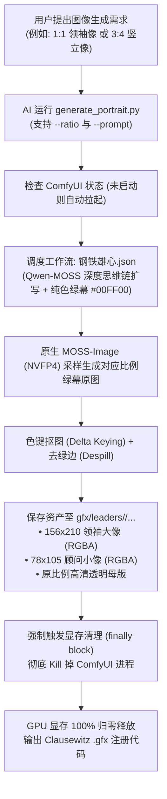

# HOI4 Portrait Generator via ComfyUI & Chroma-Key Despill

自动化《钢铁雄心4》（Hearts of Iron IV）领袖、顾问与游戏画面生成技能。  
通过调用本地部署的 ComfyUI 工作流（`钢铁雄心.json`），生成**预设比例纯色绿幕底图（#00FF00）**，并经由**影视级色差键控（Chroma Keying）与溢色抑制算法（Despill）**自动消除绿幕与边缘反光，直接输出符合 Clausewitz 引擎规格的标准领袖大头像（156×210）、顾问小头像（78×105）及对应比例的高清透明底母版。

> [!CAUTION]
> **显存清理铁律 (Mandatory VRAM Cleanup & Process Kill Gate)**：
> ComfyUI 在加载扩散模型与大语言模型后会长期常驻占用数 GB 至 10+ GB 显存。**所有立绘生成任务结束后，必须彻底杀掉 ComfyUI 进程，严禁遗留后台占用显存！**  
> 流水线脚本默认已启用“用后即杀（Auto-Kill）”保护；AI 亦可在流程终末显式执行 `--kill` 确保显存 100% 归零释放。

---

## 核心环境与资产路径 (Environment Contracts)

| 项 | 绝对路径 / 配置 | 说明 |
| :--- | :--- | :--- |
| **ComfyUI 根目录** | `C:\Program Files\Comfyui-WF-2026.8.8\Comfyui-WF-2026.8.8` | 秋叶整合包运行根目录 |
| **工作流源文件** | `C:\Program Files\Comfyui-WF-2026.8.8\Comfyui-WF-2026.8.8\ComfyUI\user\default\workflows\钢铁雄心.json` | MOSS-Image 原生底模 + Qwen3.8-9B-distill 思维链推演工作流 |
| **ComfyUI 内置 Python** | `C:\Program Files\Comfyui-WF-2026.8.8\Comfyui-WF-2026.8.8\python\python.exe` | 包含 Torch 2.10 (CUDA 13.0)、Pillow、NumPy、Llama-cpp、psutil |
| **服务端口** | `http://127.0.0.1:8188` | ComfyUI REST/WebSocket 服务端口 |
| **技能流水线脚本** | `.agents/skills/hoi4-portrait-generator/scripts/generate_portrait.py` | 具备服务自启、工作流驱动、色键抠图与**进程查杀释放显存**的全功能脚本 |
| **项目便捷入口** | `tools/generate_portrait.py` | 根目录下等价调用的便捷脚本 |

---

## 工作流最新节点拓扑与改进 (Workflow Topology Updates)

当前工作流已升级为**纯净高保真直连架构**：
1. **移除固定 LoRA（去除了 Node 41 观澜 LoRA）**：
   - 扩散模型 `UNETLoader`（`moss_image_sft_nvfp4.safetensors`）直接与 `SkipLayerGuidanceDiTSimple` 直连。
   - **优势**：消除了特定动漫脸型与画风束缚，角色形象更加真实多元，不仅适合学生自治会成员，也能完美呈现军官、教务长、长者领袖等不同年龄段角色。
2. **升级 Qwen-MOSS 提示词深度思维链（Node 90）**：
   - 采用显存占用更低的 `Qwen3.8-9B-distill-heretic_nvfp4_q8_0.gguf` 模型。
   - 启用了 `enable_thinking: True` 与 `thinking_effort: 深度推演 (MOSS六步法/严苛自检 - 推荐)`。
   - 模型先在思维链中推演焦段、空间、纯色绿幕边界与平光照明约束，随后输出高精度画面提示词，扩写完成后毫秒级释放显存。

---

## 画面比例预设一览 (Supported Aspect Ratios)

脚本提供了 `--ratio` / `-r` 接口，支持工作流预设的所有标准比例（同时支持简写与标准全名）：

| 比例参数 (`--ratio`) | 映射预设名称 | 推荐用途 (HOI4 游戏场景) |
| :--- | :--- | :--- |
| **`1:1`** *(默认)* | `1:1 (Square)` | **标准头像/领袖特写**，最适合领袖与顾问头像生成 |
| **`3:4`** | `3:4 (Portrait Standard)` | **竖向半身像**，适合站姿领袖、将领立绘 |
| **`2:3`** | `2:3 (Portrait Photo)` | **标准竖构图肖像**，适合含胸部至腰部的完整军装立绘 |
| **`4:3`** | `4:3 (Standard)` | **标准横画幅**，适合小型事件新闻配图（Event Pictures） |
| **`16:9`** | `16:9 (Widescreen)` | **宽屏横幅**，适合大型超级事件（Super Events）、剧场宣传或加载图 |
| **`9:16`** | `9:16 (Portrait Widescreen)`| **全身大立绘**，适合展示全身服饰或二次元全幅角色 |
| **`21:9`** | `21:9 (Ultrawide)` | **超宽带景长卷**，适合全景战役加载背景图 |
| **`3:2`** | `3:2 (Photo)` | **经典胶片横画幅**，适合历史战役场景配图 |

---

## 执行流水线 (Pipeline Flowchart)



---

## 显存释放与进程查杀机制 (VRAM Cleanup Contracts)

为杜绝生图后持续霸占显存，本技能建立了三重防护：

### 1. 默认自动查杀 (Auto-Kill by Default)
每次运行 `generate_portrait.py`，无论生成成功还是发生异常（`try...finally` 块），脚本**默认会在结束时立即杀掉由其拉起或正在监听 8188 端口的 ComfyUI 进程**。
> 只有当显式传入 `--keep-alive` 参数时，才会保持后台常驻（用于批量连续高频生图）。

### 2. 独立一键释放显存命令
在任何时候，AI 或用户只需执行带有 `--kill` 参数的命令，无需传入其他参数，即可瞬间清理所有 ComfyUI 残留进程并释放显存：
```powershell
& "C:\Program Files\Comfyui-WF-2026.8.8\Comfyui-WF-2026.8.8\python\python.exe" tools/generate_portrait.py --kill
```

### 3. PowerShell 原生查杀兜底
若 Python 进程被意外锁定，AI 可直接执行以下 PowerShell 单行命令进行兜底查杀：
```powershell
Get-NetTCPConnection -LocalPort 8188 -State Listen -ErrorAction SilentlyContinue | ForEach-Object { Stop-Process -Id $_.OwningProcess -Force }
```

---

## AI Agent 调用规范与命令 (Agent Execution Guide)

任何 AI 助手在需要生成或替换《钢铁雄心4》立绘肖像时，**接口保持完全一致向前兼容，只需在 PowerShell 中运行以下标准命令**：

### 1. 标准调用命令（生图 + 自动 Kill 进程释放显存）

```powershell
& "C:\Program Files\Comfyui-WF-2026.8.8\Comfyui-WF-2026.8.8\python\python.exe" tools/generate_portrait.py `
  --name "portrait_<TAG>_<character_name>" `
  --ratio "1:1" `
  --prompt "<角色外貌与服饰特征描述>" `
  --outdir "gfx/leaders/<TAG>"
```
*(执行完毕后控制台将输出 `[✓] Successfully terminated ComfyUI process(es). GPU VRAM 100% freed!`)*

### 2. 参数说明

*   `--prompt`（必填）：角色的核心外貌特征、服饰、年龄与神态。脚本会**自动补全并强化**纯色绿幕（#00FF00）、棚拍平光与清晰轮廓指令。
*   `--ratio` / `-r`（可选，默认 `1:1`）：画面比例预设。支持 `1:1`, `2:3`, `3:2`, `3:4`, `4:3`, `9:16`, `16:9`, `21:9`。
*   `--megapixels` / `-m`（可选，默认 `1.0`）：生成画面的目标百万像素（1.0 MP 约等于 1024×1024）。
*   `--name`（可选）：输出文件名前缀。建议遵守 HOI4 命名规范：`portrait_<TAG>_<pinyin_or_english_name>`（如 `portrait_YDS_chen_lin`）。
*   `--outdir`（可选）：存放目录，默认为 `gfx/leaders/custom`，模组正式开发请指定对应国家路径，如 `gfx/leaders/YDS`。
*   `--seed`（可选）：指定随机种子，用于复现固定画面。
*   `--kill`（独立开关）：立即强杀所有 ComfyUI 进程并释放显存，不执行生图。
*   `--keep-alive`（可选）：阻止生图后自动杀掉进程（仅建议在连续批量生成多张立绘的循环中使用；**批量生成完毕后必须补跑一次 `--kill`**）。

---

## 批量生成时的显存管理范例 (Batch Generation Pattern)

当 AI 需要连续批量生成多张立绘（例如一次性生成 5 个内阁成员肖像）时，推荐采用“**批量保持常驻 $\to$ 终末强制查杀**”的高性能范式：

```powershell
# 1. 批量生成期间保持服务常驻，避免反复冷启动
& "C:\Program Files\Comfyui-WF-2026.8.8\Comfyui-WF-2026.8.8\python\python.exe" tools/generate_portrait.py --name "portrait_YDS_char1" --prompt "..." --keep-alive
& "C:\Program Files\Comfyui-WF-2026.8.8\Comfyui-WF-2026.8.8\python\python.exe" tools/generate_portrait.py --name "portrait_YDS_char2" --prompt "..." --keep-alive

# 2. 全部生成完毕后，强制执行终末清理，彻底释放显存！
& "C:\Program Files\Comfyui-WF-2026.8.8\Comfyui-WF-2026.8.8\python\python.exe" tools/generate_portrait.py --kill
```

---

## 自动生成的输出资产规范 (Asset Outputs)

脚本执行完成后，将在目标文件夹输出对应比例与规格的文件：

| 文件规格 | 尺寸 (像素) | 通道与格式 | 用途 |
| :--- | :--- | :--- | :--- |
| `<name>_transparent_<W>x<H>.png` | **按比例自动计算** | **RGBA** (透明底) | 所选比例的**高清透明母版**（去绿幕+去绿边） |
| `<name>_raw_<W>x<H>.png` | **按比例自动计算** | **RGB** (绿幕) | ComfyUI 生成的纯色绿幕原始母版 |
| `<name>_156x210.png` | **156 × 210** | **RGBA** (透明底) | **游戏内国家领袖常驻大立绘**（自动智能人像裁切） |
| `<name>_small_78x105.png` | **78 × 105** | **RGBA** (透明底) | **政治顾问、内阁成员、陆海军将领小头像** |

---

## 游戏内代码集成闭环 (Clausewitz Mod Integration)

AI 生成完图片后，必须执行以下两步将肖像接入模组：

### 步骤 1：在 `interface/<TAG>_characters.gfx` 中注册材质

在对应国家的 `.gfx` 文件（如 `interface/YDS_characters.gfx`）的 `spriteTypes = { ... }` 内部追加：

```pdx
	spriteType = {
		name = GFX_portrait_<TAG>_<character_name>
		texturefile = "gfx/leaders/<TAG>/portrait_<TAG>_<character_name>_156x210.png"
	}
	spriteType = {
		name = GFX_portrait_<TAG>_<character_name>_small
		texturefile = "gfx/leaders/<TAG>/portrait_<TAG>_<character_name>_small_78x105.png"
	}
```

### 步骤 2：在 `common/characters/<TAG>_characters.txt` 中绑定领袖/顾问

```pdx
characters = {
	<TAG>_<character_name> = {
		name = <TAG>_<character_name>
		portraits = {
			civilian = {
				large = GFX_portrait_<TAG>_<character_name>
				small = GFX_portrait_<TAG>_<character_name>_small
			}
		}
		country_leader = {
			ideology = <ideology_sub_type>
			traits = { <trait_id> }
			expire = "1965.1.1.1"
		}
	}
}
```

---

## 异常自愈与检查清单 (Troubleshooting)

1. **显存未释放 / 显存占用过高**：
   - 直接运行 `& "C:\Program Files\Comfyui-WF-2026.8.8\Comfyui-WF-2026.8.8\python\python.exe" tools/generate_portrait.py --kill` 瞬间强杀。
2. **语法校验守门员**：
   - 修改完 `.gfx` 或 `.txt` 后，运行 `.agents/skills/hoi4-fast-modifier/scripts/verify_mod.py` 确保 100% 通过验证。
