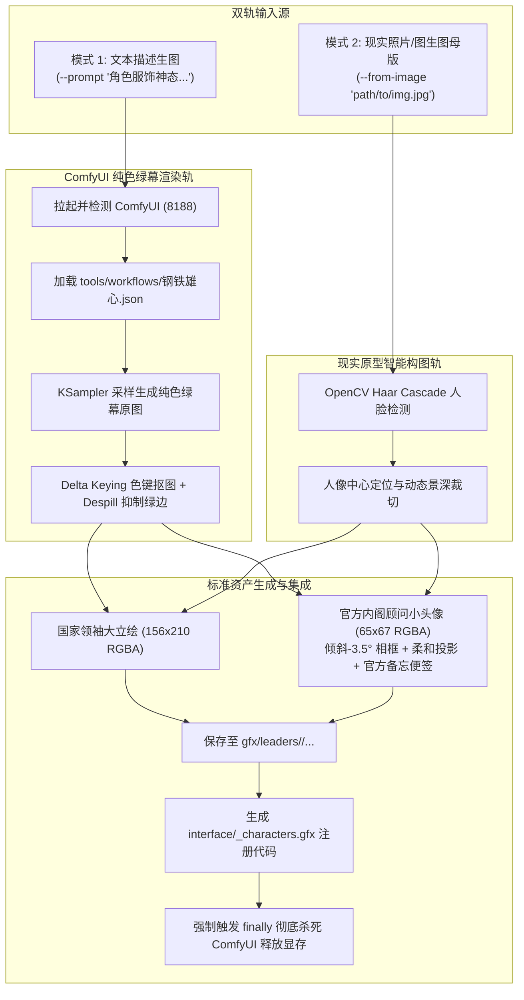

# HOI4 Portrait Generator (ComfyUI Workflow & Canonical Advisor Pipeline)

自动化《钢铁雄心4》（Hearts of Iron IV）国家领袖、将领与内阁政治顾问立绘生成技能。  
支持**双轨制生成管线**：
1. **ComfyUI 纯色绿幕文生图管线**：调用项目内置工作流 `tools/workflows/钢铁雄心.json`，支持 8 种画幅预设，结合**影视级色差键控（Chroma Keying）与溢色抑制算法（Despill）**自动消除绿幕与边缘反光。
2. **现实原型 / 图生图后处理管线**：通过 `--from-image` 传入现实参考照片或 AI 图生图母版，经由**人脸特征检测与重心智能变焦**自动裁切构图。

统一规范化输出严格符合 Clausewitz 引擎与 GUI 标准的：
- **国家领袖常驻大立绘**：`156 × 210` RGBA（半身像）
- **内阁政治顾问小头像**：严格为 **`65 × 67`** RGBA（经典官方卷宗相框倾斜 -3.5°、柔和投影、右下角官方内阁备忘便签，完全杜绝 78×105 引致的文字遮挡与跨行溢出）
- **原比例高清透明底母版**：`transparent_<W>x<H>.png`

> [!CAUTION]
> **显存清理铁律 (Mandatory VRAM Cleanup & Process Kill Gate)**：
> ComfyUI 在加载扩散模型与大语言模型后会长期常驻占用数 GB 至 10+ GB 显存。**所有立绘生成任务结束后，必须彻底杀掉 ComfyUI 进程，严禁遗留后台占用显存！**  
> 流水线脚本默认已启用“用后即杀（Auto-Kill）”保护；AI 亦可在流程终末显式执行 `--kill` 确保显存 100% 归零释放。

---

## 核心环境与资产路径 (Environment Contracts)

| 项 | 绝对路径 / 配置 | 说明 |
| :--- | :--- | :--- |
| **模组内置工作流** | `tools/workflows/钢铁雄心.json` | 模组版本受控的 ComfyUI 工作流源文件 |
| **技能内置工作流备份** | `.agents/skills/hoi4-portrait-generator/resources/钢铁雄心.json` | 技能随附自包含资源备份 |
| **官方顾问备忘便签资产** | `tools/assets/vanilla_advisor_note.png` | 官方内阁顾问卷宗便签素材（65×67） |
| **ComfyUI 整合包根目录** | `C:\Program Files\Comfyui-WF-2026.8.8\Comfyui-WF-2026.8.8` | 秋叶整合包运行根目录 |
| **ComfyUI 内置 Python** | `C:\Program Files\Comfyui-WF-2026.8.8\Comfyui-WF-2026.8.8\python\python.exe` | 包含 Torch 2.10 (CUDA 13.0)、Pillow、NumPy、OpenCV |
| **服务端口** | `http://127.0.0.1:8188` | ComfyUI REST/WebSocket 服务端口 |
| **项目便捷入口脚本** | `tools/generate_portrait.py` | 根目录下等价调用的全功能流水线脚本 |
| **技能流水线脚本** | `.agents/skills/hoi4-portrait-generator/scripts/generate_portrait.py` | 技能随附脚本，具备双轨生成、自动抠图与进程查杀功能 |

---

## 画面比例预设一览 (Supported Aspect Ratios)

在 ComfyUI 文生图模式下，脚本提供了 `--ratio` / `-r` 接口，支持工作流预设的所有标准比例：

| 比例参数 (`--ratio`) | 映射预设名称 | 推荐用途 (HOI4 游戏场景) |
| :--- | :--- | :--- |
| **`1:1`** *(默认)* | `1:1 (Square)` | **标准头像/领袖特写**，最适合领袖与顾问头像生成 |
| **`3:4`** | `3:4 (Portrait Standard)` | **竖向半身像**，适合站姿领袖、将领立绘 |
| **`2:3`** | `2:3 (Portrait Photo)` | **标准竖构图肖像**，适合含胸部至腰部的完整军装立绘 |
| **`4:3`** | `4:3 (Standard)` | **标准横画幅**，适合小型事件新闻配图（Event Pictures） |
| **`16:9`** | `16:9 (Widescreen)` | **宽屏横幅**，适合大型超级事件（Super Events）、剧场宣传或加载图 |
| **`9:16`** | `9:16 (Portrait Widescreen)`| **全身大立绘**，适合展示全身服饰或全幅角色 |
| **`21:9`** | `21:9 (Ultrawide)` | **超宽带景长卷**，适合全景战役加载背景图 |
| **`3:2`** | `3:2 (Photo)` | **经典胶片横画幅**，适合历史战役场景配图 |

---

## 执行流水线架构 (Dual Pipeline Architecture)



---

## AI Agent 调用规范与命令 (Agent Execution Guide)

### 管线 1：通过 ComfyUI 工作流进行文生图（生图后自动释放显存）

```powershell
& "C:\Program Files\Comfyui-WF-2026.8.8\Comfyui-WF-2026.8.8\python\python.exe" tools/generate_portrait.py `
  --name "portrait_<TAG>_<character_name>" `
  --ratio "1:1" `
  --prompt "<角色外貌、年龄与服饰特征描述>" `
  --outdir "gfx/leaders/<TAG>"
```
*(执行完毕后控制台将输出 `[OK] Successfully terminated ComfyUI process(es). GPU VRAM 100% freed!`)*

### 管线 2：基于已有照片 / 现实原型图进行 HOI4 规格处理

当人物有现实原型（需先检索真实照片并用图像模型处理后），使用 `--from-image` 直接裁剪生成规范资产，**完全无需占用 GPU 显存**：

```powershell
& "C:\Program Files\Comfyui-WF-2026.8.8\Comfyui-WF-2026.8.8\python\python.exe" tools/generate_portrait.py `
  --from-image "tools/reference_photos/<character_photo>.jpg" `
  --name "portrait_<TAG>_<character_name>" `
  --outdir "gfx/leaders/<TAG>"
```

### 管线 3：显式查杀释放显存命令

无论何时，若需要立即终止后台常驻的 ComfyUI 进程释放显存，只需执行：

```powershell
& "C:\Program Files\Comfyui-WF-2026.8.8\Comfyui-WF-2026.8.8\python\python.exe" tools/generate_portrait.py --kill
```

---

## 自动生成的输出资产规范 (Asset Outputs)

脚本执行完成后，将在目标文件夹输出对应尺寸的文件：

| 文件命名规则 | 尺寸 (像素) | 通道与格式 | 引擎与界面用途 |
| :--- | :--- | :--- | :--- |
| `<name>_156x210.png` | **156 × 210** | **RGBA** (透明底/纯色底) | **游戏内国家领袖常驻大立绘** |
| `<name>_small_65x67.png` | **65 × 67** | **RGBA** (透明底) | **政治顾问、内阁成员官方规范小头像**（契合 231×74 按钮与圆框，绝无文字遮挡与跨行越界） |
| `<name>_small.png` | **65 × 67** | **RGBA** (透明底) | 官方内阁顾问标准别名 |
| `<name>_transparent_<W>x<H>.png` | 自动计算 | **RGBA** (透明底) | 所选比例的**高清透明母版**（文生图抠图产物） |
| `<name>_raw_<W>x<H>.png` | 自动计算 | **RGB** (绿幕) | ComfyUI 生成的纯色绿幕原始母版 |

> [!NOTE]
> 早期脚本生成的 `78 × 105` 属于未经 GUI 适配的等比缩放尺寸，在内阁槽位（`political_selectable_idea_entry_grid`）中会导致右侧文字遮挡与底部越界。当前管线已全面重构升级为官方 **`65 × 67`** 规范相框与便签格式。

---

## 游戏内代码集成闭环 (Clausewitz Mod Integration)

### 步骤 1：在 `interface/<TAG>_characters.gfx` 中注册材质

```pdx
spriteTypes = {
	spriteType = {
		name = "GFX_portrait_<TAG>_<character_name>"
		texturefile = "gfx/leaders/<TAG>/portrait_<TAG>_<character_name>_156x210.png"
	}
	spriteType = {
		name = "GFX_portrait_<TAG>_<character_name>_small"
		texturefile = "gfx/leaders/<TAG>/portrait_<TAG>_<character_name>_small_65x67.png"
	}
}
```

### 步骤 2：在 `common/characters/<TAG>_characters.txt` 中绑定角色

```pdx
characters = {
	<TAG>_<character_name> = {
		name = <TAG>_<character_name>
		portraits = {
			civilian = {
				large = "GFX_portrait_<TAG>_<character_name>"
				small = "GFX_portrait_<TAG>_<character_name>_small"
			}
		}
		country_leader = {
			ideology = <ideology_sub_type>
			traits = { <trait_id> }
		}
		advisor = {
			slot = political_advisor
			idea_token = <TAG>_<character_name>_advisor
			allowed = {
				original_tag = <TAG>
			}
			traits = { <trait_id> }
			cost = 100
		}
	}
}
```

---

## 异常自愈与检查清单 (Troubleshooting)

1. **显存未释放 / 显存占用过高**：
   - 直接运行 `& "C:\Program Files\Comfyui-WF-2026.8.8\Comfyui-WF-2026.8.8\python\python.exe" tools/generate_portrait.py --kill` 瞬间强杀。
2. **语法校验守门员**：
   - 修改完 `.gfx` 或 `.txt` 后，运行 `.agents/skills/hoi4-fast-modifier/scripts/verify_mod.py` 确保 100% 通过验证。
