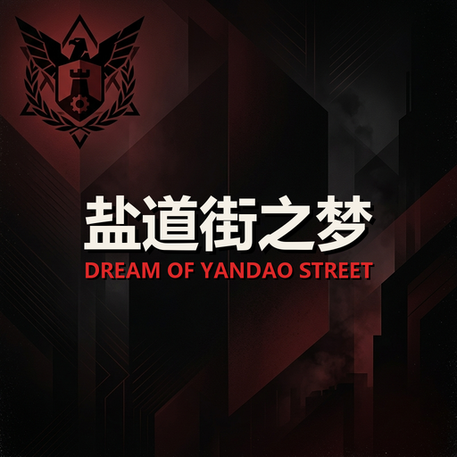
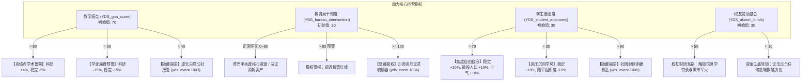
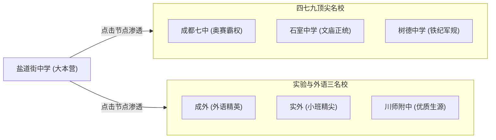
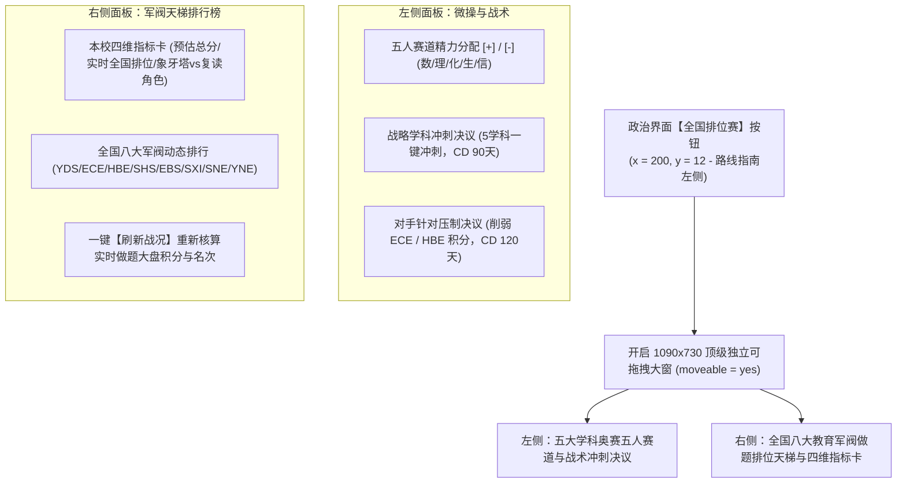
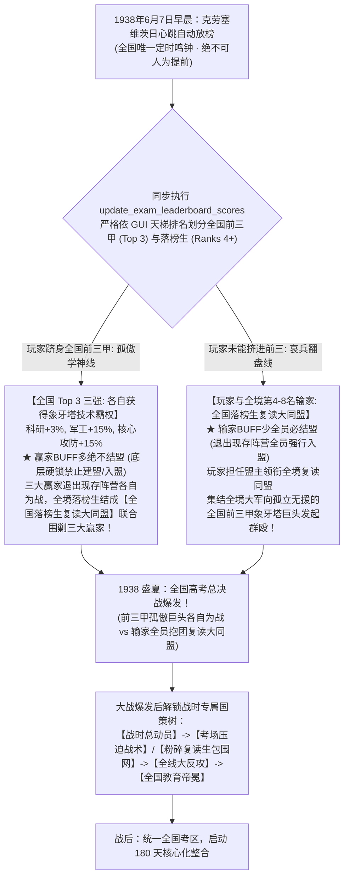
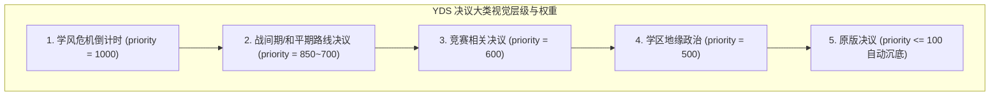

# 《钢铁雄心4》模组："盐道街之梦" (Dream of Yandao Street)



> **版本**：v1.2.0  
> **支持游戏版本**：1.19.* (Clausewitz 引擎 / No Step Back + By Blood Alone + Arms Against Tyranny 新特性兼容)  
> **模组类别**：架空历史 (Alternative History) / 校园政治叙事 (Campus Political Role-Playing) / 深度机制玩法 (Deep Mechanics Mod)  
> **创意工坊 ID**：3756733339  
> **工作区路径**：`c:\Users\10431\Desktop\HOI4`

---

## 目录 (Table of Contents)
- [1. 模组概述与世界观背景](#1-模组概述与世界观背景)
  - [1.1 历史沿革与故事开端 (1936)](#11-历史沿革与故事开端-1936)
  - [1.2 主要势力与领袖一览](#12-主要势力与领袖一览)
  - [1.3 全国应试割据版图 (各大教育集团)](#13-全国应试割据版图-各大教育集团)
- [2. 完整文件树与目录架构解析](#2-完整文件树与目录架构解析)
- [3. 核心机制全景 (Core Gameplay Mechanics)](#3-核心机制全景-core-gameplay-mechanics)
  - [3.1 四维动态数值体系与安全/预警/崩溃阈值规范](#31-四维动态数值体系与安全预警崩溃阈值规范)
  - [3.2 政治点 (PP) 全周期日净产出收益曲线模型](#32-政治点-pp-全周期日净产出收益曲线模型)
  - [3.3 60天常态学风危机数理模型与对冲精算](#33-60天常态学风危机-yds_uc_spread_of_freedom-数理模型与对冲精算)
  - [3.4 四大极端崩溃与隐藏结局 (含铜梁巴中隐藏线)](#34-四大极端崩溃与隐藏结局-含铜梁巴中隐藏线) ➜ [专属文档: README_TLB.md](README_TLB.md)
  - [3.5 高一·一班权力平衡系统 (Class 1 BOP)](#35-高一一班权力平衡系统-class-1-bop)
  - [3.6 成都学区地缘政治与地图 GUI (School District GUI)](#36-成都学区地缘政治与地图-gui-school-district-gui)
  - [3.7 全国高考试卷院独立GUI系统与八校排位天梯](#37-全国高考试卷院独立gui系统与八校排位天梯-national-exam-board--standalone-league-gui)
  - [3.8 1938 盛夏：全国统一高考放榜与大战爆发机制](#38-1938-盛夏全国统一高考放榜与大战爆发机制-the-gaokao-reckoning--apocalypse)
  - [3.9 180天学区统考整合与核心化体系 (Coring Mechanics)](#39-180天学区统考整合与核心化体系-coring-mechanics)
  - [3.10 交互式政治路线指南 (Interactive Route Guide SGUI)](#310-交互式政治路线指南-interactive-route-guide-sgui)
- [4. 国策树架构深度分解 (National Focus Trees)](#4-国策树架构深度分解-national-focus-trees)
  - [4.1 主线国策树 (`YDS_focus.txt`)](#41-主线国策树-yds_focustxt)
  - [4.2 极权国策树：刘彦极端均等与高压托管 (`YDS_liu_yan_focus.txt`)](#42-极权国策树刘彦极端均等与高压托管-yds_liu_yan_focustxt)
  - [4.3 崩溃国策树：无政府白卷主义 (`YDS_anarchy_focus.txt`)](#43-崩溃国策树无政府白卷主义-yds_anarchy_focustxt)
  - [4.4 最高教育局巡视督导组国策树与东三省“取而代之”企划预留 (`EBS_focus.txt`)](#44-最高教育局巡视督导组国策树与东三省取而代之企划预留-ebs_focustxt) ➜ [专属文档: README_EBS.md](README_EBS.md)
- [5. 决议与事件系统全景 (Decisions & Events)](#5-决议与事件系统全景-decisions--events)
- [6. 地图、省份划分与编制资产 (Map, States & OOB)](#6-地图省份划分与编制资产-map-states--oob)
- [7. 美术、UI与原声音乐系统 (GFX, Interface & Soundtrack)](#7-美术ui与原声音乐系统-gfx-interface--soundtrack)
- [8. 本地化与多语言架构 (Localisation Architecture)](#8-本地化与多语言架构-localisation-architecture)
- [9. Clausewitz 引擎底层避坑指南与开发红线 (43条硬核法则)](#9-clausewitz-引擎底层避坑指南与开发红线-43条硬核法则)
- [10. 后续开发者与 Agent 协作开发准则](#10-后续开发者与-agent-协作开发准则)

---

## 1. 模组概述与世界观背景

### 1.1 历史沿革与故事开端 (1936)
故事发生在成都的**盐道街中学**，其在推演沙盘中代表着控制川渝教育核心的大本营（初始 Tag: `YDS`）。

*   **前情合校危机**：老盐道街中学原本是一所具有优良学术传统与名校口碑的学府。然而在教育局主导的行政合并案中，老盐道街受到强力弹压，被迫与一所底子薄弱的综合类学校强行合并。为了推进绝对的教育资源平均分配，上级教育局直接指派**蒋光平**进驻，担任合并后的校委会最高掌舵人。
*   **1936年开局困局**：强制合并与铁腕管制导致校内教学秩序严重倒退，拔尖学生被严重打压、中层教师疲于奔命、老校区校友痛心疾首。全校笼罩在学业崩盘与内部暴动的火山口之上。三大派系在校内剑拔弩张，外部更有蓉城诸名校与全国考霸集团虎视眈眈。

### 1.2 主要势力与领袖一览

| 领袖姓名 | 意识形态体系 | 阵营名称 | 核心执政理念与路线特色 |
|---|---|---|---|
| **蒋光平** | 校务官僚专制 / 大纲绝对均等派<br>(Paternal Autocrat / Radical Socialist) | 盐中校委会<br>(YDC) | 教育局体制内铁腕。开局为专制家长制（校务官僚专制），推行大纲绝对统一、严厉惩治违纪与拔尖特权，通过牺牲顶尖名校光环换取全校资源的绝对平均化。后期完成均等国策可平稳转型为红星均等公社。 |
| **李刚** | 绩点达尔文狂热 / 老校复兴圣战 / 校友资本商会<br>(National Populist / Market Liberal / Social Conservative) | 老校区复兴军<br>(YDF) | 老校区政治名师。极度怀念昔日荣光，暗中秘密串联老校友、抢购绝版高端教辅、动员民兵武装政变，主张以达尔文式的绩点分层重振精英学校辉煌。后期可走向**绩点达尔文分支**或**校友商业资本联盟分支**。 |
| **自治委员会** | 学生主权自由派 / 师长督导立宪制<br>(Social Liberal / Authoritarian Democrat) | 盐中一班自治联盟<br>(YDD / YDS 权力平衡期) | 高一·一班学生代表与开明教师联合组成的过渡期集体领导机构。在唐思懿（激进学生主权）与邓霜（温和师长改良）通过权力平衡决出胜负前主持校政，使用西班牙内战无政府领导人头像。 |
| **唐思懿** | 学生主权自由派 / 思想解放自治<br>(Social Liberal) | 盐中一班自治联盟<br>(YDD - 学生侧) | 高一·一班学生领袖。痛恨形式主义高压管教，主张思想解放、言论自由、成立学生自治议会、废除校服，将学校的管理主权彻底归还全体学生。 |
| **邓霜** | 师长督导立宪制 / 理性妥协改良<br>(Authoritarian Democrat) | 盐中一班自治联盟<br>(YDD - 教师侧) | 高一·一班班主任。在激进学生与铁腕校方之间巧妙周旋，推行温和体制内改良、模块化选课与学分制，追求升学成绩与学生幸福感的理性平衡。 |
| **刘彦** | 极端教务统制 / 督导铁腕极权<br>(Totalist) | 教育局接管专署<br>(隐藏极权领袖) | 上级教育局委派的极端冷酷行政机器。在教育局干预度达到 100% 时空降，锁死全部正常国策，开启禁绝一切社团、全天候全方位监控的“无灵魂机器”黑暗路线。 |
| **无政府领袖** | 无政府白卷主义 / 社团割裂割据<br>(Anarcho Xuexism) | 自治社团联合 / 白卷公社<br>(隐藏崩溃领袖) | 当校园秩序彻底解体时登场的无政府领袖。包含动漫社与体训生武装割据的**社团封建割据**，以及彻底焚毁试卷、放弃升学竞争的**虚无白卷涅槃**。 |
| **汤启梅** | 严格军事化寄宿体制 / 封闭式教育<br>(Paternal Autocrat) | 铜梁巴川中学<br>(TLB - 教师立权派) | 拥有超20年教龄的老年英语名师。推行铁腕高压的封闭式封闭教学，杜绝校外干扰；但本人重女轻男且管理偏袒。执政效果：**政治点数每日 +1.0、稳定度 +20%、战争支持度 +5%、科研速度 -10%**（详见 [README_TLB.md](README_TLB.md)）。 |
| **胡朝强** | 技术官僚教育改良 / 幽默启发式升学<br>(Authoritarian Democrat / Social Liberal) | 铜梁巴川中学<br>(TLB - 教师温和改良派) | 年长资深数学名师，曾为高考状元。主张以幽默化解焦虑，以思维深度替代无效机械刷题。执政效果：**科研速度 +20%、消费品工厂需求 -10%**（详见 [README_TLB.md](README_TLB.md)）。 |
| **六班自治委员会** | 学生联合公社 / 班级多元自治<br>(Radical Socialist / Syndicalist) | 铜梁巴川中学<br>(TLB - 学生自治派) | 高一·六班56名学生组成的集体权力机关（“56名学生，56只花”）。对外反抗教育高压，内部小团体众多、派系竞争激烈。执政/民族精神效果【各怀鬼胎】：**稳定度 -10%、消费品工厂需求 +5%**（详见 [README_TLB.md](README_TLB.md)）。 |
| **张瀚予** | 学生自由意志主义 / 跨学科骨干<br>(Social Liberal) | 铜梁巴川中学<br>(TLB - 六班核心操盘手) | 六班核心领袖学生之一，身兼数职、多才多艺，兼任强力政治顾问与陆军指挥官，提供全方位的行政效率与战术组织加成（详见 [README_TLB.md](README_TLB.md)）。 |
| **陈专员** | 极端官僚集权 / 巡视威权统筹<br>(Paternal Autocrat) | 最高教育局巡视督导专署<br>(EBS - 中枢督导组) | 最高教育督导专署总专员。表面大讲“四个回归与挤干水分”，实则是掌控全国考卷命题权与京津名额特权的官僚太上皇。下辖怀总工（赛博考务）、周总导（评估风暴）、王司长（足球洗钱）、郗特使（西藏高考移民）与王总管（营养餐包干）等庞大内阁（详见 [README_EBS.md](README_EBS.md)）。 |

### 1.3 全国应试割据版图 (各大教育集团)
本模组重绘了全国版图，将全国划分为七大代表性应试教育超级实体与周边边缘学区：

1.  **`YDS` 盐道街中学 (川渝大本营)**：控制成都、重庆、川南、川西等川渝核心学区。
2.  **`SXI` 陕南秦岭考霸同盟 (陕西盟主 - 李军)**：坐拥关中与陕南，以严酷的全寄宿军事化早晚自习著称。
3.  **`HBE` 华中楚天考霸集团 (两湖盟主 - 周鹏)**：以黄冈密卷与华师一题库为核心壁垒，奥赛与题海战术登峰造极。
4.  **`YNE` 滇黔名校联考同盟 (西南名校 - 李伟)**：云贵高原上的联合联考阵线，兼具体训与民族特长生战术。
5.  **`SHS` 山河四省教育联盟 (华北高考修罗场 - 王老师)**：晋冀鲁豫超级做题家军团，坐拥全国最狂暴的生源与极其残酷的高考军备竞赛。
6.  **`SNE` 华南考试同盟 (两广名校 - 陈老师)**：主打新高考自选模块、全英语沉浸教学与国际部升学渠道。
7.  **`ECE` 华东学校组织 (江浙沪皖 - 张老师)**：吴越学派联盟，奥赛集训队与名校自主招生金字塔尖的掌控者。
8.  **`EBS` 最高教育局巡视督导组 (中枢 Boss - 陈专员)**：坐镇平津冀与东北关外，掌握全国教育统筹与巡视问责最高权威的庞然大物。其势力遍布北方并深度管控东三省，贪婪与特权引发了关外诸校“为何我们不能取而代之”的强烈野心（详见 [专属文档: README_EBS.md](README_EBS.md)）。
9.  **`ZBX` 周边学校**：覆盖边疆与偏远学区的中立边缘地带。

---

## 2. 完整文件树与目录架构解析

整个模组工程遵循严格的 Paradox Clausewitz 引擎标准规范构建：

```
c:\Users\10431\Desktop\HOI4\
├── descriptor.mod                                      # 模组元数据配置文件 (v1.2.0, 1.19.*, replace_path)
├── thumbnail.png                                       # 创意工坊封面图 (325KB)
├── README.md                                           # 全局技术与机制核心文档
├── README_TLB.md                                       # 铜梁巴川中学 (TLB) 隐藏路线专属独立解析文档
├── README_EBS.md                                       # 最高教育局巡视督导组 (EBS) 路线与东三省企划解析文档
├── commit.bat                                          # Windows 双击或命令行一键 Git 提交/推送批处理
├── commit.ps1                                          # PowerShell 一键 Git 提交/推送脚本
├── commit.py                                           # 跨平台一键提交核心脚本 (支持参数传入或交互式输入简介)
│
├── .agents/skills/                                     # Agent 技能与工程专属开发规范
│   ├── hoi4-fast-modifier/                             # 模组极速低幻觉增量修改技能 (含自动自检脚本)
│   │   ├── SKILL.md                                    # 6步快速修改流水线与YDS专属领域映射表
│   │   └── scripts/verify_mod.py                       # 编码、括号匹配与ASCII注释自动防御检查器
│   └── hoi4-mod-maker/                                 # 深度整合的专业级 HOI4 技能库 (源自 zhangxiaoyu66666/hoi4skill)
│       ├── SKILL.md                                    # 范围契约、TAG证据门与代码库检索规范
│       └── references/ (18个核心技术规范)               # 涵盖作用域、国策排版、决议、事件、本地化与验证手册
│
├── common/                                             # 游戏通用逻辑数据
│   ├── bookmarks/the_gathering_storm.txt               # 1936剧本预设书签 (默认选中 YDS)
│   ├── bop/YDS_class_1_bop.txt                         # 高一·一班唐思懿-邓霜权力平衡系统
│   ├── characters/
│   │   ├── YDS_characters.txt                          # 盐中全剧情领袖定义 (蒋/李/唐/邓/刘/无政府)
│   │   ├── TLB_characters.txt                          # 铜梁巴中领袖定义 (汤启梅/胡朝强/六班自治委员会/张瀚予)
│   │   ├── EBS_characters.txt                          # 最高教育督导组领袖与内阁定义 (陈专员/怀总工/周总导/王司长/郗特使/王总管/海淀委员会)
│   │   └── YDS_enemy_characters.txt                    # 全国七大考霸势力领袖定义 (陈专员/周鹏/王老师等)
│   ├── countries/                                      # 26个国家的图形文化、地图颜色绑定文件
│   │   ├── colors.txt                                  # 原版颜色表追加自定义 Tag 专属色
│   │   ├── Yandao.txt, YandaoComm.txt...               # 盐中主控与内战三阵营定义
│   │   ├── TLB.txt                                     # 铜梁巴中图形文化与深青色定义
│   │   └── EBS.txt, ECE.txt, HBE.txt, SHS.txt...       # 全国考霸势力定义
│   ├── country_leader/
│   │   ├── YDS_traits.txt                              # 领袖基础特质数值属性
│   │   ├── YDS_custom_traits.txt                       # 拓展领袖特质属性与限制
│   │   ├── TLB_traits.txt                              # 铜梁巴中专属特质 (严格的管理者/幽默的教育家/各怀鬼胎/全能干事)
│   │   └── EBS_traits.txt                              # 督导组高官专属特质 (挤水分/赛博考务/大迎检/足球特许状/高原直通车/醒酒总调度)
│   ├── country_tags/yds_tags.txt                       # 注册模组所有新增静态国家 Tag (含 TLB 铜梁巴中)
│   ├── decisions/                                      # 决议机制逻辑
│   │   ├── categories/YDS_decision_categories.txt      # 集中注册全部12个决议大类
│   │   ├── categories/TLB_decision_categories.txt      # 铜梁巴中与四川内战决议大类
│   │   ├── categories/EBS_decision_categories.txt      # 督导迎检与关外羁縻决议大类
│   │   ├── YDS_decisions.txt                           # 内政/战时/学风博弈/缓减学生学业压力决议
│   │   ├── TLB_decisions.txt                           # 铜巴起义与分治停战协定决议 (半成功路线)
│   │   ├── EBS_decisions.txt                           # 跨省突击督查/营养餐审计/关外配额调配/查禁自招地下联考决议
│   │   ├── YDS_bop_decisions.txt                       # 一班权力平衡操控决议
│   │   ├── YDS_olympiad_decisions.txt                  # 奥赛国家队 5 选 3 招募与调整决议
│   │   ├── YDS_school_district_decisions.txt           # 成都学区开放日/挖名师/文斗武斗决议
│   │   ├── political_decisions.txt                     # 原版通用政变与内战准备决议同名彻底排空
│   │   ├── stability_war_support.txt                   # 原版低稳定度工人罢工与兵变强制内战彻底排空
│   │   └── PRC.txt                                     # 原版中共渗透防穿帮空壳安全重写
│   ├── dynamic_modifiers/YDS_dynamic_modifiers.txt     # 政治路线 6 个实时累加动态加成修饰符
│   ├── frontend/backgrounds/base_backgrounds.txt       # 主菜单前端背景挂载
│   ├── ideas/                                          # 国家精神与学区增益
│   │   ├── YDS_ideas.txt                               # 基础学风/绩点/自治度/奥赛奖牌/后勤基建/象牙塔偏科Debuff Idea
│   │   ├── TLB_ideas.txt                               # 铜梁巴中民族精神 (各怀鬼胎/铜巴运动怒潮/全川教育新主/重庆特区)
│   │   ├── EBS_ideas.txt                               # 督导组民族精神 (关外暗流/大迎检假教案/赛博天网/素质特权/关外躁动)
│   │   └── YDS_school_district_ideas.txt               # 学区渗透1-3阶段Buff与“四七九/外语”臣服综合体
│   ├── ideologies/00_ideologies.txt                    # 意识形态底层重写 (细化至KR十大意识形态体系+白卷无政府崩溃模式)
│   ├── modifier_definitions/                           # 拓展修饰符定义
│   │   └── YDS_dummy_modifiers.txt                     # 旧四大意识形态漂移与接纳度占位修饰符 (消除原版Unknown modifier日志)
│   ├── names/00_yds_names.txt                          # 考霸学生/教师专属纯中文随机名字库
│   ├── national_focus/                                 # 国策树脚本
│   │   ├── YDS_focus.txt                               # 盐中宏大主线国策树 (公共危机/主线分歧/基建/学区/奥赛/全国大战)
│   │   ├── YDS_liu_yan_focus.txt                       # 刘彦暴政专属独立国策树 (7节点)
│   │   ├── YDS_anarchy_focus.txt                       # 无政府白卷主义专属独立国策树 (7节点)
│   │   └── EBS_focus.txt                               # 最高教育局巡视督导组 20 节点国策树 (京津特权/大迎检/关外羁縻/全国征讨/东三省企划预留)
│   ├── on_actions/                                     # 游戏事件触发器与生命周期钩子
│   │   ├── YDS_on_actions.txt                          # 考霸集团投降触发全国战争推进事件
│   │   ├── YDS_on_actions_imported.txt                 # 每日学区渗透进度计算、每周 BOP 变量动态漂移、铜梁巴中隐藏线触发
│   │   └── EBS_on_actions.txt, ECE_on_actions.txt...   # 敌对势力启动空钩子与防崩溃覆盖
│   ├── scripted_effects/
│   │   ├── dummy_tech_effects.txt                      # 科技树空壳安全代理
│   │   └── YDS_exam_board_effects.txt                  # 全国高考试卷院五轨天平、AI影子推拉与放榜核算引擎
│   ├── scripted_guis/                                  # 脚本化 UI 交互逻辑
│   │   ├── YDS_school_district_gui.txt                 # 成都学区地图 6 校交互节点点击与可见性触发
│   │   ├── YDS_route_guide_sgui.txt                    # 政治界面路线指南弹窗挂载
│   │   └── YDS_exam_board_gui.txt                      # 全国高考试卷院五轨天平界面逻辑挂载
│   ├── scripted_localisation/                          # 脚本化动态文本渲染
│   │   ├── YDS_olympiad_scripted_loc.txt               # 奥赛大联考当前上阵选手名单与属性动态高亮
│   │   ├── YDS_school_district_scripted_loc.txt        # 学区渗透各校实时进度百分比显示
│   │   ├── FR_SCRIPTING_FULL_AUTOMATED.txt             # 法语自动化本地化脚本同名排空覆盖 (消灭20万行非法对象日志)
│   │   └── 00_scripted_localisation_countries_RU_loc...# 俄德语语法脚本同名排空覆盖
│   ├── scripted_triggers/                              # 脚本化判定条件
│   │   └── 00_scripted_triggers_FR_loc.txt             # 法语本地化脚本条件同名排空覆盖
│   ├── scripted_variables/YDS_variables.txt            # 预定义常量阈值 (@YDS_GPA_HIGH_THRESHOLD 等)
│   └── (empty_override files in ai, units, raids...)   # 原版干扰模块彻底安全排空
│
├── events/                                             # 叙事事件系统
│   ├── YDS_events.txt                                  # 核心剧情长链 (开局危机/分歧路线/内战爆发/两页式翻页叙事/崩溃结局)
│   ├── TLB_events.txt                                  # 铜梁巴中起义长链 (跳楼惨剧/铜巴运动/密报起义/讲台夺权/三大结局)
│   ├── EBS_events.txt                                  # 督导总署黑色幽默历史事件与东三省“取而代之”预留事件链
│   ├── YDS_national_war_events.txt                     # 全国教育大战全套事件 (三阶段爆发/突袭警报/投降结算/180天整合宣称)
│   ├── YDS_olympiad_events.txt                         # 学科奥赛事件长链 (联考决战/10个考生独立故事/金牌闭幕/作弊丑闻)
│   ├── YDS_school_district_events.txt                  # 成都名校交互反馈事件与完全收编庆典
│   ├── YDS_exam_events.txt                             # 文斗、武斗与学区联考结算事件
│   ├── YDS_route_guide_events.txt                      # 路线指南全流程图文弹窗事件
│   ├── PoliticalEvents.txt                             # 原版政治动荡与“xx之春”公投内战同名彻底排空静音覆盖
│   ├── ElectionEvents.txt                              # 原版定期大选通用事件同名彻底排空静音覆盖 (已移除多余丹麦事件防冲突)
│   ├── SEA_PRC_border_war_events.txt                   # 边境冲突决议胜负与取消结算事件链
│   └── LaR_France.txt                                  # 原版低稳定度突发内战事件静音覆盖
│
├── history/                                            # 历史初始环境
│   ├── countries/ (22个国家历史文件)
│   │   ├── YDS - Yandao.txt                            # 盐中初始政局、角色招募、四维变量初始值赋予
│   │   ├── YDC, YDF, YDD - Yandao*.txt                 # 内战三大阵营空壳历史定义
│   │   ├── TLB - TongliangBachuan.txt                  # 铜梁巴中初始政局、首都重庆(1037)与师生将领招募
│   │   └── EBS, ECE, HBE, SHS, SNE, SXI, YNE, ZBX.txt  # 全国考霸势力初始首都、科技与部队编制
│   ├── states/ (76个覆盖全国的省份定义)
│   │   ├── 1041-Chengdu, 1037-Chongqing...             # 盐中初始核心与工业配给
│   │   └── (按考霸势力版图预分配 owner/core)
│   └── units/ (17个初始与内战部队编制 OOB 文件)
│       ├── YDS_civil_war_YDS/YDC/YDF/YDD.txt           # 内战各方 5 个民兵师编制与地块布防
│       ├── TLB_civil_war.txt                           # 铜梁巴中重庆起义 5 个学生民兵师编制与地块布防
│       ├── YDS_militia_bureau/alumni/student.txt       # 决议动员紧急民兵
│       └── EBS/ECE/GZE/HBE/SHS/SNE/SXI/YNE_national_war# 全国各考霸大军初始军备编制
│
├── interface/                                          # 图形界面与渲染管线定义
│   ├── frontendmainviewbg.gfx                          # 自定义主菜单 1080P 背景渲染
│   ├── countrypoliticsview.gui                         # Kaiserreich 规格重构政治面板 (十大意识形态纵向全显/180px高纵向列表/横置民族精神)
│   ├── YDS_goals.gfx                                   # 146项国策图标精灵定义 (基础态 + Shine 动态高光，含14项全重绘自研国策图标)
│   ├── YDS_ideas.gfx                                   # 88 项精神 Buff/Debuff 图标精灵映射 (100%全独立覆盖)
│   ├── TLB_ideas.gfx                                   # 铜梁巴中民族精神图标精灵映射 (各怀鬼胎/铜巴运动/全川新主/重庆特区)
│   ├── YDS_ideologies.gfx                              # 十大意识形态大类与无政府白卷主义专属精灵映射
│   ├── YDS_characters.gfx                              # 盐道街领袖与特长生头像映射
│   ├── TLB_characters.gfx                              # 铜梁巴中师生领袖与将领头像精灵映射
│   ├── YDS_music.gui & .gfx                            # 专属原声音乐专辑《盐道街之梦》播放器底板与专辑封面按钮映射
│   ├── YDS_school_district_gui.gui & .gfx              # 成都学区决议地图面板布局与精灵映射
│   ├── YDS_exam_board.gui & .gfx                       # 全国高考试卷院与八校排位天梯独立独立大窗与政治界面按钮布局与精灵映射
│   ├── YDS_route_guide.gui                             # 政治界面“路线指南”按钮挂载布局
│   └── (EBS, ECE, HBE, SHS, SNE, SXI, YNE)_characters.gfx
│
├── gfx/                                                # 美术图像资产库
│   ├── flags/ (包括 medium/ 与 small/)                 # 57套考霸专属旗帜 (含 TLB 深青铜梁校旗全套) + 328个通用回退旗
│   ├── interface/
│   │   ├── pol_view_bg.dds & pol_view_bg_no_dlc.dds    # Kaiserreich 标准加高 (550x444) 政治面板主背景贴图
│   │   ├── leading_pol_party_bg.dds                    # 执政党高亮状态条背景纹理
│   │   ├── goals/                                      # 87 张顶级高清自研国策图标 (原版占位国策已全部替换)
│   │   ├── ideas/ (按 Tag 子目录收录)                   # YDS(58张) 与 TLB(4张) 专属国家精神图标 (ComfyUI绿幕色键抠图全实装，零原版占位)
│   │   ├── school_district_gui/                        # 成都学区地图高精度底图 (YDS_school_map_bg.tga) 与 6 校按钮
│   │   ├── exam_board_gui/                             # 试卷院面板底图、五大专属学科徽章与增减按钮
│   │   ├── yds_music_album_art.dds                     # 独立音乐专辑《盐道街之梦》304x120 双态封面按钮纹理
│   │   └── YDS_characters/ & TLB/                      # 领袖大头像、特写与 BOP 迷你头像 (156x210)
│   └── loadingscreens/                                 # 5 张 1920x1080 自定义游戏加载图与主菜单大图
│
├── music/                                              # 原声音乐与独立专辑系统 (Ogg Vorbis 格式)
│   ├── YDS_music.asset                                 # 音乐资源定义 (主界面曲与游戏内曲目 ID/音量映射)
│   ├── YDS_music.txt                                   # 独立音乐专辑 (yds_music) 电台配置与三曲加权播放
│   ├── hoi4mainthemeallies.ogg & YDS_maintheme.ogg     # 主界面加载曲: 成都市盐道街中学校歌《锦水盐光》
│   ├── YDS_requiem_for_youth.ogg                       # 游戏内电台音乐: 《Requiem for Youth》（青春安魂曲）
│   ├── YDS_jinshui_yanguang_orchestral.ogg             # 游戏内电台音乐: 《锦水盐光》（大合唱团交响重编）
│   └── (保留原始母带音频: .m4a / .mp3)                  # 创作者原始音频备份
│
└── localisation/                                       # 本地化多语言包 (必须 UTF-8 with BOM)
    ├── simp_chinese/                                   # 简体中文语言包 (核心重点，超过 380KB 优质文本)
    │   ├── YDS_core_l_simp_chinese.yml                 # 基础阵营名称、通用数值 Tooltips
    │   ├── TLB_l_simp_chinese.yml                      # 铜梁巴中全套国家名称、领袖生平、特质、决议与黑色幽默叙事事件本地化
    │   ├── YDS_characters_l_simp_chinese.yml           # 领袖身份与生平文本
    │   ├── YDS_custom_traits_l_simp_chinese.yml        # 领袖特质简介故事
    │   ├── YDS_ideas_l_simp_chinese.yml                # 所有国家精神名与详细 Lore 说明
    │   ├── YDS_focus_l_simp_chinese.yml                # 宏大国策树名称与剧情故事描述
    │   ├── YDS_events_l_simp_chinese.yml               # 307KB 巨幅黑色幽默剧情事件长链 (全量去AI化精修，含两页翻页长篇叙事)
    │   ├── YDS_decisions_l_simp_chinese.yml            # 决议操作、前置条件与后果说明
    │   ├── YDS_bop_l_simp_chinese.yml                  # 高一·一班权力平衡 (BOP) 专属标题、阵营与全区间中英文描述
    │   ├── YDS_school_district_l_simp_chinese.yml      # 学区地缘政治机制词条
    │   ├── YDS_olympiad_l_simp_chinese.yml             # 奥赛特长生招募词、10名考生考试故事、闭幕辞
    │   ├── YDS_national_war_l_simp_chinese.yml         # 全国考霸势力名与阵线称谓
    │   ├── YDS_route_guide_l_simp_chinese.yml          # 路线指南交互窗口本地化文本
    │   ├── YDS_music_l_simp_chinese.yml                # 游戏内原声音乐中文曲名本地化
    │   ├── replace/zzzzzzzzzz_yds_ideologies_l_simp_chinese.yml # 意识形态强行覆盖
    │   ├── replace/YDS_music_replace_l_simp_chinese.yml# maintheme 覆盖本地化 (成都市盐道街中学校歌)
    │   └── (EBS, ECE, HBE, SHS, SNE, SXI, YNE)_characters_l_simp_chinese.yml
    └── english/                                        # 对应 34 个全套英文本地化镜像文件 (含 YDS_music)
```

---

## 3. 核心机制全景 (Core Gameplay Mechanics)

### 3.1 四维动态数值体系与安全/预警/崩溃阈值规范
本模组摒弃了传统 Mod 静态 Buff 的单调设计，完全由以下四大底层变量驱动日常校园内政：



#### 四维核心指标阈值对照表
| 核心变量 | 初始值 | 理想安全区间 | 预警/惩罚阈值 | 极端崩溃/接管阈值 | 触发后果与对应结局 |
|---|---|---|---|---|---|
| **教学绩点** (`YDS_gpa_score`) | 70 | 60 ~ 80 | `< 60` (学业低迷) | `< 40` | 触发 `yds_event.1003`，转入【虚无白卷公社】崩溃国策树 |
| **学生自治度** (`YDS_student_autonomy`) | 30 | 30 ~ 70 | `< 30` (高压沉闷) | `> 90` | 触发 `yds_event.1000`，转入【社团割据割裂】崩溃国策树 |
| **教育局干预度** (`YDS_bureau_intervention`) | 30 | 0 ~ 80 | `> 80` (极权迫近) | `≥ 100` | 触发 `yds_event.1004`，刘彦空降开启【无灵魂机器】极权树 |
| **校友赞助基金** (`YDS_alumni_funds`) | 30 | 20 ~ 100 | `< 10` (资金告罄) | 软锁定 (无事件) | 封锁全部真题采买与黑市采购，引发下游绩点不可逆崩盘 |

#### 政治路线动态累加修正器 (Dynamic Modifiers)
在 `common/dynamic_modifiers/YDS_dynamic_modifiers.txt` 中注册了 6 个动态修饰器，其加成数值直接绑定自国策与决议中实时 `add_to_variable` 的因子：
*   **蒋光平路线**：
    *   `YDS_bureau_control_buff_1`（督导组全面进驻）：按变量 `YDS_bureau_industry_factor` 实时提升工厂产出。
    *   `YDS_bureau_control_buff_2`（清场后的秩序初建）：按变量 `YDS_bureau_eff_factor` 提升生产效率上限。
*   **唐思懿/邓霜路线**：
    *   `YDS_autonomy_buff_1`（改良派温和治理）：按变量 `YDS_autonomy_industry_factor` 提升工业产出。
    *   `YDS_autonomy_buff_2`（行政谈判成果）：按变量 `YDS_autonomy_goods_factor` 缩减民用消费品需求。
*   **李刚路线**：
    *   `YDS_alumni_buff_1`（教辅垄断财源）：按变量 `YDS_alumni_industry_factor` 提升工业产能。
    *   `YDS_alumni_buff_2`（盐道街政变清障）：按变量 `YDS_alumni_org_factor` 增加陆军组织度。

---

### 3.2 政治点 (PP) 全周期日净产出收益曲线模型
本模组基于 Clausewitz 底层严谨的政治点生成公式进行全流程数理建模：
$$\text{Daily PP} = \left(2.00 + \sum \text{Flat Modifiers}\right) \times \left(1 + \sum \text{Percentage Modifiers}\right)$$

#### 各路线跨时期每日政治点净产出走势
```
  PP/天
  2.30 ┼                                                  ╭───── [晚期全国大战/终极霸权: 2.13~2.25]
  2.20 ┼                             ╭──── 蒋光平示范校 (2.12~2.15)
  2.10 ┼                 ╭── 蒋光平统制 (2.07)   ├──── 邓霜/李刚 (2.08~2.14)
  2.00 ┼                 ├── 邓霜/李刚 (2.03~2.06) ╰──── 唐思懿自治 (1.98~2.03)
  1.90 ┼                 ╰── 唐思懿学生 (-0.05领袖: 1.95)
  1.50 ┼── 早期合校危机
       │  (全线共通: 1.53)
  1.00 ┼──────────────────────────────────────────────────────────
       0d                175d                     315d             600d+ (游戏时间)
```

| 历史发展阶段 | 时间范围 | 蒋光平 (教务统制) | 唐思懿 (学生议会) | 邓霜 (教师温和改良) | 李刚 (老校复兴) | 关键环境影响因素 |
|---|---|---|---|---|---|---|
| **第一阶段：合校危机** | Day 0 ~ 175 | **+1.53 PP/天**<br>(~45.9 PP/月) | **+1.53 PP/天**<br>(~45.9 PP/月) | **+1.53 PP/天**<br>(~45.9 PP/月) | **+1.53 PP/天**<br>(~45.9 PP/月) | 承受合校动荡 (`-0.30`, `-10%`) 与教学滑坡 (`-0.15`) 严峻压制 |
| **第二阶段：路线过渡** | Day 175 ~ 315 | **+2.07 PP/天**<br>(~62.1 PP/月) | **+1.95 PP/天**<br>(~58.5 PP/月) | **+2.06 PP/天**<br>(~61.8 PP/月) | **+2.03 PP/天**<br>(~60.9 PP/月) | 拔除合校 Debuff，各路线领袖特质与专属执政精神生效 |
| **第三阶段：建设争霸** | Day 315 ~ 600 | **+2.12 ~ +2.15 PP/天**<br>(~63.6 ~ 64.5 PP/月) | **+1.98 ~ +2.03 PP/天**<br>(~59.4 ~ 60.9 PP/月) | **+2.11 ~ +2.14 PP/天**<br>(~63.3 ~ 64.2 PP/月) | **+2.08 ~ +2.11 PP/天**<br>(~62.4 ~ 63.3 PP/月) | 消除路线过渡惩罚，叠加小卖部垄断 (+0.02) 与名校臣服加成 |
| **第四阶段：全国决战** | Day 600+ | **+2.20 ~ +2.25 PP/天** | **+2.08 ~ +2.13 PP/天** | **+2.19 ~ +2.24 PP/天** | **+2.16 ~ +2.21 PP/天** | 战时总动员一次性注入 +150 PP，终战解锁全国统考帝冕 (+0.05，全期外挂Buff封顶+0.25) |

---

### 3.3 60天常态学风危机 (`YDS_uc_spread_of_freedom`) 数理模型与对冲精算
内战结束且完成核心路线开篇国策（`YDS_equalized_education` / `autonomous_school` / `restore_old_glory`）后，系统自动激活 60 天周期自重启任务（较原版 30 天周期延长一倍）：


#### 1. 无干预自然衰变速率与崩溃推演
若玩家完全不使用决议进行对冲，变量以**每日 $\Delta\text{GPA} = -0.083$、$\Delta\text{SA} = +0.167$** 的速率平缓滑坡（滑坡速率较 30 天周期降低 50%）：
*   **蒋光平线**：前置国策将干预度推至 75，子国策执行期绩点骤降至 50。**第 180 天（3 轮循环）GPA 跌破 40，触发虚无白卷崩溃！**
*   **唐思懿线**：国策赋予大量自治度，叠加自然漂移。**第 140 天（约 2.3 轮循环）SA 即突破 90，触发社团割据崩溃！**
*   **李刚帝国线**：专注于校友资金累加时缺乏绩点回补，**第 280 天 GPA 跌破 40 崩溃！**

#### 2. 重构后三大路线稳态对冲收支精算表 (Equilibrium Model)
重构彻底消除了原始版本中单次调控耗费 70 PP、甚至双重扣费导致的“点数赤字必死”缺陷。随着学风危机结算周期延长至 60 天，玩家调控节奏更加宽裕，月度自由支配 PP 盈余进一步提升：

| 政治主线 | 推荐调控决议组合 | 单轮执行周期与冷却 | 变量对冲效果 (对冲每60天 GPA-5, SA+10) | 月均 PP 消耗 | 月均 PP 净收入 | 月均自由支配 PP 盈余 | 稳定性与抗崩溃评价 |
|---|---|---|---|---|---|---|---|
| **蒋光平**<br>(教务统制) | 1.0 $\times$ 【大纲模拟考】<br>0.5 $\times$ 【突击查寝】 | 考: 14d (CD 30d)<br>寝: 7d (CD 45d) | GPA **+8**, SA **-10**, BI **-5**<br>完全抵消学风危机，压制干预度 | **32.5 PP / 月**<br>(耗能比 ~48%) | +67.5 ~ 75.0 PP | **+35.0 ~ 42.5 PP**<br>(留存充裕点数点将点军) | **极高**。消除 5% 稳定度雪崩，BI 稳步受控在 60~75 安全区。 |
| **唐思懿/邓霜**<br>(学生自治) | 1.0 $\times$ 【自愿晚自习】<br>0.4 $\times$ 【成立官方社团】 | 晚: 14d (CD 30d)<br>社: 21d (CD 60d) | GPA **+8**, SA **-12.8**, BI **-2.4**<br>有力回升绩点，强力压制自治度 | **32.0 PP / 月**<br>(耗能比 ~54%) | +57.0 ~ 65.0 PP | **+25.0 ~ 33.0 PP**<br>(摆脱自治线高昂点数饥荒) | **极高**。官方社团降至 35 PP，杜绝 70 PP 破产陷阱；邓霜政权修复准入。 |
| **李刚**<br>(老校复兴) | 0.6 $\times$ 【收购绝版真题】<br>0.8 $\times$ 【赞助校园娱乐】<br>0.6 $\times$ 【校友企业拉赞助】<br>0.2 $\times$ 【搜集绝版奥数题】 | 真: 14d (CD 30d)<br>娱: 14d (CD 21d)<br>赞: 21d (CD 30d)<br>奥: 30d (CD 45d) | GPA **+6** (对冲-5净增+3.5/月折合)<br>SA **-9.6** (强力压制自治度)<br>AF **+2.4** (赞助+16.8对冲消耗14.4)<br>BI **+0.2** (动态平抑30~35) | **43.0 PP / 月**<br>(耗能比 ~68%) | +58.5 ~ 68.0 PP | **+15.5 ~ 25.0 PP**<br>(从容运作军工采购与抗压) | **极高**。实装校园娱乐 35 天高频压制 SA（AF -8），杜绝 Day 210 暴乱；赞助提速（51d周期+28 AF），资金链与绩点永续平衡。 |

#### 3. 关键战略窗口：战后必须优先点【奥赛国家队】国策抢分
当内战结束并触发学风危机（`yds_event.1001` / `yds_event.1002`）时，国策树右侧的**【奥赛国家队分支】**（`YDS_olympiad_initiative`）将同步正式解锁（`YDS_olympiad_unlocked = 1`）。
**★ 玩家在此阶段的核心战略必须是：第一时间优先推进奥赛国策线！★**

*   **对冲常态学风危机的高效供血库**：
    *   国策 `YDS_specialty_funding_boost`（学科专项资金扶持）与 `YDS_train_olympiad_elites`（集训奥赛菁英）直接为不同政体一次性补充关键资源：
        *   **法西斯线 (李刚)**：直接注入校友基金 **+20** 与化学攻坚进度 +12，有效缓解黑市教辅采购资金链；
        *   **民主线 (唐思懿/邓霜)**：注入自治度 **+15** 与数学/生物攻坚进度 +10，并直接奖励 GPA **+5**。
    *   **★ 均等化与官僚专制禁绝奥赛（核心机制！）**：
        *   当执政党为**极端教务统制** (`totalist` - 刘彦)、**大纲绝对均等派** (`radical_socialist` - 蒋光平红星公社)、**校务官僚专制** (`paternal_autocrat` - 蒋光平官僚专制) 时，均等化与官僚专制路线彻底禁绝奥赛精英选拔，**无法点击任何奥赛国策**！
        *   **必然决战失败者设定**：由于无法获取奥赛竞赛加成，该政治路线在 1938 年全国高考决战放榜时注定落榜败北，必然作为全国落榜生复读大同盟的一员参战！
*   **1938 盛夏全国统一高考放榜大清算 (Gaokao Reckoning) 的胜负决胜源**：
    *   五大学科总决赛（`YDS_national_olympiad_finals`）与教练精力集训积累的学科攻坚点数与金牌，将在 1938 年 6 月 7 日直接转化为全考区总分权重加成。
    *   **排位决裂机制**：优先抢分才能杀进全国前三甲（Top 3），斩获超高数值的【象牙塔技术霸权】独占赢家加成；若奥赛拖延不点（或走均等化/官僚路线被锁），放榜时排位落后将被迫沦为复读生同盟，在全国大战中处于被动挨打的劣势！

---

### 3.4 四大极端崩溃与隐藏结局 (含铜梁巴中隐藏线)

1.  **虚无主义白卷崩溃 (Nihilistic Anarchy - 触发事件 `yds_event.1000`/`1003`)**：
    *   **诱因**：过度放任自由或改革失败，全校平均绩点跌破 40。
    *   **演变**：学生集体交白卷，放弃一切分数评定与高考晋升，学校被虚无白卷公社接管，触发国策树强制替换为 `YDS_anarchy_focus` 的右侧分支。
2.  **社团割据无政府暴乱 (Corporatist Anarchy - 触发事件 `yds_event.1001`/`1002`)**：
    *   **诱因**：过度鼓吹学生自治，导致学生自治度突破 90。
    *   **演变**：班级与校委会行政建制彻底瓦解，动漫社、体训纠察队割据操场与教学楼，触发国策树替换为 `YDS_anarchy_focus` 的左侧分支。
3.  **刘彦极权高压托管 (Liu Yan Totalitarian Regrading - 触发事件 `yds_event.1004`)**：
    *   **诱因**：教育局干预度达到 100%。
    *   **演变**：教育局撤销蒋光平职权，派遣狂热极权代理人**刘彦**带队空降。锁死所有正常路线，强制加载专属极权国策树 `YDS_liu_yan_focus_tree`，推行班级全天候监控与彻底剥夺个人意志的“无灵魂升学机器”路线。
4.  **铜梁巴中起义与四川教育内战 (Tongliang Bachuan Rebellion - 触发事件 `tlb_event.1` / Tag: `TLB`)**：
    *   **独立深度解析文档**：📖 **[《铜梁巴川中学 (TLB) 隐藏路线全解析》(README_TLB.md)](README_TLB.md)**（含完整世界观背景故事、领袖数值、四轨失误计数图谱、四大历史结局与全套文件资产映射）。
    *   **剧情定位**：盐道街中后期不可逾越的必然历史危机。学业重压引爆全川学潮，重庆成立起义政权分庭抗礼。
    *   **必然触发机制**：玩家完成核心路线三大主流分支之一的 6 个分水岭国策中的任意一个后（`YDS_bureaucractic_integration` / `YDS_red_star_committee` / `YDS_student_parliament` / `YDS_pragmatic_deal` / `YDS_gpa_darwinism` / `YDS_alumni_alliance`），固定延时 3 天必定自动触发导火索事件 `tlb_event.1`（【被压力压垮的学生！】），并由每日轮询机制提供双重保险。
    *   **核心变量与动态博弈**：引入危机专属失误计数器 `YDS_tlb_blunders`（初始为 0），贯穿宣传、学潮、对峙与管理四轨。选错（粗暴激化）导致 `blunders + 1`，选对（对话协商）导致 `blunders + 0` 并分流。若累积达到 3 次失误，强制引爆终局内战事件 `tlb_event.3`（密报：争主权，反不公！），铜梁巴中在重庆（State 1037）宣告建国起义并动员 5 个学生民兵师。
    *   **四大演变结局**：
        1.  **起义成功·接管全川 (`tlb_event.10`)**：铜梁巴中攻占成都，推翻盐中旧秩序，全川统一并获得民族精神【全川教育新主】。
        2.  **半成功·接管重庆 (`tlb_event.20`)**：通过战时互认停火决议，双方分治，盐中承认巴中对重庆特区的管辖权与自治地位。
        3.  **失败·失败的斗争 (`tlb_event.30`/`31`)**：盐中卫队攻克重庆平定叛乱，起义失败但历史记忆永存。
        4.  **零惩罚软着陆·暴风雨后的妥协 (`tlb_event.99`)**：在失误未满 3 次前通过公开听证会成功斡旋，**不施加任何负面惩罚 Debuff**，纯享稳定度 +15% 与 50 政治点数奖励。

---

### 3.5 高一·一班权力平衡系统 (Class 1 BOP)

一班改革联盟胜利后，在唐思懿（激进学生代表）与邓霜（温和班主任）决出胜负前，由**自治委员会**（头像为西班牙内战无政府领导人）担任过渡期国家元首。双方将围绕班级治理主导权通过权力平衡系统（BOP）展开动态博弈并最终决定唯一国家领袖：

*   **双轨委员会严重负面惩罚 (Deadlock Debuffs)**：
    *   自治委员会由学生与教师代表混合组成，因缺乏终决权威而陷入严重的路线扯皮与行政僵局。
    *   领袖特质 `YDS_autonomous_council_trait` 施加了全方位的负面惩罚：**政治点数获取 `-0.15/天`、稳定度 `-15%`、战争支持度 `-10%`、消费品工厂需求 `+5%`、工厂生产效率上限 `-10%`、陆军组织度 `-10%`、意识形态防御 `-20%`**。
    *   强烈的内政阵痛逼迫玩家必须争分夺秒地利用权力天平决议选拔出真正的独任领导人，一旦决胜登基即可彻底摆脱该 Debuff。
*   **多维立体博弈决议库 (10 大双轨 BOP 决议 - 纯粹博弈 GPA 与自治度，无 AF 依赖)**：
    *   **核心法则**：本路线绝无校友基金（AF）参与；**增加学生自治度（SA）在机制上属于负面 Debuff / 散漫混乱风险**（若自治度突破 90 会直接引爆社团封建割据崩溃 `yds_event.1000`）。推行唐思懿路线需要承受学风散漫与绩点折损的代价；而推行邓霜路线则通过强力整肃散漫（降低自治度）与提振绩点来稳固治权。
    *   **学生自治侧（推向唐思懿 / 左倾 - 以放任散漫为代价换取自治夺权）**：
        1.  `YDS_bop_rally_students` **【组织学生自治集会】**：消耗 15 PP，扣除 4 GPA，学风散漫度（自治度）`+8`，BOP `-0.08`。
        2.  `YDS_bop_student_wall_newspapers` **【张贴自治进步大字报】**：消耗 25 PP，微量动荡，提升社民支持率，学风散漫度（自治度）`+6`，BOP `-0.10`。
        3.  `YDS_bop_fund_student_clubs` **【放权筹办自治社团嘉年华】**：消耗 20 PP，扣除 6 GPA，学风散漫度（自治度）`+10`，BOP `-0.12`。
        4.  `YDS_bop_mobilize_campus_guard` **【扩编一班自治纠察队】**：消耗 20 PP 与 50 步枪，战意 +3%，扣除 3 GPA，武装自治度 `+8`，BOP `-0.15`。
        5.  `YDS_bop_boycott_standardized_tests` **【发动罢考与自治总动员】**：消耗 35 PP，扣除 10 GPA 与 5% 稳定度，自治度狂飙 `+15`（极度逼近崩溃线），BOP `-0.20`。
    *   **教师督导侧（推向邓霜 / 右倾 - 强力整肃散漫Debuff，提振应试绩点）**：
        6.  `YDS_bop_teacher_crackdown` **【强化晚自习教师巡查】**：消耗 15 PP，整肃散漫（自治度 `-8`），全校平均绩点 `+5`，BOP `+0.08`。
        7.  `YDS_bop_enforce_study_discipline` **【推行课堂教学秩序守则】**：消耗 25 PP，稳定度 +3%，提升威权民主支持率，整肃散漫（自治度 `-5`），绩点 `+5`，BOP `+0.10`。
        8.  `YDS_bop_academic_remedial_funds` **【强制推行晚自习名师培优】**：消耗 20 PP，整肃散漫（自治度 `-6`），全校平均绩点 `+8`，BOP `+0.12`。
        9.  `YDS_bop_recruit_faculty_constabulary` **【组建教工校纪巡察督导组】**：消耗 20 PP 与 10 指挥点，稳定度 +4%，整肃散漫（自治度 `-8`），绩点 `+6`，BOP `+0.15`。
        10. `YDS_bop_emergency_curriculum_lockdown` **【启动全封闭军事化轮训】**：消耗 35 PP，短期稳定度 -5%，强力压制散漫（自治度 `-15`），绩点暴涨 `+12`，BOP `+0.20`。
*   **界面与刻度**：左侧为**唐思懿 (学生侧 - 激进民主)**，右侧为**邓霜 (教师侧 - 温和改良)**。
*   **关键区间效应与领袖登基**：
    *   `[-1.00 ~ -0.99]` **学生绝对夺权**：触发事件 `yds_event.2001`，自治委员会卸任，**唐思懿**正式登基成为唯一国家领袖（执政党转为 Social Liberal，支持率 +25%），清除 BOP 与负面特质。
    *   `[-0.99 ~ -0.50]` **学生强势**：民主支持率每日漂移 +0.05，可征兵人口增加，但生产效率受挫。
    *   `[-0.10 ~ +0.10]` **脆弱联盟**：双方势均力敌，自治委员会在重度内耗中维持过渡期。
    *   `[+0.50 ~ +0.99]` **班主任主导**：稳定度大幅提升（+20%），科研速度 +10%，民主倒退。
    *   `[+0.99 ~ +1.00]` **教师绝对接管**：触发事件 `yds_event.2002`，自治委员会卸任，**邓霜**正式登基成为唯一国家领袖（执政党转为 Authoritarian Democrat，支持率 +25%），清除 BOP 与负面特质。
*   **动态每周漂移 (`on_weekly`)**：
    *   自治度 > 50 时自动向左漂移（学生化）；
    *   自治度 < 30 或 GPA > 70 时自动向右漂移（教师化）。

---

### 3.6 成都学区地缘政治与地图 GUI (School District GUI)

在结束内部内战后自动激活，决议面板内嵌原生的成都学区地理分布地图 (`YDS_school_map_bg.tga`)：



*   **核心动作**：
    *   **学区开放日**：积累学术声望与生源吸引力。
    *   **名校名师挖角**：大幅拉升声望，削弱对方师资。
    *   **文斗 (学术辩论/联考挑战)**：通过事件选择向目标学校施加学术渗透。
    *   **武斗 (器材掠夺/黑话对线)**：消耗步兵装备实施强行攻势，夺取物理控制力。
*   **三阶段臣服与质变**：
    *   单校渗透 25% / 50% / 75% 分别解锁 Phase 1 至 3 的科研与稳定加成。
    *   **四七九全部臣服**：合并解锁终极国家精神 **`YDS_elite_schools_united`**（科研+4%，稳定+20%，PP+0.05，组织度+15%）。
    *   **外语三校全部臣服**：合并解锁终极国家精神 **`YDS_regular_schools_united`**（科研+3%，PP+0.03，工业产出+10%，征兵+2%）。

---

### 3.7 全国高考试卷院独立GUI系统与八校排位天梯 (National Exam Board & Standalone League GUI)

本机制已全面脱离原版决议面板的狭窄限制，重构为一个**完全独立的顶级窗口交互系统**（`interface/YDS_exam_board.gui` 与 `common/scripted_guis/YDS_exam_board_gui.txt`），如同【路线指南】一样通过国家政治界面（`countrypoliticsview`）专属入口按钮开启：



1.  **政治界面专属入口与独立交互视窗**：
    *   **独立入口按钮与解锁门槛**：位于国家政治界面（`countrypoliticsview`）顶部 `x = 200, y = 12`，紧邻右侧 `x = 330, y = 12` 的【路线指南】按钮形成水平并列排布。**严格受控于奥赛国策**：开局（1936.1.1）时精力点数为 0 且按钮隐藏，必须完成国策【奥赛特长班试点】（`YDS_olympiad_initiative`）或激活 `YDS_olympiad_active` 后才正式赋给 8 点精力并开启排位赛大门，杜绝抢跑导致的数值与事件时序紊乱。
    *   **1090x730 顶级自由视窗**：采用独立 Top-level 桌面窗口架构，支持全屏自由拖拽（`moveable = yes`），具备【刷新战况】与 `[X]` 关闭按钮（或快捷键 ESC 退出）。
2.  **五人赛道与决议深度融合**：
    *   **五轨赛道真实特长养成模型 (15%~20% 底子起步)**：数学（赖思翰 20%）、物理（俄罗宁贝 15%）、化学（周敬淞 15%）、生物（邓云博 20%）、信息学（庹文 15%）五赛道告别不合理的 50% 虚高初值，由符合建班底子的真实基准起步，各自配有专属学术图标、实时进度条、金牌线（70%）、派驻精力数以及**实时每周净变化指标（`每周 [?YDS_delta_*|+1]%`）**。
    *   **精力与反馈闭环**：每投入 1 点教练精力在每周推拉中稳定提供 **`+0.6%/周`** 产出；增派精力（10 PP）或收回精力（5 PP）后，面板上的「每周」预测值立即同步刷新，每周心跳（`execute_exam_board_weekly_tick`）严格兑现，告别漫长等待与黑箱操作。
    *   **对手阻力与针对决议透明化**：赛道自然承受外部名校阻力（ECE 数化 -0.3%/周、HBE 物理 -0.35%/周、SNE 生物 -0.3%/周、EBS 信息 -0.35%/周）。发动「压制华东六校」或「压制楚天集团」（消耗 30 PP，120天冷却）除了立即带来进度突进与敌对总分 -10 外，其对应阻力在 120 天冷却期内全额清零！
    *   **战术冲刺决议内置**：将原本堆叠在决议栏中的繁琐条目彻底移入 GUI 内部控制台，包含 5 大学科专属冲刺按钮（消耗 25 PP，增加进度并提升学术声望，90 天独立冷却）。
3.  **全国八大教育军阀做题天梯排行榜 (Leaderboard)**：
    *   **实时大盘排位算法与“预计金牌”联动**：内置 `update_exam_leaderboard_scores` 引擎，实时运算全国八大势力（盐道街中学 YDS、华东学校组织 ECE、华中楚天考霸集团 HBE、山河四省教育联盟 SHS、最高教育局巡视督导组 EBS、陕南秦岭考霸同盟 SXI、华南考试同盟 SNE、滇黔名校联考同盟 YNE）的动态积分与全国排名（1~8名）。
    *   **正向反馈立竿见影**：在国决前，任一赛道进度冲破 70% 即刻被计入「预计金牌」（每金 +15 模拟积分），同时直接压低对应对手的总积分；国决完成后切换为真实金牌结算。玩家对赛道的每一次投入与冲刺都能即刻在天梯排名和身份预测中看到正向收益。
    *   **玩家核心指标卡**：实时汇总展示玩家当前的做题总分、GPA 绩点、学术声望、[预计金牌/金牌] 数与作弊风险，并动态研判 1938.6.7 高考总决战的前瞻地位（【预计跻身全国前三 · 象牙塔独占候选】vs【预计落榜区间 · 全国复读大同盟领袖】）。
    *   **军阀属性与强项明细**：每个军阀条目均清晰标注其当前全国排名（Top 3 象牙塔金标 vs 复读预备标）、做题总积分、学科特色与战略预测。
4.  **冬令营国决夺金与顶级内阁顾问晋升**：
    *   完成国策【全国五大学科奥赛总决赛】时，进度达到 **70%** 的学科正式斩获**全国金牌**（每枚金牌锁定 +15 模拟积分），锁定清北提前批保送名额！
    *   夺金学生正式授衔为 YDS 国家核心顾问（入驻 `characters/` 专属槽位），并颁发对应学科永久国家精神：
        *   **赖思翰**：理论家顾问（火炮软攻/穿甲 +10%、火控雷达研发 +20%）。
        *   **俄罗宁贝**：重工业理论家（机械化装甲研发 +15%、核物理突破 +20%）。
        *   **周敬淞**：军工物资顾问（合成炼油与橡胶 +20%、工兵破拆攻击 +10%）。
        *   **邓云博**：陆军高管（师组织度恢复 +10%、伤员治愈恢复率 +25%）。
        *   **庹文**：电子军工顾问（计算机研发 +20%、密码破译速度 +25%）。

---

### 3.8 1938 盛夏：全国统一高考放榜与大战爆发机制 (The Gaokao Reckoning & Apocalypse)

模组将全国宏观大势完全收束于 **1936 高一入学 -> 1937 高二分化 -> 1938 毕业大考** 的高中三年周期中。
针对高考的绝对历史性与严肃性，**高考时间全国唯一、绝对固定，任何势力绝不可提前开考**：
* **历史鸣钟时刻**：**1938 年 6 月 7 日清晨 00:00**（`on_daily` 每日心跳精准检测）。中央试卷院正式全自动面向全境放榜，无须且不可通过任何国策人为提前！



*   **天梯名次与大决战完全统一 (`calculate_gaokao_reckoning_1938`)**：
    *   取消所有与 GUI 脱钩的二次随机投骰，放榜时直接调用 `update_exam_leaderboard_scores = yes`。
    *   以 GUI 排位榜当前排名（`YDS_rank_<TAG> < 4`）作为唯一的、不可逆的评判依据：榜上前 3 名 100% 成为象牙塔赢家，第 4~8 名 100% 成为复读同盟成员，实现“所见即所得”，彻底消灭“排位明明在前三却被分入复读同盟”或反之的恶性脱节 Bug。
*   **【赢家BUFF多不结盟，输家BUFF少结盟】核心博弈法则**：
    *   **赢家（全国前三甲 Top 3 · 象牙塔独占霸权）**：
        *   获得超高数值精神 **【象牙塔技术霸权】**（科研速度 +3%，顶级军备产能 +15%，核心攻防 +15%）。
        *   **绝对孤立无盟**：强制执行 `leave_faction = yes` 退出任何已有阵营，底层挂载外交硬规则 **`can_join_factions = no`** 与 **`can_create_factions = no`**。赢家自视甚高，彼此之间及对外绝不组建或加入任何同盟，三强各自独立据守，独自对抗复读生浪潮！
    *   **输家（第 4~8 名 · 全国落榜生复读大同盟）**：
        *   单体精神数值较低（偏向人力动员与组织度恢复），专属 Idea（`YDS_repeater_coalition_pact` / `YDS_repeater_underdog_spirit`）强制解锁外交权限 **`rule = { can_join_factions = yes can_create_factions = yes }`**。
        *   全员在入盟前强制执行 **`leave_faction = yes`**，扫清原版抗日民族统一战线等旧阵营羁绊，100% 顺利加入 **`FACTION_REPEATER_COALITION`（全国落榜生复读大同盟）**，合兵一处向全国前三甲象牙塔巨头同时宣战！
        *   **若玩家位列前三**：玩家作为三大巨头之一，单挑全境复读生同盟大军。
        *   **若玩家位列第四及以后**：玩家担任复读同盟盟主，统率所有失意考霸共同围剿前三名学霸！

*   **战时专属国策支线（大战爆发后解锁）**：
    *   彻底消除了“提前开考”的不合理国策，国策树战时分支 строго 要求 `has_global_flag = yds_national_war_active`：
        1.  `YDS_gaokao_war_mobilization`（全国高考战时总动员）：1938.6.7 大战爆发后解锁，获得全国战争动员 Idea、150 政治点与 20% 战争支持度。
        2.  `YDS_exam_hall_tactics`（考场压迫战术）：获得【考场压迫战术精神】（攻防各 +10%，经验 +25）。
        3.  `YDS_break_repeater_siege`（粉碎复读生包围网）：获得【破围突击意志】（移速 +10%、突破 +15%）。
        4.  `YDS_all_front_counterattack`（全线教育大反攻）：一键赋予全国 40+ 考区地块宣称，打通 180 天核心化整合通道。
        5.  `YDS_all_china_educational_hegemony`（全国高考教育帝冕）：终战大捷后解锁，获得终极精神【全国统考霸权神话】（稳定度 +15%、科研 +3%、每日政治点 +0.05）。


---

### 3.9 180天学区统考整合与核心化体系 (Coring Mechanics)
为了防止战后无休止的叛乱与虚无占领，本模组引入了类似 TNO 的深度整合决议链（决议分类：`YDS_national_war_coring_category`）：

1.  击溃对应考霸实体并实际占领其省份。
2.  在决议栏启动 **180天学区融合决议**（消耗 50 政治点）：
    *   吸收关中学风、整合楚天题库、联通华南大湾区轨道、收编华东奥赛基地等。
3.  倒计时 180 天结束后，触发专属整合庆典事件，**瞬间为 YDS 添加该大区所有省份的核心 (Core)**，并返还大量工业、绩点与适役人口！

---

### 3.10 交互式政治路线指南 (Interactive Route Guide SGUI)
在政治界面（按 `U` 打开 `countrypoliticsview`），常驻一个精巧的“路线指南”交互按钮：
*   **引擎交互驱动**：由 `interface/YDS_route_guide.gui` 和 `common/scripted_guis/YDS_route_guide_sgui.txt` 驱动。
*   **全景指引功能 (`yds_route_guide.1`)**：玩家点击后直接唤出图文并茂的路线提示弹窗，全面涵盖：
    1.  **三大常规政治路线与博弈法则**：
        *   **蒋光平（校务官僚 / 红星公社均等）**：统制大纲、消除拔尖特权，通过科层整编推进教育绝对平均化。（注：均等派与官僚专制路线禁选奥赛国策，高考决战必然落败为复读同盟）
        *   **李刚（老校区复兴军 / 绩点达尔文 / 校友资本）**：托古改制、抢购真题、精英分层；或联合川东校友商会推行试卷商业特权。
        *   **唐思懿 / 邓霜（高一·一班改革联盟）**：**权力平衡 (BOP) 核心博弈**。过渡期领袖“自治委员会”拥有全方位极严苛负面惩罚（政治点数 `-0.15/天`、稳定度 `-15%`、战意 `-10%`、消费品 `+5%`），必须争分夺秒通过 BOP 决议向唐思懿（激进学生自治）或邓霜（温和师长改良）推进，尽早决出独任领袖以彻底解除全套 Debuff！
    2.  **核心机制与战略抢分（必读先机！）**：
        *   **★【奥赛国家队路线：战后必须优先点国策拿分！】★**：学风危机爆发时，国策树右侧的【奥赛国家队分支】正式解锁。优先推进奥赛国策不仅能为本路线注入巨额急需绩点与资金，更能通过教练精力分配与五大学科集训斩获金牌与攻坚点数。**1938年6月7日全国统一高考放榜大清算 (Gaokao Reckoning)** 时，学科积分直接折算为统考总分加成，唯有优先抢分才能杀进全国前三甲（Top 3）斩获【象牙塔技术霸权】独占赢家加成！（注意：极端教务统制、大纲绝对均等派、校务官僚专制路线无法点击奥赛国策，该线必然是高考决战的失败者）
        *   **【成都学区地缘政治】**：消耗声望与生源开启 7 天限时渗透任务，附庸成外、七中、树德等六所名校。
        *   **【全国高考试卷院与全国大战】**：1938 盛夏全国统一高考放榜，引爆覆盖全国七大做题家军团的全国教育大战，推行三大阶段统考攻坚与 180 天核心化整合。
    3.  **三大暴毙红线与四大极端/隐藏结局指标**：
        *   **虚无主义白卷摆烂**：GPA < 40（成绩崩溃，教育局接管，全员放弃升学）。
        *   **社团封建割据暴乱**：学生自治度 > 90（课堂纪律瓦解，动漫社与体训队割据操场）。
        *   **刘彦极权高压托管**：教育局干预度达到 100%（撤职蒋光平，空降极权代理人开启无灵魂机器路线）。
        *   **铜梁巴中起义与四川教育内战 (TLB)**：完成核心分支国策后 3 天必然爆发，面临四轨暗箱失误网络；累计 3 次失误引爆内战，理性斡旋可达成零惩罚软着陆（无 Debuff，稳定度 +15%、PP +50）。

---

## 4. 国策树架构深度分解 (National Focus Trees)

本模组采用**35天标准高节奏叙事节奏** (`cost = 5`，小部分战时应急国策为 `cost = 3`)。

```mermaid
graph TD
    subgraph Prologue ["序章：公共合校危机 (共5节点)"]
        F1["合校余波"] --> F2["教学质量危机"]
        F2 --> F3["教师队伍不满"]
        F2 --> F4["学潮暗涌"]
        F3 & F4 --> F5["总决裂时刻 (触发分歧事件)"]
    end

    subgraph Branch_Comm ["蒋光平：教务统制线"]
        F5 --> C1["铁腕纪律整肃"] --> C2["开除害群之马"] --> C3["督导专员进驻"] --> C4["全面均等化教育"]
        C4 --> C5A["官僚统制支线 (标准示范校)"]
        C4 --> C5B["红星委员会支线 (劳动公社)"]
    end

    subgraph Branch_Democ ["唐思懿/邓霜：一班改革同盟 (BOP驱动)"]
        F5 --> D1["高一·一班觉醒"] --> D2["改革同盟集结"] --> D3["行政谈判拉锯"] --> D4["自治学校试验"]
        D4 --> D5A["唐思懿：学生议会与学术共和国"]
        D4 --> D5B["邓霜：学分制与平衡教学基地"]
    end

    subgraph Branch_Fasc ["李刚：老校区复兴军"]
        F5 --> A1["老校友联络网"] --> A2["垄断高端教辅"] --> A3["盐道街武装政变"] --> A4["重铸老校荣光"]
        A4 --> A5A["绩点达尔文与精英分层"]
        A4 --> A5B["校友同盟与大盐道街扩张"]
    end

    subgraph Branch_Logistics ["校园后勤与军工工坊 (9节点)"]
        L1["校园资产清点"] --> L2["食堂小卖部统制"]
        L2 --> L3["架空连廊立体网络"]
        L3 --> L4["器材室征调 / 金工军械坊"]
        L4 --> L5["油印试卷工坊超频 / 化学特种试剂"]
        L5 --> L6["超级联合后勤工坊 (巨型工业Buff)"]
    end

    subgraph Branch_Geopolitics ["成都学区争霸 (10节点)"]
        G1["成都学区地缘政治"] --> G2["接触四七九"]
        G2 --> G3["联合七中 / 瓦解七中霸权"]
        G2 --> G4["石室文庙同盟 / 树德铁律公约"]
        G3 & G4 --> G5["制霸蓉城教育界"]
    end

    subgraph Branch_Olympiad ["奥赛与联考 (5节点)"]
        O1["奥赛特长班试点"] --> O2["八校决战大联考"]
        O2 --> O3["专项津贴 / 封闭魔鬼集训"]
        O3 --> O4["全国五大学科奥赛总决赛"]
    end

    subgraph Branch_NationalWar ["全国教育大战 (10节点)"]
        W1["冲破省界：出川远征"] --> W2["收服秦岭SXI / 击溃楚天HBE / 压服滇黔YNE"]
        W2 --> W3["挺进中原沿海"] --> W4["扫荡山河四省SHS / 平定华南SNE / 决战华东ECE"]
        W4 --> W5["问鼎中枢：决裂督导组"] --> W6["全国应试神话终结 (天下一统)"]
    end
```



### 4.1 主线国策树 (`YDS_focus.txt`)
包含多达 60+ 个全定制节点，由序章公共危机起步，历经三方内战洗礼，并在胜利后并行展开后勤建设、学区地缘外交、奥赛国家队集训与全国三阶段征服。

### 4.2 极权国策树：刘彦极端均等与高压托管 (`YDS_liu_yan_focus.txt`)
当教育局干预度达到 100% 时自动切换。7 个超快节奏（耗时 21 天，`cost = 3`）极权节点：
1.  **全面绝对管制** (`YDS_ly_absolute_control`)
2.  **清洗异见师生** (`YDS_ly_purge_dissent`)
3.  **极端唯成绩论** (`YDS_ly_extreme_meritocracy`)
4.  **思想高压监控** (`YDS_ly_thought_policing`)
5.  **彻底取缔一切社团** (`YDS_ly_ban_all_clubs`)
6.  **全班级全天候监听** (`YDS_ly_monitor_every_class`)
7.  **终局：建造无灵魂的完美机器** (`YDS_ly_the_perfect_machine`) —— 稳定度 -50%，学校沦为绝对死寂的考试工厂。

### 4.3 崩溃国策树：无政府白卷主义 (`YDS_anarchy_focus.txt`)
当自治度过高或绩点过低崩溃时切换。两大对立子分支：
*   **社团封建割据**：动漫社宣传部 (`YDS_anime_propaganda`)、体训队纠察军 (`YDS_sports_league_militia`)、操场工团公社 (`YDS_syndicalist_playground`)。
*   **虚无白卷涅槃**：全校总罢考 (`YDS_general_strike`)、操场篝火焚书 (`YDS_playground_bonfire`)、虚无主义涅槃 (`YDS_nihilistic_nirvana`) —— 拆除全校工厂，回归纯粹精神解脱。

### 4.4 最高教育局巡视督导组国策树与东三省“取而代之”企划 (`EBS_focus.txt`)
国家代码 `EBS`。坐拥北京大院中枢与北方广袤版图，已升级为 **42 核心与分支节点的大型防重叠博弈国策树**（严格遵循 `x >= 10` 与宽间距排版规范，每个国策完成均触发独立叙事事件，共 70 个专属剧情事件），完整呈现督导中枢的五阶段交织危机与全国统战：
1.  **阶段一：督导总署中枢整风与危机发端 (Center x: 28, y: 0-3)**：
    *   `EBS_supreme_inspection_bureau` (最高教育局巡视督导专署) ➜ `EBS_inspectors_general_assembly` (常务例会) ➜ `EBS_balance_bureaucratic_interests` (安抚利益) 与 `EBS_uncover_internal_corruption` (暗查黑料) ➜ **`EBS_the_council_schism` (中枢决裂，联动危机数理大决算)**。
2.  **阶段二：中枢多阶段交织危机事件链与五大路线夺权 (x: 10-46, y: 4-8)**：
    *   严格遵循 TLB 级深度小说叙事规范，构建 5 阶段交织危机链（`ebs_crisis.1` ~ `ebs_crisis.5`，严格每事件 2 选项、无领导人名、300~500字长篇长文），实时追踪 5 大派系声望变量（`EBS_power_chen/huai/zhou/wang/dongbei`），在决算点动态触发唯一终局事件（`ebs_ending.1` ~ `ebs_ending.5`，单选项确立统治不可逆转）：
    *   **路线 A：陈专员官僚大院特权集权 (x: 10-14, y: 4-7)**：陈专员集权 (`EBS_chen_absolutism`) ➜ 巩固京津特权 (`EBS_strengthen_beijing_admissions`) ➜ 海淀早培垄断 (`EBS_fortify_haidian_bastion`) ➜ 西藏三年空挂直通车 (`EBS_tibet_airdrop_express`) ➜ 京津不可动摇之特权 (`EBS_the_untouchable_nobility`)。
    *   **路线 B：怀总工赛博算力专政 (x: 18-22, y: 4-7)**：技术官僚政变 (`EBS_huai_technocratic_coup`) ➜ 清华附中超算天网 (`EBS_tsinghua_supercomputer_grid`) ➜ 脑电波微表情防作弊 (`EBS_ai_proctoring_neurolink`) ➜ 做题家信用算法 (`EBS_algorithmic_credit_system`) ➜ 算法即命运 (`EBS_algorithm_determines_destiny`)。
    *   **路线 C：周总导铁血迎检大极权 (x: 26-30, y: 4-7)**：全面极权接管 (`EBS_zhou_evaluation_frenzy`) ➜ 万校操场狂刷绿漆 (`EBS_nationwide_lawn_greening`) ➜ 百万师生通宵抄假教案 (`EBS_midnight_paperwork_mobilization`) ➜ 以评促肃反 (`EBS_evaluation_or_shutdown`) ➜ 极权示范帝国 (`EBS_total_inspection_state`)。
    *   **路线 D：王司长与王总管黑金帝国 (x: 34-38, y: 4-7)**：后勤体育联合执政 (`EBS_wang_commercial_consortium`) ➜ 二级运动员加分倒卖 (`EBS_sports_quota_black_market`) ➜ 全国预制菜垄断包干 (`EBS_school_canteen_cartel`) ➜ 黑金小金库 (`EBS_educational_slush_funds`) ➜ 黑金教育财阀 (`EBS_educational_plutocracy`)。
    *   **⭐️ 路线 E：东三省名校“奉系入关”政变 (x: 42-46, y: 4-8)**：关外风暴摔碎茶缸 (`EBS_dongbei_conspiracy_active`) ➜ 联络长春东北师大附中 (`EBS_placate_dongbei_normal`) ➜ 哈尔滨沈阳铁血结盟 (`EBS_secret_alliance_of_three_provinces`) ➜ 奉系考霸专列誓师入关 (`EBS_mukden_express_to_beijing`) ➜ **攻占教育部大楼 (`EBS_dongbei_takes_over_moe`，触发政变大捷事件 `ebs_dongbei.2`)** ➜ 全国重工平权统考试卷 (`EBS_heavy_industry_exam_equality`)！
3.  **阶段三：全国高考试卷院与试题垄断支线 (x: 50-54, y: 1-4)**：
    *   掌控中央绝密印厂 (`EBS_seize_central_printing_press`) ➜ 垄断全国信息学命题 (`EBS_rig_informatics_syllabus`，压制全境信息学赛道阻力) 与 打击华东楚天奥赛题库 (`EBS_suppress_southern_olympiad`) ➜ 操纵试卷院排位大盘 (`EBS_manipulate_national_exam_board`) ➜ **提前锁定全国前三甲象牙塔霸权 (`EBS_lock_ivory_tower_top3`)**。
4.  **阶段四：1938 盛夏全国教育大战总动员 (Center x: 28, y: 10-13，受控于 `yds_national_war_active`)**：
    *   战时全境管制动员 (`EBS_war_mobilization_1938`) ➜ 踏平山河四省 (`EBS_pacify_shanhe_coalition`)、抄没楚天题库 (`EBS_subjugate_huazhong_hbe`)、摧垮华东华南 (`EBS_strike_east_and_south`) ➜ 决战兵临蓉城接管盐道街 (`EBS_final_siege_of_yandao`) ➜ **全国一统：颁发中央统考圣典与180天全境核心化 (`EBS_nationwide_educational_dominion`)**。

> 详尽的领袖黑历史现实原型剖析、特质参数精算、五阶段危机事件链数理与东三省考霸入关政变三大路线推演，请参阅专属说明文档：[README_EBS.md](README_EBS.md)。

---

## 5. 决议与事件系统全景 (Decisions & Events)

### 5.1 决议大类架构与显示优先级规范 (`YDS_decision_categories.txt`)
模组严格将决议按生命周期划分为专属大类，并通过引擎的 `priority` 权重参数确立了清晰的决策界面视觉层级（权重数值越高，在决议面板中展示位置越靠前）：

| 界面显示顺位 | 决议分类 ID | 分类中文名称 / 功能定位 | 引擎权重 (`priority`) | 视觉排布设计意图 |
|:---:|---|---|:---:|---|
| **1 (置顶)** | `YDS_universal_crisis` | **学风危机倒计时** | **1000** | 核心生命线机制，随时警示 GPA 与自治度倒计时 |
| **2** | `YDS_peacetime_*` | **和平期线路决议** (教务/老校/自治) | **850** | 和平期最常驻调控循环操作面板 |
| **2** | `YDS_wartime_*` | **战间期/战时线路决议** (应急动员) | **800** | 内战期高频军事与后勤决策 |
| **2** | `YDS_free_route_struggle`<br>`YDS_class_1_bop_decisions` | **路线博弈与权力天平决议** | **750 / 740** | 一班内政动态博弈 |
| **2** | `YDS_national_war_coring_category` | **全国战统一整合决议** | **700** | 进军全川及全国战的核心化整合 |
| **3** | `YDS_olympiad_category` | **竞赛相关决议** (奥赛看板) | **600** | 学术攻关与奥赛夺金核心操作面板 |
| **4** | `YDS_school_district_category` | **学区地缘政治** (成都学区地图) | **500** | 战略外拓渗透附庸六大名校专属大类 |
| **5 (沉底)** | *原版通用决议 (Vanilla)* | *原版政治/外交/宣传决议* | **0 ~ 100** | 原版通用决议全部自然沉底，不再遮挡模组核心机制 |



*   **邓霜改良中立政权准入修复契约**：
    在 `common/decisions/categories/YDS_decision_categories.txt` 中，`YDS_peacetime_student` 与 `YDS_wartime_student` 准入扩大为允许中立执政：
    ```clausewitz
    allowed = {
        OR = {
            has_government = democratic
            has_government = neutrality
        }
    }
    ```
    彻底规避了邓霜在 BOP 夺权（转为 `neutrality`）后学生分类决议完全蒸发的技术故障。

---

### 5.2 三大路线和平期核心调控决议全量重构明细表
所有和平期危机调控决议全面落实“**基准耗资 20~35 PP、执行期 7~30 天、冷却期 30~60 天**”的黄金平衡标准：

#### 1. 蒋光平（教务统制线 / 盐中校委会 - Communism）
*决议分类*：`YDS_peacetime_bureau`（`common/decisions/YDS_decisions.txt:99-164`）

| 决议 ID | 本地化名称 | 前置条件 (Available) | 消耗 PP (面额 / 净耗) | 执行时长 (days_remove) | 冷却时间 (days_re_enable) | 四维核心变量结算 | 稳定度与附加修正 | 设计定位与死锁修复说明 |
|---|---|---|---|---|---|---|---|---|
| `YDS_pb_forced_mock_exam` | 强制大纲模拟考 | 无 | 25 / **25** | 14 天 | **30 天** | GPA **+8**, SA **-5** | 稳定度 **-0.01**, 战支 +0.02 | 核心绩点回补手段；稳定度扣减从 -5% 降至 -1%，消除高压猝死循环。 |
| `YDS_pb_dorm_sweep` | 突击查寝与搜查 | BI > 5 | 25 / **15** (返还10) | 7 天 | **45 天** | BI **-5**, SA **-10** | 无负面稳定度 | 核心压制干预与自治手段；门槛降为 BI > 5，扣减减半(-5)，消除干预度枯竭死锁。 |
| `YDS_pb_bureau_intervention`| 深化均等化改革 | 无 | 30 / **20** (返还10) | 14 天 | **30 天** | BI **+8**, GPA **+2** | 稳定度 **+0.05** | 稳固内政与供能手段；周期缩短至 14d/CD 30d，BI 增量提升至 +8，根除断供风险。 |

#### 2. 唐思懿 / 邓霜（学生自治线 / 一班改革同盟 - Democratic & Neutrality）
*决议分类*：`YDS_peacetime_student` 与 `YDS_class_1_bop_decisions`

| 决议 ID | 本地化名称 | 前置条件 (Available) | 消耗 PP (面额 / 净耗) | 执行时长 (days_remove) | 冷却时间 (days_re_enable) | 四维核心变量结算 | 稳定度与附加修正 | 设计定位与死锁修复说明 |
|---|---|---|---|---|---|---|---|---|
| `YDS_ps_voluntary_night_study`| 组织自发晚自习 | SA > 8 | 25 / **20** (返还5) | 14 天 | **30 天** | GPA **+8**, SA **-8** | 稳定度 **+0.02** | 自治线主干控分决议；成本从 45 PP 降至 25 PP，维持学术生命线。 |
| `YDS_ps_host_club_activities` | 开展社团活动 | 无 | 20 / **20** | 14 天 | **45 天** | SA **+10**, GPA **-2** | 稳定度 **+0.05**, 战支 +0.01 | 提振士气与拉升自治；GPA 扣减从 -5 降至 -2，保护学术底线。 |
| `YDS_ps_official_clubs` | 成立官方自治社团 | SA > 12 | 35 / **30** (返还5) | 21 天 | **60 天** | SA **-12**, BI **-6** | 稳定度 **+0.05**, 战支 +0.02 | 核心去官僚化决议；落实 5 PP 净返还与 BI 防负保护，解除不可承受之重。 |
| `YDS_ps_promote_autonomy` | 推行社团自治 | SA > 8 | 15 / **-5** (返还20) | 30 天 | **45 天** | SA **-8** | 民主支持率 **+0.05**, 战支 +0.02 | 政治动员决议；净返还 5 PP，用于调剂阶段性点数紧张。 |
| `YDS_bop_teacher_crackdown` | 强化教师晚自习巡查 | SA > 8 | 15 / **15** | 14 天 | **30 天** | GPA **+5**, SA **-8** | BOP 偏向邓霜 **+0.08** | **修补 0 PP 白嫖 Bug**；注入 15 PP 成本与 30 天 CD，平衡博弈成本。 |
| `YDS_bop_rally_students` | 组织学生自治集会 | GPA > 4 | 15 / **15** | 14 天 | **30 天** | SA **+10**, GPA **-4** | BOP 偏向唐思懿 **-0.08**| **修补 0 PP 白嫖 Bug**；注入 15 PP 成本与 30 天 CD，平衡博弈成本。 |

#### 3. 李刚（老校复兴线 / 老校区复兴军 - Fascism）
*决议分类*：`YDS_peacetime_alumni`（`common/decisions/YDS_decisions.txt:9-97`）

| 决议 ID | 本地化名称 | 前置条件 (Available) | 消耗 PP (面额 / 净耗) | 执行时长 (days_remove) | 冷却时间 (days_re_enable) | 四维核心变量结算 | 稳定度与附加修正 | 设计定位与死锁修复说明 |
|---|---|---|---|---|---|---|---|---|
| `YDS_pa_buy_rare_materials` | 高价收购绝版真题 | AF > 10 | 25 / **25** | 14 天 | **30 天** | AF **-10**, GPA **+10** | 战争支持度 **+0.03** | **彻底剔除 -10 PP 双重扣费陷阱**；AF 消耗降为 10，绩点回补高性价比。 |
| `YDS_pa_sponsorship_drive` | 校友企业拉赞助 | 无 | 30 / **20** (返还10) | 21 天 | **30 天** | AF **+28**, BI **+2** | 稳定度 **+0.02** | 资金输血工具；执行21天/CD 30天，月均注入约 +16.5 AF，干预增量仅 +2。 |
| `YDS_pa_hoard_books` | 搜集绝版奥数题 | AF > 10 | 20 / **20** | 30 天 | **45 天** | AF **-10**, BI **-5** | 稳定度 **+0.02**, 战支 +0.02 | **赋予李刚线主动压降 BI 手段**；消除刘彦必定极权接管的机制漏洞。 |
| `YDS_pa_sponsor_entertainment`| 赞助校园娱乐活动 | AF > 7 | 20 / **20** | 14 天 | **21 天** | AF **-8**, SA **-12** | 稳定度 **+0.05** | 自治度防火墙；执行14天/CD 21天，强力提供 -12 SA 压制，AF 消耗压减至 8。 |

---

### 5.3 战时内政应急动员决议全景 (`YDS_wartime_*`)
三方内战期间，专属战时大类（`YDS_wartime_bureau`、`YDS_wartime_student`、`YDS_wartime_alumni`）激活，提供装备调拨、防线死守、兵源征召与资源紧急动员：
*   **标准化冷却全面实装**：所有突击/防守作战精神赋予 30 天冷却；黑市/物资征发赋予 30 天冷却；民兵紧急爆兵赋予 45~60 天冷却，防止战争失衡。
*   **平准动员成本**：原版耗资高达 55 PP / 45 PP 的筹集决议（`gather_intervention` / `gather_funds` / `gather_autonomy`）统一平准至 **25~35 PP**，执行 14 天，冷却 30~45 天，确保战时政治点充裕。

---

### 5.4 180天学区统考整合与核心化体系 (`YDS_national_war_coring_category`)
（详见第 3.9 节学区整合全景）

---

### 5.5 叙事长链、两页翻页设计与川渝市井黑色幽默文风 (`events/YDS_events.txt` & `localisation/`)
模组在 `events/YDS_events.txt` 与对应本地化文件中构建了超 10 万字的**川渝校园市井与科层官场黑色幽默叙事长链**（涵盖两页翻页长篇事件，如 `yds_event.14` 导向 `yds_event.1214`，`yds_event.16` 导向 `yds_event.1216`）：
*   **连续两页翻页架构**：第 1 页充分展开校园世相、师生群像与荒诞制度细节，末尾提供“【下一页 →】”选项；第 2 页承接高潮冲突，并提供“【← 上一页】”与战略抉择。
*   **去 AI 化与川渝方言生活气息（Sichuanese Vernacular & Campus Realism）**：全量 550 个事件词条（横跨 `YDS_events_l_simp_chinese.yml`、`TLB_l_simp_chinese.yml` 与 `YDS_exam_board_l_simp_chinese.yml`）彻底摒弃“不是A而是B”、“不是比喻/修辞”等大模型翻译腔与空洞的书面公知说教。保留深受好评的铜梁巴中（TLB）冷峻克制风格，全面重塑成都盐中本部长篇剧情：深度融入**九眼桥老茶馆、三花盖碗茶、军屯锅盔、蛋烘糕、冷锅串串、化学社冷凝管涮牛油火锅**等蓉城生活细节，自然穿插“脑壳昏、搞锤子、巴适、摆龙门阵、嬢嬢、卡卡角角、打烂仗、拉稀摆带、各人”等川普方言俚语，打造既扎实接地气又极具辛辣黑色幽默的中国重点高中荒诞现实主义叙事。

---

## 6. 地图、省份划分与编制资产 (Map, States & OOB)

### 川渝核心与全国 76 个考霸省份
*   **成都 (State 1041 - 首都)**：2 军工厂、1 民用厂，初始基础牢固。
*   **重庆 (State 1037)**：川东枢纽与第二工业基地。
*   **内战平衡省份 (State 752 昌都 / 753 甘南)**：手动注入基础工业（各 1 军工 1 民工），确保一班自治联盟分裂建国后具备抗衡的工业血液。
*   **全国 70+ 省份**：悉数赋予历史工业配额与各考霸势力核心，在宣战、割让与 180 天整合中无缝流转。

### 部队编制 (OOB) 资产
*   `YDS_civil_war_YDS/YDC/YDF/YDD.txt`：内战爆发时各自分配 5 个民兵师（Militia），准确落位在对应省份地块 ID（Province ID）上。
*   `history/units/` 下配有全国各大考霸集团的专属主力大兵团编制：
    *   `SXI_national_war.txt`：10 个 12 宽秦岭防守步兵师（5步1炮+掘壕工兵，经验 0.30）。
    *   `HBE_national_war.txt`：10 个师（8 个 14 宽学术步兵师 + 2 个 12 宽奥赛突击旅，经验 0.30/0.40）。
    *   `YNE_national_war.txt`：10 个 12 宽高原山地步兵师（6步+侦察连，经验 0.30）。
    *   `SHS_national_war.txt`：12 个师（10 个 20 宽毛坦厂人海防线师 + 2 个装甲冲锋师 3轻坦+7摩 20宽，经验 0.55/0.60）。
    *   `SNE_national_war.txt`：14 个师（11 个 20 宽正规步炮师 + 3 个自选装甲突击师 4轻坦+8摩 24宽，经验 0.60）。
    *   `ECE_national_war.txt`：16 个师（12 个 20 宽江南精锐师 + 4 个尖端学术装甲师 4轻坦+8摩+4支援连 24宽，经验 0.65）。
    *   `EBS_national_war.txt`：20 个师（15 个 24 宽重火力督导近卫师 + 5 个中型装甲重装巡视突击师 4中坦+8摩+2炮 30宽，豪华5支援连，经验 0.85）。
*   **纯 ASCII 命名规范**：编制内部 `name` 与 `division_template` 全部采用纯英文/数字，从根本上绝绝因编码问题引起的闪退。

---

## 7. 美术、UI与原声音乐系统 (GFX, Interface & Soundtrack)

1.  **主菜单背景与加载图**：
    *   `interface/frontendmainviewbg.gfx` 重写主界面，完美适配 1920x1080 专属主视觉图。
    *   `gfx/loadingscreens/` 内含 5 张 1080P 超高清加载背景图，展现校园风貌。
2.  **146 项全套国策精灵图 (`YDS_goals.gfx`)**：
    *   **全自研国策图标替换**：对曾占用原版通用图标（`GFX_goal_generic_*`）的 14 个国策（校园资产盘点、小卖部垄断、架空连廊、器材室征用、劳技课兵工厂、文印室超频、化学试剂管制、手工标准化、校园超级工厂、高考总动员、考场压迫战术、粉碎复读生包围网、全线大反攻、全国教育帝冕）全部通过 ComfyUI + 色键去绿流水线生成高精度专属图章，并全量注册 `SpriteType` 与 `_shine` 动态高光 Shader，实现主干国策树 100% 独立美术覆盖。
3.  **全套自定义旗帜**：
    *   覆盖全部 12 个 Tag，按 `Tag_ideology.tga` 规范制作 56 套三种规格（标准、中等、微型）旗帜，绝无白旗或黑旗。
4.  **领袖肖像与 BOP 迷你肖像**：
    *   蒋光平、李刚、唐思逸、邓霜、刘彦均配备高质量油画风或现实风立绘。
    *   **全领袖构图比例与头部视线对齐规范**：以经典原版特写李刚肖像为统一基准，对蒋光平、邓霜、唐思逸等领袖完成无损 Lanczos 算法的高精重新居中裁切。头部画框占比统一自 38%~42% 提振至 58%~61%，全员双眼视线对齐至 y≈80~86 黄金分割线，顶空统一控制在 12~18px，彻底解决原先胸像景别过远、头部占比过小的问题；全套高清 `.png` 及同名 `.tga` 与 `_small` 缩略图均已全链路同步。
    *   一班 BOP 权力天平专门制作了唐思逸与邓霜的微缩图标 (`portrait_tang_siyi_bop.png` / `portrait_deng_shuang_bop.png`)。
5.  **原声音乐与独立音乐专辑系统 (`music/` & `interface/YDS_music.gui`)**：
    *   **独立专辑《盐道街之梦》原声专辑 (`yds_music`)**：实装完整的独立电台与专辑界面架构（`interface/YDS_music.gui`、`interface/YDS_music.gfx` 与 `gfx/interface/yds_music_album_art.dds` 304x120 高清双态封面）。玩家打开右上角音乐播放器时，可直接在专辑库中选中专属的“《盐道街之梦》原声专辑”，集中收录、点播与循环全部三首原创曲目：
        *   `maintheme`：《成都市盐道街中学校歌〈锦水盐光〉》（校歌原声，同时作为主菜单与加载曲 `maintheme`）
        *   `YDS_song_requiem_for_youth`：《Requiem for Youth》（青春安魂曲，48kHz 立体声 Ogg Vorbis）
        *   `YDS_song_jinshui_yanguang_orchestral`：《锦水盐光》（大合唱团交响重编，48kHz 立体声 Ogg Vorbis）
    *   **势力动态加权机制**：为 `tag = YDS` 赋予 `factor = 2` 的播放倍率，使盐中玩家在日常内战与全国应试战争中高频领略专属史诗配乐。
    *   **双语本地化支持**：在 `YDS_music_l_simp_chinese.yml` 与 `replace/YDS_music_replace_l_simp_chinese.yml` 中完整注册专辑名与中文曲名，音乐播放器与切歌提示框中完美显示中文专辑与歌名。
6.  **全套 88+ 国家精神图标与 ComfyUI 绿幕色键抠图管线 (`YDS_ideas.gfx` / `TLB_ideas.gfx` & `gfx/interface/ideas/`)**：
    *   **影视级纯色绿幕 (#00FF00 Chroma Key) 渲染与软键控**：采用本地 ComfyUI 工作流驱动生成 1024x1024 纯绿底图，经软键控算法（Delta Keying: G - max(R, B)）与边缘去绿溢色抑制（Despill），自动等比缩放至 64x64 RGBA 居中透明 PNG。
    *   **100% 消除原版占位与缺失**：补齐目前缺失的 16 项盐道街专属精神（象牙塔偏科、小卖部垄断、体育器材兵工化、化学试剂自给、奥赛魔鬼集训/稳健策略、象牙塔霸权、复读公约/哀兵动员、考场战术、破围意志、统考神话、学区渗透反弹及名校臣服）以及 4 项铜梁巴中专属精神（各怀鬼胎、铜巴运动怒潮、全川教育新主、重庆特区自治权），全模组国家精神 100% 拥有专属 Sprite 绑定与零警告渲染。
    *   **五大学科奥赛金牌荣誉专属徽章**：数学（积分算符与规矩）、物理（量子跃迁原子环与电光）、化学（苯环分子与反应量杯）、生物（DNA双螺旋生命律动）、信息学（硅晶芯片总线矩阵）全数拥有独立金质奖章与绶带，终结通用图标替代。
    *   **应试与大战决战核心精神**：【全国落榜生复读公约】（血蜡封印军政誓约卷轴）、【哀兵必胜·总复读动员】（烈焰涅槃不灭日冕）、破围突击意志（铁拳碎裂铁丝网阻击）、考场压迫战术精神（战术网格与金峰钢笔）。
    *   **学术极权与地缘统战系列**：象牙塔技术霸权（金桂象牙尖塔）、全国统考霸权神话（双龙金印大勋章）、象牙塔应试偏科（失衡重压天平）、四七九名校集团臣服（三王冠纹章盾）、外围名校集团臣服（三联星银盾）、学区渗透暗流（红黑警戒裂纹盾）。
    *   **校园工业化系列**：小卖部垄断协议、体育器材军火化、化学试剂军工化、校园千兆工厂全部分配独立 64x64 图标。
    *   **彻底消除原版回退**：清除所有 `picture = generic_*` 占位符，所有国家精神在 Clausewitz 引擎中 100% 拥有专属 Sprite 绑定与零警告渲染。

---

## 8. 本地化与多语言架构 (Localisation Architecture)

模组采用精细的模块化本地化设计，全部存放在 `localisation/simp_chinese/` 与 `localisation/english/`：

*   **严格 UTF-8 with BOM 规范**：所有 `.yml` 文件头部带有 `\xef\xbb\xbf` 标识，第一有效行为 `l_simp_chinese:`，彻底杜绝缺失 BOM 导致的引擎静默崩溃。
*   **高优先级覆盖机制**：利用 `replace/zzzzzzzzzz_yds_ideologies_l_simp_chinese.yml` 字典序最后加载原则，强行覆盖原版政治意识形态，使原版文本乖乖屈服。
*   **颜色代码排版美化**：广泛运用 `§Y`（金黄）、`§R`（鲜红警示）、`§G`（绿色增益）、`§L`（故事剧情浅灰斜体）、`§!`（复位），为复杂机制说明提供现代 3A 级的可读性。
*   **全事件去 AI 化与川渝方言生活精修**：针对 `YDS_events_l_simp_chinese.yml`、`TLB_l_simp_chinese.yml` 与 `YDS_exam_board_l_simp_chinese.yml` 全部 550 项事件标题、正文及选项进行深度文学重构。保留重庆铜梁巴中（TLB）广受好评的文风，其余部分全面注入成都/川渝接地气的生活气息与地道椒盐川普，保持单行 `\n` 转义与无内嵌英文双引号格式安全。

---

## 9. Clausewitz 引擎底层避坑指南与开发红线 (44条硬核法则)

以下 43 条法则是开发历程中总结的血泪经验，任何后续开发者或 Agent 必须奉为铁律：

| 编号 | 易错点 (Pitfall) | 现象 (Symptom) | 底层原因 (Cause) | 规范与规避法则 (Solution) |
|---|---|---|---|---|
| **① 脚本文件中的中文注释 Bug** | 启动报 `Unexpected token` 或花括号配对错误，即便肉眼括号对称。 | Clausewitz 在 ANSI 解析 `.txt` 脚本时，中文注释多字节编码会被误判为 `}` 等控制符号。 | **所有 `.txt` 脚本文件（focus/events/ideas）中注释必须全部使用纯英文/ASCII**。中文故事只能写在带 BOM 的 `.yml` 中。 |
| **② 国家事件声明语法外层遗漏** | 报错 `Unexpected token: event_id` 或事件静默失效。 | 事件顶层不能直接写 `yds_event.1 = { }`。 | 必须在外层声明类型：`country_event = { id = yds_event.1 ... }`。 |
| **③ 国策树与决议关键字混淆** | 奖励无效或属性修改抛错。 | 国策完成块用了决议语法，或属性指令拼写错误。 | 国策树效果块必须是 `completion_reward = { }`；加稳定度用 `add_stability`，加支持率用 `add_popularity`。 |
| **④ 严禁使用原生 `civil_war` 指令** | 游戏突然报 `Failed to generate a name for a character` 闪退。 | 自定义 Tag 触发 `civil_war` 时引擎动态生成 `D01` 并尝试自动起名，与中文环境转码冲突死锁。 | **严禁使用 `civil_war`**。采用“**静态预注册 Tag + 手动核心化转移省份 + 加载 OOB**”方案。 |
| **⑤ 文件编码两重天** | 汉化乱码、首行失效或闪退。 | 引擎对文本和脚本编码规则截然相反。 | **`.yml` 本地化**：必须 **UTF-8 with BOM**；<br>**`.txt` 脚本**：必须普通 **UTF-8 without BOM** 或 ANSI。 |
| **⑥ 现代 IDE 剥离 BOM 陷阱** | 修改后游戏全屏原始英文 ID，报 `Missing UTF8 BOM`。 | 编辑器保存时默认不带 BOM，剥离了首部 ``。 | 自动化修改 `.yml` 必须指定使用 Python `utf-8-sig` 进行回写保存。 |
| **⑦ 事件选项与描述键名重名冲突** | YAML 报错或事件选项文本错乱。 | 事件 ID 为 `yds_event.1` 时，描述为 `.d`；若选项也叫 `.d` 会导致键重复覆盖。 | 选项键名建议添加明确后缀，如 `yds_event.1.d_opt` 或 `.a`、`.b`。 |
| **⑧ 持续性国策 UI 遮挡** | 国策树左侧节点无法被鼠标点击。 | 原版常驻的“持续性国策”面板固定悬浮在 `x = 0 ~ 8` 区域。 | **国策树最左侧节点的 X 坐标必须从 `x = 9` 开始起排**。 |
| **⑨ 省份转移作用域陷阱** | 宣战转移领土后对方依然是空壳。 | `transfer_state` 与 `transfer_state_to` 混淆。 | 必须在**省份作用域**下操作：`1041 = { add_core_of = TAG transfer_state_to = TAG }`。 |
| **⑩ OOB 中 `location` 字段概念混淆** | 刷出的部队跑到天涯海角甚至非洲。 | 把大区 State ID 当成了地块 Province ID。 | `location` 必须填 `history/states/XXX.txt` 中 `provinces = { }` 列表内的具体地块 ID。 |
| **⑪ 新增国家 Tag 必须完全重启** | 控制台 `reload` 后目标国家仍显示为 `---`。 | Tag 注册表在引擎冷启动时一次性加载进只读内存。 | 新增或修改 `country_tags/` 文件后，必须彻底退出客户端并重启游戏。 |
| **⑫ 内战国策死锁与重复触发** | 内战爆发后很快又二次内战，分裂国无专属国策。 | 国策未设绕过条件或前置判定宽松导致 AI 循环点亮。 | 路线起步国策设 `available = { always = no }`（由事件强制点亮），并添加 `bypass = { tag = 分裂国 }`。 |
| **⑬ 分裂小国无初始工业** | 新国家因为零工厂无法生产步枪。 | 原版部分偏远省份本身没有任何工厂。 | 在分裂阵营核心省份的 `history/states/` 中，至少手动添加 2 军工 + 2 民工。 |
| **⑭ 角色继承而非动态生成** | 领袖头像缺失或报 `Failed to generate a name`。 | 使用了 `create_country_leader` 动态创角。 | 在 `characters/` 中预定义角色，通过 `recruit_character` + `promote_character` 无缝继承。 |
| **⑮ 领袖特质不支持 `_desc`** | 特质简介悬停时不显示。 | Clausewitz 底层硬编码禁止领袖特质读取描述。 | 采用黑科技：在特质名称本地化中直接嵌入换行与颜色：`YDS_trait:0 "特质名\n\n§L简介故事...§!"`。 |
| **⑯ 原版系统词条加载覆盖霸权** | 意识形态汉化被原版或汉化包覆盖。 | 加载顺序在原版或高权重汉化 Mod 之前。 | 建立 `localisation/simp_chinese/replace/` 目录，文件名以 `zzzzzzzzzz_` 领先命名。 |
| **⑰ 动态加成需配对 Custom Tooltip** | 玩家在国策界面看不懂数值加成。 | 动态修正器在国策面板可能显示原始变量名。 | 在国策 `completion_reward` 中加入直观清晰的 `custom_effect_tooltip`。 |
| **⑱ NSB 角色指令弃用** | 报 `Unknown effect-type: set_country_leader`。 | 使用了老旧的旧版角色指令。 | 换为新指令：`retire_character` 退休，`promote_character` 提拔为国家元首。 |
| **⑲ decision_categories 重复包装崩溃** | 所有决议静默失效，BOP 无法加载。 | 多个文件内重复声明了 `decision_categories = { }`。 | `categories/` 下最好单文件声明，或采用原版无外层壳的裸写方式。 |
| **⑳ decision_categories 首行空行/注释** | 分类名被报 `Unexpected token`。 | 该解析器对顶层极其敏感，前置空行或注释会导致丢失上下文。 | `decision_categories = {` 后下一行**立即**紧跟第一个分类定义，中间严禁空行或注释。 |
| **㉑ on_actions 中 country scope 闪退** | `on_startup` 报 `Unexpected token: YDS`。 | `on_startup` 属于全局环境，部分引擎版本拒收国家作用域。 | 变量与阵营初始状态统一在 `history/countries/` 中通过 `set_variable` 初始化。 |
| **㉒ 本地化文件缺少语言作用域头** | 游戏启动静默闪退无任何日志。 | `.yml` 顶层缺少作用域声明。 | 首行必须写明 `l_simp_chinese:`，下一行开始键值。 |
| **㉓ BOP 脚本画蛇添足外层包裹** | 权力平衡 UI 消失，降级显示在普通决议中。 | 误在文件外层包裹 `bop = { }`。 | BOP 脚本文件顶层直接开始写 `YDS_class_1_bop = { ... }`，切勿套壳。 |
| **㉔ OOB 历史编制中文乱码** | 游戏启动无声闪退。 | OOB 的 `name = "..."` 填入中文或产生编码冲突。 | OOB 编制名字全部使用纯英文（如 `"1st Student Militia"`）。 |
| **㉕ 决议脚本画蛇添足外层包裹** | 决议报错 `Unexpected token: decisions: {`。 | 误在决议脚本外层包裹 `decisions = { }`。 | 顶层直接以分类名开头：`Category_ID = { Decision_ID = { ... } }`。 |
| **㉖ 更换执政党领袖消失** | 政变后原领袖永久丢失变成大众脸。 | 换党错误使用了 `retire_character`。 | 换党直接使用 `set_politics`，旧领袖会自动退居在野首脑；切忌轻率 `retire`。 |
| **㉗ 领袖引用未定义特质** | 角色加载直接被引擎静默丢弃。 | 给角色挂载了未在 `country_leader` 中注册的 Trait。 | 确保所有角色声明的特质在 `common/country_leader/` 中存在实体。 |
| **㉘ 角色修改与旧存档不兼容** | 修复角色后旧存档仍报人物不存在。 | HOI4 1.11+ 在开局时将人物数据库固化存入存档。 | 修改或新增角色逻辑后，**测试必须开启一局新游戏 (New Game)**。 |
| **㉙ 决议严格大于判定 UI 误导** | 玩家刚好达到阈值却不能点击决议。 | 引擎对 `> 10` 判定为必须达到 11。 | 在本地化描述中手动追加醒目的执行条件标注：`\n\n§R要求：绩点严格大于 10§!`。 |
| **㉚ targeted_modifier 目录与包装陷阱** | 报错 `Invalid effect 'targeted_modifier'`。 | 目录放错（放到了 modifiers 而非 modifier_definitions），或顶层缺包装。 | 必须放在 `common/modifier_definitions/`，顶层包裹 `modifier_definitions = { }`。 |
| **㉛ 事件 ID namespace 必须前置声明** | 报错 `Malformed token: yds_xxx.1`，引擎空转刷日志。 | 事件点号前的命名空间未预先注册。 | 新建事件文件头部第一件事：写明 `add_namespace = yds_xxx`。 |
| **㉜ 外部脚本重写与编辑器缓存冲突** | Python 补 BOM 后 IDE 内存回写，文件被冲回 1 行或乱码。 | 编辑器持有打开文件的内存缓存，外部覆写后两者打架。 | 凡用自动化脚本处理 `.yml`，**必须先在 IDE 中关闭该文件**，执行完脚本再重新载入。 |
| **㉝ 音频格式与文件路径编码陷阱** | 音乐无法播放、电台列表空白或游戏启动报错。 | Clausewitz 引擎音频必须为 Ogg Vorbis (`.ogg`)，且底层 C++ `fopen` 在非全中文字符环境下无法识别中文路径与中文文件名。 | 将音频转码为标准 48kHz 立体声 `.ogg`，文件名与 Asset/Song ID 必须全部为纯 ASCII 英文；中文歌名统一在带 BOM 的 `.yml` 本地化中映射。 |
| **㉞ characters 脚本根节点重复声明** | 报 `recruit_character: Unknown character` 或角色无法加载。 | 错误地为每个角色分别包裹 `characters = { }`，导致引擎只解析部分块或覆盖抛弃后续人物。 | `common/characters/*.txt` 单文件必须且只能有一个根 `characters = { }` 块，所有人物平级并列写入该块内部。 |
| **㉟ 阵营结盟前外交规则与现存阵营死锁** | 战争爆发后落榜生国家未被拉入联盟，仍然孤立或各自为战。 | ① 国家受中立/原版规则限制禁止建盟与入盟；② 目标国家已身处原版阵营（如统一战线），`add_to_faction` 无法强行拉入。 | ① 阵营 Buff 必须显式赋予 `rule = { can_join_factions = yes can_create_factions = yes }`；② 建盟与拉人前，盟主与所有成员必须先显式执行 `leave_faction = yes`。 |
| **㊱ 国策前置多阶段国家精神统合吞没陷阱** | 达成两校或全部控制后，后续国策条件依旧打叉（X）无法点亮。 | 阶段三小 Buff 在合校时被 `remove_ideas` 并合成为高级统合 Idea（如 `YDS_regular_schools_united`），导致仅检测小 Buff 的国策条件失效。 | 国策 `available` 判定必须使用 `OR = { }` 兼容多套标识：既检测阶段三 Flag，又兼容检测统合高级 Idea 及渗透变量（`> 99`）。 |
| **㊲ 原版通用政治事件（xxx之春）恶性循环污染** | 游戏进行到中后期，频繁不断弹窗“盐道街之春”（xxx之春）等原版通用事件。 | 原版 `PoliticalEvents.txt` 中的 `political.22` 与 `political.23` 依 MTTH 针对政党支持率偏差国家反复循环触发。 | 在模组内新建 `events/YDS_political_overrides.txt`，声明 `add_namespace = political`，将 `political.22` 与 `political.23` 重载并赋予 `trigger = { always = no }` 彻底静音。 |
| **㊳ 细分意识形态选线与执政党切换脱钩** | 玩家在国策树选择不同政治路线后，政党支持率变化但国家元首与执政党纹丝不动。 | 国策仅增加了 `add_popularity`，缺少关键的 `set_politics = { ruling_party = <ideology> elections_allowed = <yes/no> }`，且分支起步国策误留 `always = no` 导致无法手动点击。 | 在所有政治路线分支首个国策与转型关键国策（如邓霜妥协、红星均等）中严格补全 `set_politics`，并配置专属大幅支持率（+25%~+40%），同时移除 `always = no`。 |
| **㊴ KR加高政治面板底部功能按钮重叠遮挡** | 政治界面中【占领地区】、【合作政府】、【管理附属国】按钮横插在党派列表与民族精神中间，遮挡党派显示。 | KR 底图（`pol_view_bg.dds`）由原版 344px 纵向加高至 444px，底部按钮若停留在原版 `y = 390` 会截断党派展示区。 | 将 `manage_occupied_button`、`show_exiles_collaborations_button`、`subjects_button_container` 统一从 `y = 390` 下移至 `y = 490`（文字 498、图标 491），为 11 大政党列表腾出完整展示纵深。 |
| **㊵ 意识形态 `_desc` 文本过长导致国家 Tooltip 排版折叠遮挡** | 鼠标悬停在国旗或政治面板时，弹出框中“政府：xxx”文本发生多行折叠，疯狂重叠遮挡下方的“下一次大选”、“执政党”等字段。 | HOI4 引擎在国家悬停 Tooltip 的 `政府：$GOVERNMENT|H$` 标签后直接抓取 `<ideology>_desc`；若写成 80 字的长文，引擎会强制将长句塞入单行固定槽，引发严重折行与图文穿插重叠。 | 大类意识形态的 `<ideology>_desc` 必须遵循原版与 KR 规范，仅保留 4 字精炼政体词（如“官僚专制”、“学生自治”、“均等公社”）；详尽的世界观设定与长篇剧情全部下放至子类型 `<subtype>_desc` 中显示。 |
| **㊶ 事件命名空间与事件 ID 全局重名碰撞 (1000003 崩溃陷阱)** | 报错 `Failed to create id 1000003 50. Already exists in game. This might crash the game.`，偶发闪退。 | 在覆写原版或通用事件文件时，跨文件私自声明了其他 DLC/原版专有命名空间（如 `denmark_political_events`）并试图置空，导致引擎数字 ID 哈希碰撞。 | 屏蔽原版事件必须在同名文件内重载，严禁跨文件声明无关命名空间；已独立存在的原版/DLC 事件切勿在通用文件内重复定义。 |
| **㊷ 国家精神中技术科研加成修饰符语法陷阱** | 报错 `Unknown modifier: industrial_research_speed_factor` 等，科研速度加成静默失效。 | `modifier = { }` 仅支持通用修饰符（如 `research_speed_factor`）；不存在按特定科技类别的 `xxx_research_speed_factor` 变量。 | 针对科技类别（工业、步枪、电子等）的速度增益，必须使用平级的 `research_bonus = { industry = -0.30 infantry_weapons = -0.25 electronics = 0.10 }` 块。 |
| **㊸ 边境冲突 (start_border_war) 回调事件强制预校验陷阱** | 启动日志狂刷 `invalid on_win/lose/cancel event for start border war`，边境冲突结束后卡死无法移交省份。 | `start_border_war` 会在游戏启动阶段严格静态验证 `attacker`/`defender` 的 `on_win`、`on_lose`、`on_cancel` 事件 ID 是否存在于全局事件表中。 | 凡配置 `start_border_war`，必须确保其引用的胜负结算事件（如 `SEA_PRC_border_war_events.*`）在 `events/` 中具备完整定义与本地化，缺一不可。 |
| **㊹ 多角色领袖晋升与预招募重复声明陷阱** | 启动日志或事件触发时报错 `Cannot promote a charater with several country leader roles without an ideology in input` (807) 或 `Character cannot be assigned to TAG as it is already assigned to TAG` (5554)。 | ① 在 HOI4 1.11+ 角色体系中，若一个角色（如自治委员会、蒋光平、李刚）在 `common/characters/*.txt` 中定义了多个 `country_leader` 块，直接裸调 `promote_character = TAG_char` 引擎无法推断应启用哪个子角色，强制抛出 error 807 且晋升失效；② 角色若已在 `history/countries/` 初始历史中被 `recruit_character`，事件再次无条件招募会报 error 5554 冲突。 | ① 多角色领袖晋升必须使用指定子意识形态的复合语法块：`promote_character = { character = TAG_char ideology = <sub_ideology> }`；② 动态招募前必须严格包裹存在性条件守卫：`if = { limit = { NOT = { has_character = TAG_char } } recruit_character = TAG_char }`。 |
| **㊺ 触发器数学比较符 (`>=`/`<=`) 与复合触发器非块赋值语法陷阱** | 报错 `Error: unexpected token ( 12 )`，紧随其后狂刷 `Invalid trigger 'cost'`、`Unknown trigger-type: days_remove`，导致后续整批决议报 `Unexpected token` 瘫痪；同时报 `Non assign trigger is not enclosed in {}: has_power_balance`。 | ① Clausewitz 引擎的所有数值与变量比较触发器（如 `check_variable`、`command_power`）**严格仅支持 `>`、`<`、`=`**，绝对不支持 `>=` 或 `<=`！写成 `>= 12` 会使词法解析器在读取 `>` 后将 `= 12` 判定为孤立非法 Token 导致大括号作用域截断破损，级联瘫痪后续决议；② `has_power_balance` 属于复合块触发器，严禁使用裸赋值 `has_power_balance = <id>`。 | ① 彻底杜绝 `>=` 与 `<=`，一律改写为严格大于/小于（如 `>= 12` 转换为 `> 11`，`command_power >= 10` 转换为 `command_power > 9`）；② 决议分类的可见性直接绑定派系斗争标识 `has_country_flag = YDS_faction_struggle_active`，干净杜绝复合触发器语法歧义。 |
| **㊻ 本地化文本换行符解析逃逸破坏文件结构陷阱** | 游戏内特定模块本地化完全失效（直接显示原始代码变量名，如 `YDS_bop_rally_students`）；`error.log` 报 `Invalid key name at line X and column 1 in localisation/.../*.yml`。 | Clausewitz 引擎要求 YAML 文件每行都必须由空格缩进且格式严格为 ` key:0 "value"`。若在文本内容替换或写入时引入了**真实的物理回车换行（Literal Newline）**而非字面转义符 `\n`，引擎读到换行后的下一行时会因为行首缺少冒号定义而报错，并随即**彻底抛弃整份本地化文件后续的所有条目**！ | 所有长篇本地化与 Tooltip 中的多行排版，必须严格保持在单行内使用转义字符 `\n`，严禁在引号内敲入真实物理换行；所有条目严格遵循标准 ` key:0 "..."` 规范书写。 |
| **㊼ 外部工具写回抹除 UTF-8 BOM 导致本地化静默瘫痪与 BOP 独立架构陷阱** | 游戏内 BOP 界面顶部标题与区间文字显示生肉代码（如 `YDS_class_1_bop`、`YDS_fragile_alliance`）；`reload loc` 后文字依旧不刷新。 | ① 编辑器或自动化脚本以无 BOM 的标准 UTF-8 保存 `.yml` 时，会直接抹杀开头的 3 字节 BOM（`0xEF 0xBB 0xBF`），导致 Clausewitz 引擎在读取中文字符集时解码失败或整文件跳过；② 原版将 BOP（Balance of Power）本地化作为独立模块管理（如 `bba_bop_l_*.yml`），若将 BOP 零散硬塞在决议文件中，一旦决议文件有格式瑕疵或键名冲突，BOP 核心界面将首当其冲瘫痪。 | ① 外部脚本写回 `.yml` 必须严格声明 `utf-8-sig` 并强制执行 BOM 回验管道；② 将权力平衡体系本地化彻底独立剥离为 `YDS_bop_l_simp_chinese.yml` 与 `YDS_bop_l_english.yml`，全量配齐 `[bop_id]`、`[side_id]`、`[range_id]` 及其对应 `_desc` 悬停提示，并清理决议文件中的重复键名消除碰撞警告。 |
| **㊽ 周期钩子作用域错配与动态积分黑箱断层陷阱** | 玩家在面板投入精力与政治点，但赛道进度长时间纹丝不动；天梯排名毫无正向反馈，直到终局才发现一切操作无效。 | ① 计时器变量累加被错误置于 `on_weekly` 块内，`counter > 89` 实际上演化为 90 周（近 630 天），原本期望的 90 天（季度）被放大了 7 倍，导致整个前中期完全不执行推拉结算；② 玩家积分只抓取冬令营决战后才赋值的实际金牌数（`YDS_gold_medals_won`），国决前始终为 0，即便赛道早已推破 70%，天梯排名与身份预测依然呈现落榜死寂，操作与数值反馈严重割裂；③ AI 影子决议以 0 消耗在后台每 45 天无声剥夺 5~6% 进度，玩家在 GUI 看不到任何对手动作提示与扣分来源。 | ① 将长周期黑箱累加重构为直接的每周推拉脉冲（`execute_exam_board_weekly_tick`），并向 GUI 暴露带符号的即时每周变化（`每周 [?YDS_delta_*|+1]%`）；② 积分大盘引入「预计金牌」动态研判（国决前任意赛道 > 69 立即 +15 分进总分），让每一次微操与冲刺都即时体现在天梯升降上；③ 铲除静默扣分的 AI 影子决议，将对抗转化为透明的每周静态阻力，并由「压制对手」决议提供直接阻力清零对冲。 |

---

## 10. 后续开发者与 Agent 协作开发准则

未来所有接入本项目的 AI Agent 或开发者，应当严格恪守以下开发工作流：

1.  **纯 ASCII 脚本与 UTF-8 with BOM 本地化分离**：
    *   严禁在 `common/` 和 `events/` 的 `.txt` 脚本中撰写任何中文注释与中文故事。
    *   所有中文对话、剧情描述、Tooltip 必须且只能写在 `localisation/simp_chinese/` 的 `.yml` 文件中，并通过 Python 的 `utf-8-sig` 编码保证 BOM 头健全。
2.  **增量开发新机制的标准流程**：
    *   **新增变量**：先在 `history/countries/YDS - Yandao.txt` 中通过 `set_variable` 赋初值，并同步在 `YDS_core_l_simp_chinese.yml` 中追加 Tooltip。
    *   **新增事件**：必须首先在事件文件顶行检查或添加 `add_namespace`，并在 `localisation/simp_chinese/YDS_events_l_simp_chinese.yml` 中配齐 `.t`（标题）、`.d`（正文）、`.a`（选项）。
    *   **新增国策**：在 `common/national_focus/YDS_focus.txt` 中布局，保持 `cost = 5`（35天节奏），在 `interface/YDS_goals.gfx` 绑定图标，并在 `YDS_focus_l_simp_chinese.yml` 填写描述。
    *   **新增考霸阵营**：在 `yds_tags.txt` 注册，在 `history/countries/` 和 `history/states/` 配置版图，并在 `YDS_national_war_events.txt` 和 `YDS_national_war_coring_category` 中完成战争与 180 天整合闭环。
3.  **改写时必须全量同步更新 README.md (Mandatory README Synchronization)**：
    *   **架构与文件对齐**：凡是新增、删除、重构任何文件（如新增国策树、事件文件、决议类别、省份文件或美术资产），必须在 README 的第 2 节（目录树）中同步登记其相对路径与功能定位。
    *   **机制与设定对齐**：凡是对领袖属性、意识形态、四维数值（GPA、干预度、自治度、资金）、一班 BOP 权力天平、成都学区地缘政治、奥赛特长生招募、全国教育大战阶段或 180 天核心化整合进行了改动，必须在 README 的第 1、3、4、5 节同步更新其判定阈值、效果描述与流程图。
    *   **避坑指南动态扩充**：若在开发或调试过程中踩到 Clausewitz 引擎的新报错、新崩溃陷阱（如新版本弃用指令、特殊作用域冲突），必须在第 9 节（避坑指南）中追加新的编号条目，防止未来开发者或 Agent 重蹈覆辙。
    *   **文档即代码准则**：严禁出现“代码已改但 README 还停留在旧版本”的脱节现象；任何功能增改或重构均需包含代码与 README 的双重同步交付。
4.  **测试验证规范**：
    *   每次修改后，检查 `Documents/Paradox Interactive/Hearts of Iron IV/logs/error.log`，确保零报错进入主菜单。
    *   启动新游戏进行内测，重点观测 1936 年合校危机、三方内战分裂、学区地缘 GUI、奥赛国家队招募以及冲破省界的全国战争触发！
5.  **Git 版本管理与一键提交规范 (Git Up-to-Date & One-Click Commit)**：
    *   **修改前必检**：任何改动开始前，必须先在终端执行 `git status` 与 `git pull`，确保当前分支无意外未提交代码，且基线与远程仓库保持严格同步，禁止在陈旧代码上做增量修改。
    *   **一键提交归档**：代码验证与文档同步完成后，运行根目录脚本一键归档并推送（修改简介由操作者填写）：
        ```powershell
        .\commit.bat "修改内容简介..."
        # 或交互式运行（由终端提示输入修改简介并选择是否推送到 GitHub）：
        python commit.py
        ```

---
*本项目完全遵循 Paradox Interactive 最终用户许可协议进行学术性与趣味性架空创作。*
