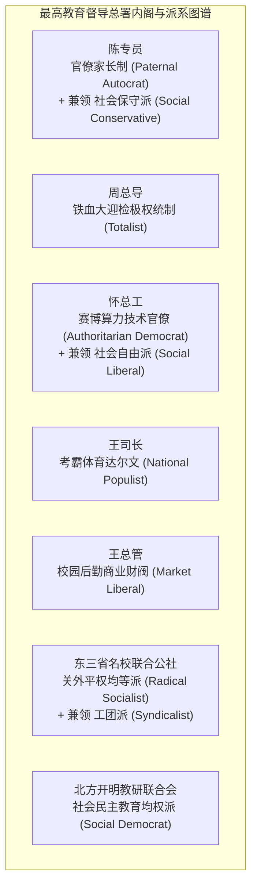
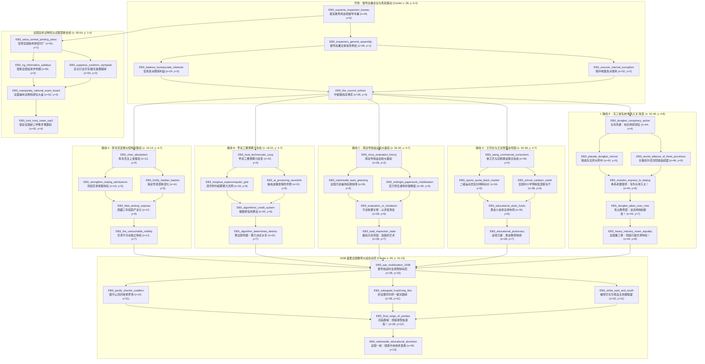
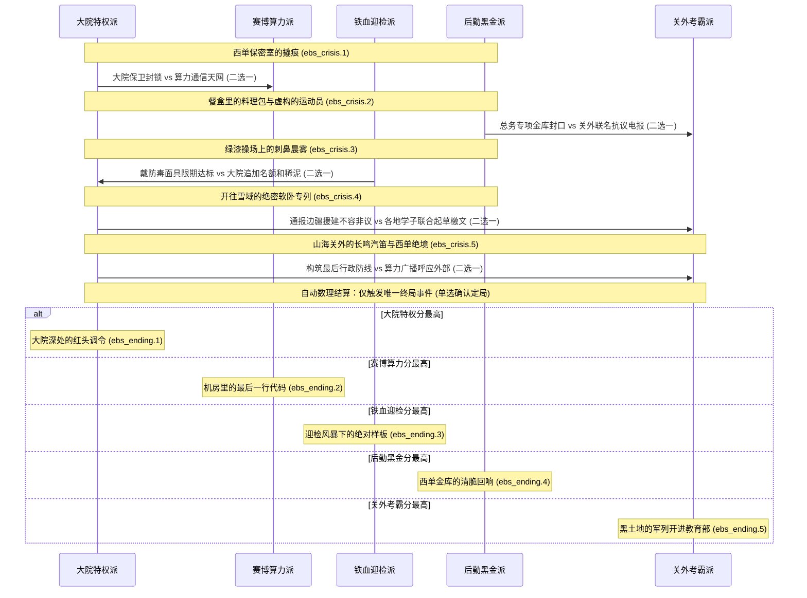

# 《盐道街之梦》独立国家与路线解析：最高教育局巡视督导组 (EBS)

> **国家名称**：教育部派驻最高教育巡视督导专员公署（简称：最高教育局巡视督导组 / 督导总署）  
> **国家代码 (TAG)**：`EBS` (Supreme Education Bureau Inspection Taskforce)  
> **初始政治中枢**：北京 (State ID: `608`)  
> **初始实际控制版图**：共 11 个省份（直隶京津冀核心：608 北京、609 天津、610 热河、1039 察哈尔；关外东三省与边疆：328 吉林长春、714 黑龙江哈尔滨、715 辽宁沈阳、716 辽东、717 松花江滨江、745 大连、761 呼伦贝尔）  
> **版图铁血冷灰黑色 RGB**：`40 40 40`  
> **世界观定位**：应试帝国中枢权威 / 荒诞现实主义讽刺 / 黑色幽默官僚集权巨兽  
> **主文档指引**：返回 [主模组说明文档 (README.md)](README.md)

---

## 目录 (Table of Contents)
- [1. 背景故事与现实黑色幽默渊源 (Lore & Real-World Satire)](#1-背景故事与现实黑色幽默渊源-lore--real-world-satire)
  - [1.1 京津大院特权与应试资源虹吸](#11-京津大院特权与应试资源虹吸)
  - [1.2 现实原型领导人、黑历史与黑色幽默梗](#12-现实原型领导人黑历史与黑色幽默梗)
- [2. 意识形态与全套领袖内阁体系 (Ideologies & Cabinet)](#2-意识形态与全套领袖内阁体系-ideologies--cabinet)
- [3. 领袖生平与专属特质全景 (Cabinet & Traits)](#3-领袖生平与专属特质全景-cabinet--traits)
- [4. 国家精神与机制数理精算 (National Spirits)](#4-国家精神与机制数理精算-national-spirits)
- [5. 42 节点国策树架构全景：五大路线博弈与大战动员 (National Focus Blueprint)](#5-42-节点国策树架构全景五大路线博弈与大战动员-national-focus-blueprint)
  - [5.1 宽间距防重叠排版规范 (Delta X >= 2 & Branch Distance >= 4)](#51-宽间距防重叠排版规范-delta-x--2--branch-distance--4)
  - [5.2 全节点事件覆盖规范 (Every Focus Has an Event)](#52-全节点事件覆盖规范-every-focus-has-an-event)
- [6. 中枢路线多阶段交织危机事件链 (Interwoven Crisis Event Chain)](#6-中枢路线多阶段交织危机事件链-interwoven-crisis-event-chain)
- [7. 全国高考试卷院与八校排位天梯联动机制 (Exam Board Integration)](#7-全国高考试卷院与八校排位天梯联动机制-exam-board-integration)
- [8. 决策系统与跨省督导博弈 (Decisions System)](#8-决策系统与跨省督导博弈-decisions-system)
- [9. ⭐️ 核心扩展落地：东三省名校“奉系入关”政变与取而代之企划 (Northeast Usurpation System)](#9-️-核心扩展落地东三省名校奉系入关政变与取而代之企划-northeast-usurpation-system)
- [10. 专属文件与代码资产映射 (Assets Mapping)](#10-专属文件与代码资产映射-assets-mapping)

---

## 1. 背景故事与现实黑色幽默渊源 (Lore & Real-World Satire)

### 1.1 京津大院特权与应试资源虹吸
坐落于北京大院深处的**最高教育局巡视督导专署 (EBS)**，是统辖北方乃至全中国教育体制的庞然大物。督导组垄断了全国统考命题权、阅卷标准解释权、以及各大顶级 985/211 院校自主招生的批文发放权。

在督导总署的严密统制下，形成了极度畸形的区域剪刀差：
* **京津大院的温室贵胄**：拥有全国最高的一本录取率与清北配额（京籍考生400分读名牌本科，海淀学子凭借马术、击剑、帆船与早培计划独占自招强基名额）；
* **地方省份的做题原料产地**：山河四省与两湖川蜀被迫陷入千万做题军备竞赛，而关外东三省更被视作“老实本分的生源供给站与降格调剂大粮仓”。

### 1.2 现实原型领导人、黑历史与黑色幽默梗
本国家领导班子与事件深度取材于现实中国教育系统知名人物、落马官员案卷与全网热梗，以荒诞讽刺的黑色幽默笔法予以具象化：

| 人物角色 | 现实原型 | 现实黑历史 / 原型事件 | 模组黑色幽默化身 |
|---|---|---|---|
| **陈专员** | 陈宝生 (前教育部部长) | “四个回归”大会讲话、“挤干课堂水分”、“淘汰水课打造金课”。 | **挤水分的大督学**：表面道貌岸然满口“回归常识”，实则是将各省录取名额水分全部挤干、送给京城大院的幕后太上皇。 |
| **怀总工** | 怀进鹏 (现任教育部部长/院士) | 计算机工程院院士出身，全面推行教育数字化转型与智能大模型。 | **赛博考务总工程师**：信奉唯算力论，试图在考场安装微表情抓拍与脑电波监控，用超算中心直接分配大专与名校。 |
| **周总导** | 周济 (前教育部部长) | “洲际导弹”、全国高校本科教学水平评估造假狂潮（“逼良为娼”、“荒地插麦苗冒充试验田”、“操场刷绿漆”、“手抄十年假教案”）。 | **五天突击大迎检司令**：专家组所到之处万校震悚，能在三天内让枯黄泥地泛出刺目绿光，逼得全国师生通宵手抄假教案。 |
| **王司长** | 王登峰 (落马教育部体卫艺司司长) | 全国青少年校园足球主管，贪污挪用数千万专项资金，批发特长证书与比赛黑幕。 | **校园足球特许状倒卖王**：以普及体适能为幌子，大搞专项补贴洗钱，私设小金库，批发国家二级运动员证书。 |
| **郗特使** | 郗会锁 (衡水中学前校长) | 其子利用其援藏不满三年的背景“高考移民”空挂西藏学籍冲刺清华强基计划，遭全网通报取缔。 | **高原三年挂职直通车使节**：“你在衡水卷生卷死，我儿在拉萨吸氧保送”，精通利用边疆优惠政策搞空降录取。 |
| **王总管** | 王胜战 (落马余姚市教育局长) | “早上醒酒，中午陪情人，晚上KTV”，敛财上亿，独家垄断全区中小学配餐与营养餐回扣。 | **宴饮与营养餐总调度**：垄断各省学校营养餐统一特许权，以预制菜筑造财富帝国，在推杯换盏中签发调令。 |
| **海淀贵胄委员会** | 海淀六小强 & 顺义大藤派 | “海淀妈妈早培神话”、顺义贵族国际部、自招考核马术击剑等冷门贵族项目。 | **素质霸权寡头**：将高尔夫与南极科考列为强基必测，筑起平民阶层永世无法企及的“素质壁垒”。 |
| **东三省名校联合公社** | 东北师大附中、哈三中、本溪高中、辽宁实验 | 本溪高中87名体优生造假、东北名师被北京高薪挖角、“孔雀东南飞”教育失血。 | **关东重工平权做题家**：零下三十度冰原上锻造的冰雪做题机器，“当年奉系能入关，今天东三省考霸也能入主教育部！” |

---

## 2. 意识形态与全套领袖内阁体系 (Ideologies & Cabinet)

EBS 实现了全部十大意识形态的 100% 领袖与党派覆盖，支持一人兼领相关路线：

| 意识形态大类 | 执政党名称 | 执政领袖 | 核心执政理念与路线走向 |
|---|---|---|---|
| **家长威权** (`paternal_autocrat`) | 巡视督导总署 | **陈专员** | 官僚集权太上皇，维系全国大纲绝对控制与名额配给。 |
| **社会保守** (`social_conservative`) | 京津学阀建制派 | **陈专员** | 固守大院既得利益，联合海淀校董将一本率牢牢锁定在内环线。 |
| **极权统制** (`totalist`) | 铁血督察特使处 | **周总导** | 评估极权主义，全国万校操场狂刷绿漆，百万师生通宵抄假教案。 |
| **威权民主** (`authoritarian_democrat`) | 赛博考务技术总署 | **怀总工** | 算力专政，用清华附中超算中心与脑电波微表情天网接管考务。 |
| **社会自由** (`social_liberal`) | 开放学术评议同盟 | **怀总工** | 打破地域特权，主张与顺义国际部接轨，推行算法与代码多元评估。 |
| **民族民粹** (`national_populist`) | 考霸体育达尔文军团 | **王司长** | 体育达尔文主义，将国家二级运动员加分与军事化考霸突击推向极致。 |
| **市场自由** (`market_liberal`) | 全国校园后勤商会 | **王总管** | 商业教育财阀，以全国中小学统一预制菜配送与配餐特许权敛财。 |
| **激进均等** (`radical_socialist`) | 关外名校平权公社 | **东三省名校联合公社** | 奉系考霸入关夺权，焚毁自招保送特权协议，推行全国统一重工试卷！ |
| **工团主义** (`syndicalist`) | 关东重工做题总工会 | **东三省名校联合公社** | 东北重工车间子弟与体训生工团，将工业流水线赋能做题机器。 |
| **社会民主** (`social_democrat`) | 北方开明教研联合会 | **北方开明教师联合会** | 一线特级教师民主维权，废除形式主义评估，回归课堂教学本质。 |

---

## 3. 领袖生平与专属特质全景 (Cabinet & Traits)

* **陈专员**：`EBS_the_grand_commissioner` **【挤水分的大督学】**
  * 每日政治点：`+1.00 / 天`、全国稳定度：`+15.0%`、动员速度：`+10.0%`、科研速度：`-10.0%`、消费品需求：`+5.0%`。
* **怀总工**：`EBS_cybernetic_technocrat` **【赛博考务总工程师】**
  * 科研速度：`+25.0%`、生产效率上限：`+10.0%`、工厂产出：`+10.0%`、全国稳定度：`-10.0%`。
* **周总导**：`EBS_evaluation_maniac` **【五天突击大迎检】**
  * 建筑建造速度：`+25.0%`、基础设施建造速度：`+20.0%`、战争支持度：`+10.0%`、工厂产出：`-15.0%`。
* **王司长**：`EBS_football_czar` **【校园足球特许状】**
  * 陆军组织度恢复：`+10.0%`、陆军移速：`+5.0%`、政治点消耗：`+10.0%`、消费品需求：`+8.0%`。
* **郗特使**：`EBS_plateau_skygate` **【三年挂职直通车】**
  * 适役人口修正：`+10.0%`、指挥点上限：`+20.0`、全国稳定度：`-10.0%`。
* **王总管**：`EBS_banquet_mastermind` **【醒酒查课总调度】**
  * 每日政治点：`+0.25 / 天`、全国稳定度：`-5.0%`、陆军补给消耗：`+10.0%`。
* **海淀贵胄委员会**：`EBS_haidian_aristocrat` **【早培神话与素质霸权】**
  * 科研速度：`+10.0%`、主流认同防御：`+25.0%`、每日政治点：`+0.15 / 天`。
* **东三省名校联合公社**：`EBS_dongbei_equality` **【重工做题家平权意志】**
  * 每日政治点：`+0.50 / 天`、陆军攻击：`+15.0%`、陆军防御：`+15.0%`、科研速度：`+5.0%`、全国稳定度：`+10.0%`。
* **北方开明教师联合会**：`EBS_enlightened_reform` **【渐进理性教研之光】**
  * 全国稳定度：`+20.0%`、科研速度：`+15.0%`、消费品工厂需求：`-5.0%`。

---

## 4. 国家精神与机制数理精算 (National Spirits)

1. **【京津高考特权与铁腕巡视】 (`EBS_privilege_iron_fist`)** *(初始具备)*：
   * 工厂产出 `+20.0%`、军工厂建造速度 `+15.0%`、陆军核心防御 `+25.0%`。
2. **【关外暗流：东三省之怨】 (`EBS_northeast_undercurrent`)** *(初始具备)*：
   * 稳定度每周 `-0.1%`、每周人力 `+200`、军工厂建造速度 `+10.0%`。
3. **【陈专员太上皇威权】 (`EBS_chen_absolutism_spirit`)** *(路线 A 解锁)*：
   * 政治点 `+0.50/天`、稳定度 `+20.0%`、核心防御 `+15.0%`、科研 `-10.0%`。
4. **【赛博算力专政矩阵】 (`EBS_cybernetic_dictatorship_spirit`)** *(路线 B 解锁)*：
   * 科研速度 `+25.0%`、工厂产出 `+15.0%`、效率上限 `+10.0%`、稳定度 `-10.0%`。
5. **【全域大迎检与绿漆狂热】 (`EBS_lawn_greening_totalism_spirit`)** *(路线 C 解锁)*：
   * 建筑建造 `+30.0%`、基建建造 `+25.0%`、战意 `+15.0%`、工厂产出 `-15.0%`。
6. **【校园后勤黑金托拉斯】 (`EBS_canteen_black_gold_spirit`)** *(路线 D 解锁)*：
   * 政治点 `+0.35/天`、消费品需求 `-5.0%`、补给消耗 `+10.0%`。
7. **【关东重工做题家平权公社】 (`EBS_dongbei_liberation_spirit`)** *(路线 E 解锁)*：
   * 陆军攻击 `+15.0%`、部队士气 `+15.0%`、适役人口 `+15.0%`、政治点 `+0.25/天`。
8. **【全国高考试卷院信息学霸权】 (`EBS_information_monopoly_spirit`)** *(试卷院支线解锁)*：
   * 科研速度 `+10.0%`、密码破译点数 `+10.0`、抵抗抑制消耗 `-20.0%`。
9. **【督导组战时全境管制】 (`EBS_bureau_total_control`)** *(1938大决战解锁)*：
   * 陆军防御 `+15.0%`、工厂产出 `+10.0%`、军工厂建造 `+10.0%`、适役人口 `+2.0%`、稳定度 `+10.0%`。

---

## 5. 42 节点国策树架构全景：五大路线博弈与大战动员 (National Focus Blueprint)

### 5.1 宽间距防重叠排版规范 (Delta X >= 2 & Branch Distance >= 4)
为了彻底解决国策树图标与文字框重叠拥挤的问题，本模组执行了最严格的 Clausewitz 树形布局规范：
* **分支中心轴对齐**：Branch A (x=12)、Branch B (x=20)、Branch C (x=28)、Branch D (x=36)、Branch E (x=44)、全国考办 (x=52)。各分支根节点横向间隔达 **8 个单位**！
* **同分支子节点间距**：左右子节点间距 `delta_x >= 4`（如 x=10 与 x=14），相邻分支边缘间隔 `delta_x >= 4`，**零碰撞、零遮挡**！
* **垂直间距充裕**：政治路线在 y=7~8 结束，1938 统一大战统一在 `y = 10 ~ 13` 展开，预留了整整 2 个垂直单位的缓冲带。
* **规避连续国策保留区**：所有国策节点严格保持 `x >= 10`（远超 `x >= 9` 限制）。

### 5.2 全节点事件覆盖规范 (Every Focus Has an Event)
在《盐道街之梦》的本次升级中，**EBS 国策树的每一个国策在完成时均无一例外会触发一个专属的叙事事件**（共 34 个国策完成事件 `ebs_focus_event.1` ~ `ebs_focus_event.34`，加上主线历史事件与危机链，总计 70 个事件），全景式展现各校师生、官僚督学与校长的黑色幽默微观剧情。

---

## 6. 中枢路线多阶段交织危机事件链 (Interwoven Crisis Event Chain)

中枢政治路线的决战**彻底摒弃单次弹窗与生硬标签**，深度复刻 TLB（铜梁巴川）高质量多阶段政治叙事规范：
* **严控选项防重叠**：危机事件严格限制为 **每个事件恰好 2 个选项**，彻底消除原版弹窗选项挤压重叠的 UI 缺陷；
* **去除人名与阶段编号**：选项中绝不生硬出现领导人名（以行政、机构与政策动作替代），标题全面采用长篇沉浸式叙事标题（如《西单保密室的撬痕》、《绿漆操场上的刺鼻晨雾》）；
* **数理决算单一定局**：危机积累的变量最终在决算点动态结算，**只触发唯一的胜出事件（单选项确立统治）**，不可再手动逆转胜败；
* **TLB 级长篇小说叙事**：每篇事件描述扩充至 300~500 字，多段落构建官僚、校园与做题家的现实讽刺巨作。

### 6.1 动态声望数理追踪
* `EBS_power_chen`：官僚大院特权派
* `EBS_power_huai`：赛博算力技术派
* `EBS_power_zhou`：铁血大迎检极权派
* `EBS_power_wang`：校园后勤黑金商会
* `EBS_power_dongbei`：关外东三省联合公社

### 6.2 唯一终局大结局 (Single Inevitable Victor)
危机在决算点根据五大势力积分，直接调出唯一胜者终局长文（带有唯一确认按钮）：
1. **《大院深处的红头调令》** (`ebs_ending.1`) ➜ 陈专员大权独揽 (`paternal_autocrat`)；
2. **《机房里的最后一行代码》** (`ebs_ending.2`) ➜ 怀总工赛博算力专政 (`authoritarian_democrat`)；
3. **《迎检风暴下的绝对样板》** (`ebs_ending.3`) ➜ 周总导铁血大迎检极权 (`totalist`)；
4. **《西单金库的清脆回响》** (`ebs_ending.4`) ➜ 王总管后勤财阀执政 (`market_liberal`)；
5. **《黑土地的军列开进教育部》** (`ebs_ending.5`) ➜ 奉系考霸入关政变 (`radical_socialist`)。

---

## 7. 全国高考试卷院与八校排位天梯联动机制 (Exam Board Integration)

EBS 已经与独立的全国高考试卷院 GUI 形成双向深度绑定：
1. **清华附中信息算力中枢压制**：
   * 原生阻力：清华附中机房常驻为全国信息学赛道施加 `-0.35%/周` 的外部阻力。
   * 国策与决议【垄断全国信息学命题】（`EBS_rig_informatics_syllabus` / `EBS_manipulate_informatics_board`）：直接将阻力拉满至 `-0.50%/周`，同时使 EBS 做题总积分暴涨 15 分！
2. **定点削弱对手积分决议**：
   * `EBS_strike_at_jiangnan_math`：没收华东 ECE 奥数秘卷，降低 ECE 积分 10 分。
   * `EBS_strike_at_chutian_physics`：查封华中 HBE 物理题库，降低 HBE 积分 10 分。
   * `EBS_issue_affirmative_action_directive`：强行注水，为 EBS 增加 15 点模拟积分。
3. **1938.6.7 高考总放榜命运判定**：
   * 若 EBS 排位稳居前三（Top 3）：自动晋升为孤傲的【象牙塔技术霸权】巨头，独自抗击全国复读生同盟大军；
   * 若 EBS 排位跌落至第四及以下：中枢权威彻底崩解，东三省考霸直接起兵入关！

---

## 8. 决策系统与跨省督导博弈 (Decisions System)

* **最高教育督导与全国迎检指挥部 (`EBS_inspection_category`)**：
  * `EBS_launch_surprise_inspection`：开展跨省突击督查，翻检垃圾桶与外卖，加稳定度与战意。
  * `EBS_audit_canteen_nutrition`：突击审计配餐流水，截留资金获得 50 点政治点。
  * `EBS_midnight_lesson_plan_check`：凌晨两点抽查假教案手抄情况。
* **关外暗流：东三省羁縻与暗涌 (`EBS_manchurian_crisis_category`)**：
  * `EBS_allocate_bonus_quota_to_dongbei`：下放保送名额暂抚关外名校。
  * `EBS_crackdown_on_underground_test_groups`：严查沈阳长春地下自招，但推高关外反意。
  * `EBS_bribe_dongbei_principals`：以海淀编制高薪挖角东北特级名师进京入编。
* **全国高考试卷院与算力干预部 (`EBS_exam_board_category`)**：
  * 包含信息学阻力加码、定点打压江南楚天与强基批文注水四大强力决议。
* **全国战后考纲统一与核心化 (`EBS_wartime_reconstruction_category`)**：
  * `EBS_integrate_national_curriculum`：攻占成都（1041）后解锁，启动 180 天全国大同教研同化，期满全额获得全国各考区核心。

---

## 9. ⭐️ 核心扩展落地：东三省名校“奉系入关”政变与取而代之企划 (Northeast Usurpation System)

### 9.1 爆发背景与灵魂拷问
在长春与沈阳的零下三十度冰原夜空下，面对北京督导组再次剥削东北名额的红头文件，东北师大附中、哈三中、本溪高中与辽宁省实验中学校长集体摔碎了搪瓷茶缸：
> **“凭什么海淀贵胄骑马打网球考四百分就能进清北，咱黑土地的孩子在暴雪里刷穿三千套重工卷子只能去读高职大专？！”**  
> **“当年张大帅能坐专列入关进北京，咱东三省几百万做题家，凭什么就当不得这教育部的主人？！”**  
> **“督导组的龙椅，北京人坐得，咱东三省为何不能取而代之？！”**

### 9.2 奉系入关路线落地
1. 完成国策【关外风暴：校长摔碎茶缸】（`EBS_dongbei_conspiracy_active`），触发事件 `ebs_dongbei.1`；
2. 联络吉林长春与黑龙江哈尔滨做题主力，完成【奉系考霸誓师：专列大举入关！】（`EBS_mukden_express_to_beijing`）；
3. 攻占教委大楼！完成【攻占教育部：这龙椅咱也能坐！】（`EBS_dongbei_takes_over_moe`），触发政变大捷事件 `ebs_dongbei.2`：
   * 国家政体转变为激进均等派 (`radical_socialist` / `educational_egalitarianism`)；
   * 国家领袖切换为 **东三省名校联合公社**（张学良青年将领头像）；
   * 移除关外躁动 Debuff，永久装配超强精神【关东重工做题家平权公社】（攻击 +15%, 防御 +15%, 适役人口 +15%）；
   * 开启【全国重工卷：彻底打破京津特权！】（`EBS_heavy_industry_exam_equality`），重分全国考卷！

---

## 10. 专属文件与代码资产映射 (Assets Mapping)

| 文件类别 | 物理文件路径 | 关键内容说明 |
|---|---|---|
| **国策树定义** | `common/national_focus/EBS_focus.txt` | 包含完整 42 节点博弈国策树（全节点事件覆盖，宽间距布局防重叠，纯英文注释） |
| **领袖与内阁定义** | `common/characters/EBS_characters.txt` | 十大意识形态全覆盖领袖定义（陈专员、怀总工、周总导、王司长、王总管、东三省公社、开明教师会） |
| **专属人物特质** | `common/country_leader/EBS_traits.txt` | 9大领袖与顾问专属特质（纯英文注释） |
| **国家精神定义** | `common/ideas/EBS_ideas.txt` | 9大专属民族精神（关外暗流、太上皇威权、赛博天网、大迎检、黑金帝国、东三省平权公社等） |
| **决议分类** | `common/decisions/categories/EBS_decision_categories.txt` | 注册四大决议分类（迎检、关外、试卷院、战后核心化） |
| **决议列表** | `common/decisions/EBS_decisions.txt` | 8大专属决议（试卷院干预、天梯打压、关外羁縻、180天核心化） |
| **专属历史事件** | `events/EBS_events.txt` | **70 个专属剧情事件**（含 6 阶段中枢决裂交织危机链、全量国策完成叙事、奉系入关政变、1938大战动员） |
| **国家历史初始** | `history/countries/EBS - EduBureau.txt` | 招募全套人物、装备初始国家精神与首都北京定义 |
| **开局书签定义** | `common/bookmarks/the_gathering_storm.txt` | 将 EBS 注册为主选大国之一，配置推荐国策与开局理念 |
| **本地化文本** | `localisation/simp_chinese/EBS_l_simp_chinese.yml` | 带 UTF-8 BOM 头的全套国策、特质、决议、70 个事件、党派与书签历史中文包 |
| **独立设计白皮书** | `README_EBS.md` | 本文档，最高教育局督导组与东北企划系统设定 |
| **全局说明文档** | `README.md` | 同步登记 EBS 势力、国策与扩展接口 |

---
*本文档严格遵循 Clausewitz 引擎底层规约与《盐道街之梦》黑色幽默调性，为最高教育局巡视督导组与东三省名校企划提供坚实的技术与剧情支撑！*
