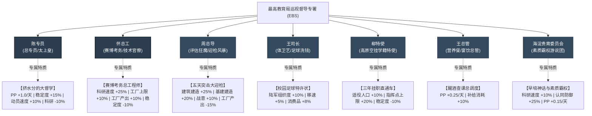

# 《盐道街之梦》独立国家与路线解析：最高教育局巡视督导组 (EBS)

> **国家名称**：教育部派驻最高教育巡视督导专员公署（简称：最高教育局巡视督导组 / 督导总署）  
> **国家代码 (TAG)**：`EBS` (Supreme Education Bureau Inspection Taskforce)  
> **初始政治中枢**：北京 (State ID: `608`)  
> **初始实际控制版图**：共 11 个省份（直隶京津冀核心：608 北京、609 天津、610 热河、1039 察哈尔；关外东三省与边疆：328 吉林长春、714 黑龙江哈尔滨、715 辽宁沈阳、716 辽东、717 松花江滨江、745 大连、761 呼伦贝尔）  
> **版图铁血冷灰黑色 RGB**：`40 40 40`  
> **世界观定位**：应试帝国中枢权威 / 荒诞现实主义讽刺 / 黑色幽默官僚集权巨兽  
> **主文档指引**：返回 [主模组说明文档 (README.md)](README.md)

---

## 目录 (Table of Contents)
- [1. 背景故事与现实黑色幽默渊源 (Lore & Real-World Satire)](#1-背景故事与现实黑色幽默渊源-lore--real-world-satire)
  - [1.1 京津大院特权与应试资源虹吸](#11-京津大院特权与应试资源虹吸)
  - [1.2 现实原型领导人、黑历史与黑色幽默梗](#12-现实原型领导人黑历史与黑色幽默梗)
- [2. 国家基本信息与开局设定 (Country Setup)](#2-国家基本信息与开局设定-country-setup)
- [3. 核心领袖、内阁与专属特质 (Cabinet & Traits)](#3-核心领袖内阁与专属特质-cabinet--traits)
- [4. 初始国家精神与机制数理 (National Spirits)](#4-初始国家精神与机制数理-national-spirits)
- [5. 20节点国策树架构全景 (National Focus Blueprint)](#5-20节点国策树架构全景-national-focus-blueprint)
- [6. 决议系统与突击迎检博弈 (Decisions System)](#6-决议系统与突击迎检博弈-decisions-system)
- [7. ⭐️ 核心扩展预留：东三省名校“为何我们不能取而代之？”企划接口 (Northeast Usurpation Interface)](#7-️-核心扩展预留东三省名校为何我们不能取而代之企划接口-northeast-usurpation-interface)
  - [7.1 关外做题重工群像与灵魂诘问](#71-关外做题重工群像与灵魂诘问)
  - [7.2 奉系考霸入关夺权三大构想路线](#72-奉系考霸入关夺权三大构想路线)
  - [7.3 系统与代码预留位置一览](#73-系统与代码预留位置一览)
- [8. 专属文件与代码资产映射 (Assets Mapping)](#8-专属文件与代码资产映射-assets-mapping)

---

## 1. 背景故事与现实黑色幽默渊源 (Lore & Real-World Satire)

### 1.1 京津大院特权与应试资源虹吸
坐落于北京大院深处的**最高教育局巡视督导专署 (EBS)**，是统辖北方乃至全中国教育体制的庞然大物。督导组垄断了全国统考命题权、阅卷标准解释权、以及各大顶级 985/211 院校自主招生的批文发放权。

在督导总署的严密统制下，形成了极度畸形的区域剪刀差：
* **京津大院的温室贵胄**：拥有全国最高的一本录取率与清北配额（京籍考生400分读名牌本科，海淀学子凭借马术、击剑、帆船与早培计划独占自招强基名额）；
* **地方省份的做题原料产地**：山河四省与两湖川蜀被迫陷入千万做题军备竞赛，而关外东三省更被视作“老实本分的生源供给站与降格调剂大粮仓”。

### 1.2 现实原型领导人、黑历史与黑色幽默梗
本国家领导班子与事件深度取材于现实中国教育系统知名人物、落马官员案卷与全网热梗，以荒诞讽刺的黑色幽默笔法予以具象化：

| 人物角色 | 现实原型 | 现实黑历史 / 原型事件 | 模组黑色幽默化身 |
|---|---|---|---|
| **陈专员** | 陈宝生 (前教育部部长) | “四个回归”大会讲话、“挤干课堂水分”、“淘汰水课打造金课”。 | **挤水分的大督学**：表面道貌岸然满口“回归常识”，实则是将各省录取名额水分全部挤干、送给京城大院的幕后太上皇。 |
| **怀总工** | 怀进鹏 (现任教育部部长/院士) | 计算机工程院院士出身，全面推行教育数字化转型与智能大模型。 | **赛博考务总工程师**：信奉唯算力论，试图在考场安装微表情抓拍与脑电波监控，用超算中心直接分配大专与名校。 |
| **周总导** | 周济 (前教育部部长) | “洲际导弹”、全国高校本科教学水平评估造假狂潮（“逼良为娼”、“荒地插麦苗冒充试验田”、“操场刷绿漆”、“手抄十年假教案”）。 | **五天突击大迎检司令**：专家组所到之处万校震悚，能在三天内让枯黄泥地泛出刺目绿光，逼得全国师生通宵手抄假教案。 |
| **王司长** | 王登峰 (落马教育部体卫艺司司长) | 全国青少年校园足球主管，贪污挪用数千万专项资金，批发特长证书与比赛黑幕。 | **校园足球特许状倒卖王**：以普及体适能为幌子，大搞专项补贴洗钱，私设小金库，批发国家二级运动员证书。 |
| **郗特使** | 郗会锁 (衡水中学前校长) | 其子利用其援藏不满三年的背景“高考移民”空挂西藏学籍冲刺清华强基计划，遭全网通报取缔。 | **高原三年挂职直通车使节**：“你在衡水卷生卷死，我儿在拉萨吸氧保送”，精通利用边疆优惠政策搞空降录取。 |
| **王总管** | 王胜战 (落马余姚市教育局长) | “早上醒酒，中午陪情人，晚上KTV”，敛财上亿，独家垄断全区中小学配餐与营养餐回扣。 | **宴饮与营养餐总调度**：垄断各省学校营养餐统一特许权，以预制菜筑造财富帝国，在推杯换盏中签发调令。 |
| **海淀贵胄委员会** | 海淀六小强 & 顺义大藤派 | “海淀妈妈早培神话”、顺义贵族国际部、自招考核马术击剑等冷门贵族项目。 | **素质霸权寡头**：将高尔夫与南极科考列为强基必测，筑起平民阶层永世无法企及的“素质壁垒”。 |

---

## 2. 国家基本信息与开局设定 (Country Setup)

| 设定项 | 设定值 / 规范 | 详细说明 |
| :--- | :--- | :--- |
| **国家代码 (TAG)** | `EBS` | 静态国家代码，在 `common/country_tags/yds_tags.txt` 注册 |
| **国家全称** | 最高教育局巡视督导专署 | 简称“巡视督导组”，英文 Supreme Education Bureau Inspection Taskforce |
| **地图代表色** | `rgb { 40 40 40 }` | 冰冷压抑的炭黑深灰（Coal Black），代表官僚权威与督察铁腕 |
| **初始首都省份** | 北京 (`State ID: 608`) | 坐拥教委大楼核心、全国最高保送名额密室与保密印刷厂 |
| **初始管辖疆域** | 11 大北方省份 | 直隶（608北京、609天津、610热河、1039察哈尔）+ 关外东北（328、714、715、716、717、745、761） |
| **初始意识形态** | 专制家长制 (`paternal_autocrat`) | 执政党“巡视督导总署”（官僚专制）；备用极权党“铁血督察特使处” (`totalist`) 与技术改良党 (`authoritarian_democrat`) |
| **初始科研槽** | 3 个科研槽 | 拥有清华附中算力中心与中央教研院科技储备 |

---

## 3. 核心领袖、内阁与专属特质 (Cabinet & Traits)

---

## 4. 初始国家精神与机制数理 (National Spirits)

1. **【京津高考特权与铁腕巡视】 (`EBS_privilege_iron_fist`)**
   * *背景*：京津地区拥有全国无可匹敌的一本录取率与保送名额特权。红头文件三天之内可抵达全国每一个考场课桌。
   * *效果*：工厂产出 `+20.0%`、军工厂建造速度 `+15.0%`、陆军防御 `+25.0%`。
2. **【关外暗流：东三省之怨】 (`EBS_northeast_undercurrent`)**
   * *背景*：东北老工业基地的考霸们在零下三十度冰天雪地里苦读，换来的却是苛刻的调剂与名额剥削。锅炉管道里的怨气正在滋生。
   * *效果*：稳定度每周 `-0.1%`、每周人力 `+200`、军工厂建造速度 `+10.0%`。
3. **【突击大迎检与材料造假】 (`EBS_inspection_frenzy`)** *(国策/事件解锁)*
   * *效果*：建筑建造速度 `+15.0%`、工厂产出 `-10.0%`、主流认同防御 `+20.0%`。
4. **【赛博考务天网】 (`EBS_cybernetic_exam_grid`)** *(国策解锁)*
   * *效果*：科研速度 `+15.0%`、反颠覆破坏 `+20.0%`、稳定度 `-5.0%`。
5. **【海淀素质教育特权】 (`EBS_haidian_privilege`)** *(国策解锁)*
   * *效果*：政治点数获得 `+0.25/天`、陆军组织度 `+5.0%`。
6. **【关外躁动：为何不能取而代之】 (`EBS_dongbei_unrest_high`)** *(东北企划前导解锁)*
   * *效果*：稳定度 `-15.0%`、战争支持度 `-10.0%`、陆军防御 `-10.0%`。

---

## 5. 20节点国策树架构全景 (National Focus Blueprint)

国策树主干布局严格满足 `x >= 9`（防止与持续性国策面板重叠），分为四大清晰分支：

```mermaid
flowchart TD
    Root["EBS_supreme_inspection_bureau<br>最高教育局巡视督导专署 (x=16, y=0)"]

    %% Branch 1: Beijing Elites
    Root --> B1_1["EBS_strengthen_beijing_admissions<br>巩固京津录取特权 (x=10, y=1)"]
    B1_1 --> B1_2["EBS_haidian_early_talent_program<br>海淀早培垄断 (x=10, y=2)"]
    B1_1 --> B1_3["EBS_shunyi_ivy_corridor<br>顺义国际部通道 (x=12, y=2)"]
    B1_2 & B1_3 --> B1_4["EBS_plateau_quota_airdrop<br>郗特使高原空挂车 (x=11, y=3)"]
    B1_4 --> B1_5["EBS_canteen_skimming_monopoly<br>王总管营养餐大包干 (x=11, y=4)"]

    %% Branch 2: Inspection Storm
    Root --> B2_1["EBS_nationwide_evaluation_wave<br>五年教学大评估 (x=16, y=1)"]
    B2_1 --> B2_2["EBS_paint_lawns_green<br>周总导刷绿操场 (x=15, y=2)"]
    B2_1 --> B2_3["EBS_fake_paperwork_industry<br>通宵手抄假教案 (x=17, y=2)"]
    B2_2 & B2_3 --> B2_4["EBS_squeeze_water_out<br>陈专员狠挤水分 (x=15, y=3)"]
    B2_2 & B2_3 --> B2_5["EBS_cybernetic_exam_net<br>怀总工赛博天网 (x=17, y=3)"]
    B2_4 & B2_5 --> B2_6["EBS_football_special_fund<br>王司长足球亿元专项 (x=16, y=4)"]

    %% Branch 3: Manchurian Discontent & Northeast Expansion Interface
    Root --> B3_1["EBS_manchurian_pacification<br>关外三省考区统抚 (x=22, y=1)"]
    B3_1 --> B3_2["EBS_placate_dongbei_normal<br>拉拢东北师大附中 (x=21, y=2)"]
    B3_1 --> B3_3["EBS_inspect_benxi_athletes<br>严查本溪87名体优生 (x=23, y=2)"]
    B3_2 & B3_3 --> B3_4["EBS_harbin_heavy_exam_industry<br>收编哈三中极寒题库 (x=22, y=3)"]
    B3_4 --> B3_5["EBS_suppress_dongbei_ambition<br>压制取而代之狂傲 (x=22, y=4)"]
    B3_5 --> B3_6["⭐️ EBS_the_manchurian_storm<br>【企划预留】关外暗雷风暴 (x=22, y=5)"]

    %% Branch 4: War of Total Educational Subjugation
    B1_5 & B2_6 --> B4_1["EBS_prepare_national_crackdown<br>发布最高督导动员令 (x=16, y=5)"]
    B4_1 --> B4_2["EBS_pacify_shanhe_coalition<br>整肃山河四省 (x=14, y=6)"]
    B4_1 --> B4_3["EBS_confiscate_huazhong_test_bank<br>查抄华中题库 (x=16, y=6)"]
    B4_1 --> B4_4["EBS_crush_east_and_south<br>摧垮华东华南 (x=18, y=6)"]
    B4_2 & B4_3 & B4_4 --> B4_5["EBS_final_march_on_yandao<br>最终决战：接管盐道街 (x=16, y=7)"]
```

---

## 6. 决议系统与突击迎检博弈 (Decisions System)

EBS 拥有两大专属决议分类：
1. **最高教育督导与全国迎检指挥部 (`EBS_inspection_category`)**：
   * `EBS_launch_surprise_inspection` (开展跨省突击督查)：消耗 30 PP，无预警检查地方名校垃圾桶与私藏题集，提升稳定度与战意。
   * `EBS_audit_canteen_nutrition` (全国学生营养餐突击审计)：消耗 25 PP，由王总管查抄流水，获得 50 PP 并强化总署后勤。
2. **关外暗流：东三省羁縻与暗涌 (`EBS_manchurian_crisis_category`)**：
   * `EBS_allocate_bonus_quota_to_dongbei` (向下划拨奥赛加分名额安抚关外)：消耗 40 PP，平息东北名校不满。
   * `EBS_crackdown_on_underground_test_groups` (突击查封沈阳长春地下自招联考)：消耗 50 PP，强行没收东北私印真题，但会导致关外暗涌加剧！
   * `EBS_bribe_dongbei_principals` (调派京城编制招抚关外名师)：消耗 35 PP，以海淀西城编制将东北名师挖角进京，临时增加 1 个科研槽！

---

## 7. ⭐️ 核心扩展预留：东三省名校“为何我们不能取而代之？”企划接口 (Northeast Usurpation Interface)

### 7.1 关外做题重工群像与灵魂诘问
东三省（辽宁、吉林、黑龙江）是中国应试版图上的“重工业长子”，拥有极具传奇色彩的名校军团：
* **东北师大附中（长春）**：关东教育长子，傲视群雄的师资母机与大纲教研泰斗；
* **哈尔滨三中（哈尔滨）**：极寒零下三十度冰原上锻造的冰雪做题机器，素以“重工业硬核刷题”令全国生畏；
* **本溪高中（本溪）**：草莽奇迹，曾经凭借“87名国家二级运动员”体优生加分事件震动全中国的战术突围大师；
* **辽宁省实验中学 & 大连二十四中**：关东辽东精英堡垒。

**灵魂拷问 (The Soul-Searching Question)**：
> “长春的暴雪夜里，校长们看着督导组发来的红头文件，终于忍无可忍摔了茶缸：  
> **‘凭什么海淀少爷小姐打网球骑马就能进名校，咱们黑土地的孩子在零下三十度刷穿三千套卷子只能读大专？！’**  
> **‘当年奉系张大帅能坐专列入关进北京，咱东三省几百万做题家，凭什么就当不得这教育部的主人？！’**  
> **‘督导组的龙椅，北京人坐得，咱东三省为何不能取而代之？！’**”

### 7.2 奉系考霸入关夺权三大构想路线 (Future Expansion Branches)
为后续大型更新预留的三条反噬路线：
1. **【奉系考霸大举入关·接管教育部】**：
   东三省各大高中秘密联合，动员沈阳、长春、哈尔滨学生铁旅，打着“还我高考公平、收回命题大权”的旗号誓师入关，攻陷北京教委大楼，逼陈专员退位，直接将教育部更名为“东北师大附中北京总督署”！
2. **【关外自主命题公署·东北教育独立】**：
   宣布脱离中央统考大纲，本溪高中与哈三中联合颁布《关外重工统考试卷》，自立高考标准，向南方各大考霸集团发起自主招生联盟！
3. **【冰原白卷涅槃·砸烂应试机器】**：
   在长春第一汽车制造厂与哈尔滨锅炉厂的烈火中，东北体训生与技校学子焚毁全部模拟题，以“工业技术压倒八股做题”走上工人技师自治道路！

### 7.3 系统与代码预留位置一览
本版本已在底层代码中完整植入未来企划的挂载钩子 (Hooks)：
* **国策挂载点**：`EBS_the_manchurian_storm` (关外暗雷风暴)
* **核心先导事件**：`events/EBS_events.txt` 中的 `ebs_dongbei.1`（东三省学校之问：为何我们不能取而代之？！）
* **事件触发标记**：`set_country_flag = EBS_dongbei_conspiracy_awakened`
* **危险状态国家精神**：`EBS_dongbei_unrest_high`（关外躁动：为何不能取而代之）
* **决议分类挂载**：`EBS_manchurian_crisis_category`
* **未来国家标签预留**：`NES` (Northeast Schools Alliance 关东考霸同盟)

---

## 8. 专属文件与代码资产映射 (Assets Mapping)

| 文件类别 | 物理文件路径 | 关键内容说明 |
|---|---|---|
| **国策树定义** | `common/national_focus/EBS_focus.txt` | 包含完整 20 节点国策树（x>=9，纯英文注释） |
| **领袖与内阁定义** | `common/characters/EBS_characters.txt` | 陈专员、怀总工、周总导、王司长、郗特使、王总管、海淀委员会定义 |
| **专属人物特质** | `common/country_leader/EBS_traits.txt` | 7大领袖与顾问专属特质（纯英文注释） |
| **国家精神定义** | `common/ideas/EBS_ideas.txt` | 5大专属民族精神（关外暗流、大迎检、赛博天网、素质霸权、关外躁动） |
| **决议分类** | `common/decisions/categories/EBS_decision_categories.txt` | 注册督导迎检与关外羁縻两大分类（纯英文注释） |
| **决议列表** | `common/decisions/EBS_decisions.txt` | 5大专属决议（无套壳，纯英文注释） |
| **专属历史事件** | `events/EBS_events.txt` | 4大黑色幽默历史事件 + 1个东北企划预留引信事件 |
| **国家历史初始** | `history/countries/EBS - EduBureau.txt` | 招募全套人物、装备初始国家精神与首都北京定义 |
| **本地化文本** | `localisation/simp_chinese/EBS_l_simp_chinese.yml` | 带 UTF-8 BOM 头的完整国策、特质、决议、事件叙事中文包 |
| **独立设计白皮书** | `README_EBS.md` | 本文档，最高教育局督导组与东北企划系统设定 |
| **全局说明文档** | `README.md` | 同步登记 EBS 势力、国策与扩展接口 |

---
*本设计文档严格遵守 Clausewitz 引擎底层规范与《盐道街之梦》黑色幽默调性，为后续东三省名校宏大企划奠定坚实的系统架构！*
