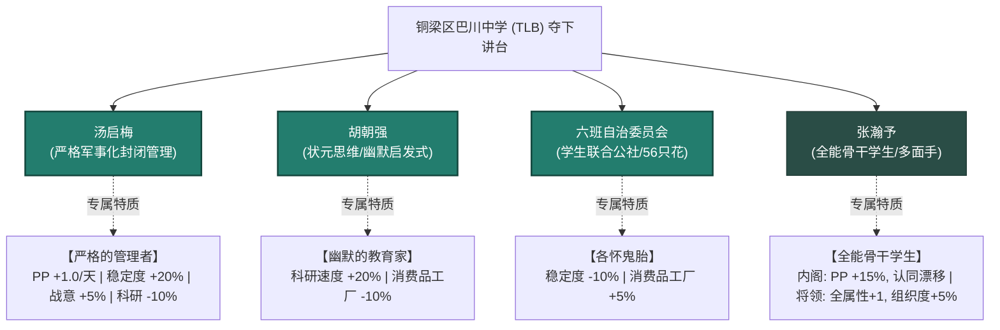
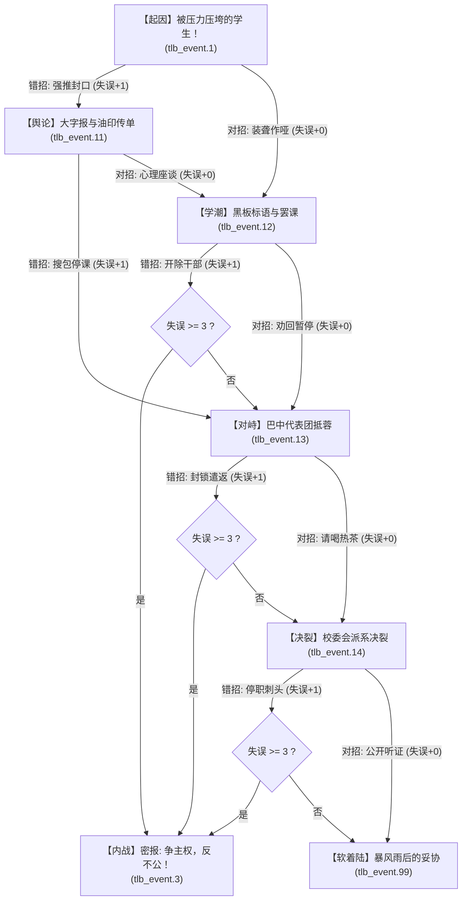
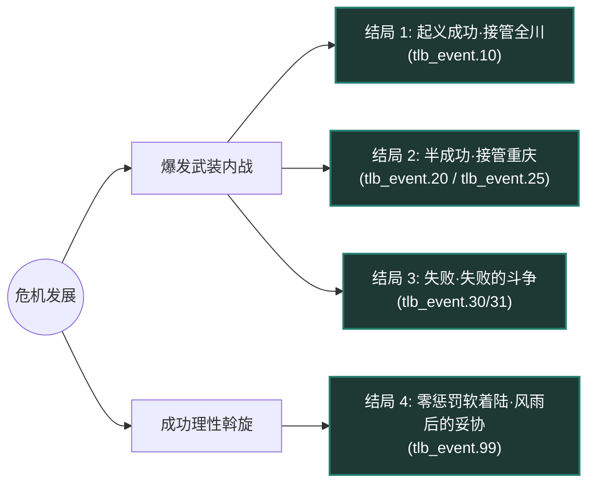

# 《盐道街之梦》独立扩展文档：铜梁巴川中学 (TLB) 隐藏路线全解析

> **国家名称**：铜梁区巴川中学（全称：重庆市铜梁区巴川中学）  
> **国家代码 (TAG)**：`TLB`  
> **初始起义省份**：重庆 (State ID: `1037`)  
> **核心宣称领土**：盐道街中学全川核心领土 (`1037` 重庆, `1041` 成都, `605` 川南, `751` 川东, `752` 川西, `753` 川北)  
> **版图深青色 RGB**：`35 125 110`  
> **主文档指引**：返回 [主模组说明文档 (README.md)](README.md)

---

## 目录 (Table of Contents)
- [1. 背景故事与世界观 (Narrative & Lore Background)](#1-背景故事与世界观-narrative--lore-background)
- [2. 国家基本信息与开局设定 (Country Identity & Setup)](#2-国家基本信息与开局设定-country-identity--setup)
- [3. 核心领袖与人物设定 (Characters, Traits & Cabinet)](#3-核心领袖与人物设定-characters-traits--cabinet)
- [4. 危机必然触发与四轨失误网络 (Trigger Mechanics & Blunder Counter Mesh)](#4-危机必然触发与四轨失误网络-trigger-mechanics--blunder-counter-mesh)
- [5. 四大历史结局与战后格局 (Four War & Story Outcomes)](#5-四大历史结局与战后格局-four-war--story-outcomes)
- [6. 决议体系与民族精神 (Decisions & Ideas)](#6-决议体系与民族精神-decisions--ideas)
- [7. 专属文件资产映射清单 (File Assets Mapping)](#7-专属文件资产映射清单-file-assets-mapping)

---

## 1. 背景故事与世界观 (Narrative & Lore Background)

### 1.1 惨剧引爆与封锁破产
学业的畸形高压与严苛考绩压垮了铜梁巴川中学的学子。三名学生在绝望中自天台坠下，用年轻生命的陨落无声抗诉着整个应试教育机器的残酷压迫。重庆与省教育局高层惊恐万状，密令封锁一切纸媒通道与长途电话线路，试图将风波掩盖在校门之内。

然而，带血的绝笔信与现场照片依然被铜梁巴中学生会骨干冒死带出校门，迅速在巴蜀大地各大学堂中疯传。

### 1.2 "铜巴运动"怒潮
全川教育界一片哗然，学生、开明教工与市民社会义愤填膺。铜梁巴中同学率先冲破封闭式寄宿铁门，在校外举起白底黑字抗议大旗，沿街游行示威。

来自重庆一中、南开、巴蜀以及成都七中、石室、树德等外地高校的声援学生代表纷纷抵渝汇合，组建起跨校联合声援团体，史称**“铜巴运动”**。抗议大潮直逼教育局官署大楼，昔日井然有序的考霸权威统治遭遇前所未有的根本动摇。

### 1.3 密报惊魂："争主权，反不公！"
这一消息自然传到了川蜀教育的冉冉新星——**盐道街中学**高层耳中。面对波及全川的汹涌学潮，盐道街校委会陷入激烈的路线分歧与昏头转向的处理泥潭。

193X 年某日，盐道街高层绝密档案室忽然收到一封加急密报，雪白的信纸中央唯有一行刺目的墨字：
> **“争主权，反不公！”**

几天后，铜梁巴中联合抗议团体正式宣告起义，宣告接管重庆防务，四川教育内战全面引爆！

### 1.4 讲台夺权与阵营裂痕
在抗议浪潮中，盐道街本校学生与教工亦发生分化，甚至加入铜巴学子的呼应之中，校方刚刚建立起的威权统治轰然倒塌，愤怒的同学与老师共同走上了讲台。

然而，看似团结一心的起义阵营内部实则暗流涌动：
* 班级之间小团体众多，路线竞争针锋相对；
* 教师派系亦伺机而动，对校领导与讲台绝对话语权觊觎已久；
* 掌控全川之后，铜梁巴中将驶向何方？

---

## 2. 国家基本信息与开局设定 (Country Identity & Setup)

| 设定项 | 设定值 / 规范 | 详细说明 |
| :--- | :--- | :--- |
| **国家代码 (TAG)** | `TLB` | 静态国家代码，在 `common/country_tags/yds_tags.txt` 注册 |
| **国家全称** | 重庆市铜梁区巴川中学 | 简称“铜梁巴中”，英文标识 Tongliang Bachuan Middle School |
| **地图代表色** | `rgb { 35 125 110 }` | 沉稳内敛的深青色（Dark Cyan），与盐道街猩红色形成强烈对比 |
| **初始首都省份** | 重庆 (`State ID: 1037`) | 起义初始核心地块，拥有坚固的校舍防线与川东物资基础 |
| **全川核心宣称** | 6 大核心州全部通领 | 拥有 1037 (重庆)、1041 (成都)、605 (川南)、751 (川东)、752 (川西)、753 (川北) 核心 |
| **初始内战兵力** | 5 个铜巴学生民兵师 | 部署在重庆 5 大关键要塞地块（`4431`, `6999`, `7240`, `11972`, `12705`） |
| **师编制标准** | 6 步兵营 (轻装自卫编制) | 具备基础轻武器与堑壕防护能力 |
| **全套旗帜资产** | 5 套标准尺寸旗帜 | `TLB.tga`, `TLB_communism.tga`, `TLB_democratic.tga`, `TLB_fascism.tga`, `TLB_neutrality.tga` (Large / Medium / Small) |

---

## 3. 核心领袖与人物设定 (Characters, Traits & Cabinet)

铜梁巴中在夺取重庆讲台后，玩家将通过专属历史事件抉择国家主导权归属。四大核心人物拥有完全符合背景设定的专属特质数值：

### 3.1 汤启梅 (Tang Qimei)
* **职务 / 派系**：英语资深名师 / 教师铁腕立权派
* **意识形态**：专制家长制 (Paternal Autocrat)
* **人物生平**：拥有超过 20 年一线教育经验的老年英语教师。深谙升学博弈法则，推行铁腕高压的封闭式军事化教学，严禁一切校外散漫干扰；但本人重女轻男，在班规与管理细则中存在明显偏袒行为。
* **专属特质**：`TLB_strict_administrator` **【严格的管理者】**
  * 政治点数每日获得：`+1.00 / 天`
  * 全国稳定度：`+20.0%`
  * 战争支持度：`+5.0%`
  * 科研速度：`-10.0%`（因过度压制创新思维与发散探索）

### 3.2 胡朝强 (Hu Chaoqiang)
* **职务 / 派系**：资深数学名师 / 教师温和改良派
* **意识形态**：威权民主 / 技术官僚改良 (Authoritarian Democrat)
* **人物生平**：年长资深数学泰斗，曾为全省高考状元，享有崇高学术威望。主张以幽默化解备考焦虑，坚信状元思维重在提炼本质规律与内涵启发，而非机械刷题疲劳战。
* **专属特质**：`TLB_humorous_educator` **【幽默的教育家】**
  * 全局科研速度：`+20.0%`
  * 消费品工厂需求：`-10.0%`（大幅减轻体制运转内耗与资源浪费）

### 3.3 六班自治委员会 (Class 6 Autonomous Council)
* **职务 / 派系**：学生联合公社 / 班级多元自治派
* **意识形态**：激进社会主义 / 学生公社工团 (Radical Socialist)
* **人物生平**：高一·六班 56 名学生组成的集体权力机关（“56 名学生，56 只花”）。对外英勇抗击应试高压体系，对内各小圈子利益错综复杂，路线争辩不休。
* **专属特质 / 民族精神**：`TLB_class_6_trait` / `TLB_class_6_discord` **【各怀鬼胎】**
  * 全国稳定度：`-10.0%`
  * 消费品工厂需求：`+5.0%`（多元派系协商拉扯带来的行政成本）

### 3.4 张瀚予 (Zhang Hanyu)
* **职务 / 派系**：六班核心骨干学生 / 跨学科操盘手
* **意识形态**：社会自由主义 (Social Liberal)
* **双重身份角色**：
  1. **强力政治顾问 (Political Advisor)**：
     * 专属特质：`TLB_multi_talented_student`
     * 政治点数获取率：`+15.0%`
     * 意识形态认同漂移防卫：`+0.10 / 天`
  2. **陆军战地军官 (Corps Commander)**：
     * 军衔等级：Skill 2 师级指挥官
     * 进攻属性：`1`
     * 防御属性：`1`
     * 计划属性：`1`
     * 后勤属性：`1`
     * 专属特性：指挥师部队组织度 `+5.0%`

---

## 4. 危机必然触发与四轨失误网络 (Trigger Mechanics & Blunder Counter Mesh)

### 4.1 必然历史事件触发规则 (Inevitable Trigger)
不同于普通的几率判定事件，铜梁巴中事件链是盐道街中后期不可逾越的**必然历史危机**：

* **核心触发锚点**：只要玩家点完三大主流路线核心子分支的 **6 大关键分水岭国策之一**：
  1. `YDS_bureaucractic_integration`（科层整编 - 蒋光平校务官僚线）
  2. `YDS_red_star_committee`（红星均等管委会 - 蒋光平公社均等线）
  3. `YDS_student_parliament`（学生议会制 - 唐思懿学生自治线）
  4. `YDS_pragmatic_deal`（治学妥协案 - 邓霜开明改良线）
  5. `YDS_gpa_darwinism`（唯绩点达尔文主义 - 李刚老校复兴军线）
  6. `YDS_alumni_alliance`（川东校友资本商会 - 李刚校友资本线）
* **触发延时**：国策完成 **3 天后**，系统必定自动弹出导火索事件 [`tlb_event.1`](file:///c:/Users/10431/Desktop/HOI4/events/TLB_events.txt#L4-L35)。
* **双保险机制**：在 `YDS_on_actions_imported.txt` 中配置了每日检查轮询，确保永不丢失触发。

### 4.2 失误计数器数理模型 (`YDS_tlb_blunders`)
危机引入了专属失误计数器变量：`YDS_tlb_blunders`（初始设定为 `0`）：
* **选错激化（错招）**：粗暴压制、武力驱散、连坐惩处，导致 `YDS_tlb_blunders + 1`；
* **理性化解（对招）**：公开听证、对话协商、承认失误，不增加失误（`+0`），付出少量 PP 或稳定度将危机分流至下一轨；
* **终局内战阈值**：**只要 `YDS_tlb_blunders >= 3`**（底层逻辑 `> 2`），盐中维稳体制彻底崩盘，强制触发终局武装内战事件 [`tlb_event.3`](file:///c:/Users/10431/Desktop/HOI4/events/TLB_events.txt#L192-L269)。
* **沉浸式盲选设计（无剧透提示）**：所有选项在游戏内均**不显示任何剧透或失误增减提示**（底层全部封装至 `hidden_effect`），玩家仅能看到真实的政治点数与稳定度即时得失，完全凭借对校园政治风向的判断与剧情角色扮演进行抉择。

### 4.3 四轨交织事件动态图谱

### 4.4 全部 18 条推演路径全景对照表 (Complete Path Matrix)

下表列出玩家在事件链中所能遭遇的全部 18 种排列组合。系统严格保证：**只要累计失误数 <= 2（不大于 3 次），必将 100% 导入和平解决软着陆；唯有累计失误数达到 3 次时，才会爆发四川内战**：

| 序号 | 危机演变推演路径 (A=错招+1, B=对招+0) | 终局失误 | 最终结局 | 结局事件 |
| :---: | :--- | :---: | :---: | :---: |
| 1 | `1.A(错+1)` $\rightarrow$ `11.A(错+1)` $\rightarrow$ `13.A(错+1)` | **3** | **内战爆发** | `tlb_event.3` |
| 2 | `1.A(错+1)` $\rightarrow$ `11.A(错+1)` $\rightarrow$ `13.B(对+0)` $\rightarrow$ `14.A(错+1)` | **3** | **内战爆发** | `tlb_event.3` |
| 3 | `1.A(错+1)` $\rightarrow$ `11.A(错+1)` $\rightarrow$ `13.B(对+0)` $\rightarrow$ `14.B(对+0)` | **2** | **和平解决** | `tlb_event.99` |
| 4 | `1.A(错+1)` $\rightarrow$ `11.B(对+0)` $\rightarrow$ `12.A(错+1)` $\rightarrow$ `13.A(错+1)` | **3** | **内战爆发** | `tlb_event.3` |
| 5 | `1.A(错+1)` $\rightarrow$ `11.B(对+0)` $\rightarrow$ `12.A(错+1)` $\rightarrow$ `13.B(对+0)` $\rightarrow$ `14.A(错+1)` | **3** | **内战爆发** | `tlb_event.3` |
| 6 | `1.A(错+1)` $\rightarrow$ `11.B(对+0)` $\rightarrow$ `12.A(错+1)` $\rightarrow$ `13.B(对+0)` $\rightarrow$ `14.B(对+0)` | **2** | **和平解决** | `tlb_event.99` |
| 7 | `1.A(错+1)` $\rightarrow$ `11.B(对+0)` $\rightarrow$ `12.B(对+0)` $\rightarrow$ `13.A(错+1)` $\rightarrow$ `14.A(错+1)` | **3** | **内战爆发** | `tlb_event.3` |
| 8 | `1.A(错+1)` $\rightarrow$ `11.B(对+0)` $\rightarrow$ `12.B(对+0)` $\rightarrow$ `13.A(错+1)` $\rightarrow$ `14.B(对+0)` | **2** | **和平解决** | `tlb_event.99` |
| 9 | `1.A(错+1)` $\rightarrow$ `11.B(对+0)` $\rightarrow$ `12.B(对+0)` $\rightarrow$ `13.B(对+0)` $\rightarrow$ `14.A(错+1)` | **2** | **和平解决** | `tlb_event.99` |
| 10 | `1.A(错+1)` $\rightarrow$ `11.B(对+0)` $\rightarrow$ `12.B(对+0)` $\rightarrow$ `13.B(对+0)` $\rightarrow$ `14.B(对+0)` | **1** | **和平解决** | `tlb_event.99` |
| 11 | `1.B(对+0)` $\rightarrow$ `12.A(错+1)` $\rightarrow$ `13.A(错+1)` $\rightarrow$ `14.A(错+1)` | **3** | **内战爆发** | `tlb_event.3` |
| 12 | `1.B(对+0)` $\rightarrow$ `12.A(错+1)` $\rightarrow$ `13.A(错+1)` $\rightarrow$ `14.B(对+0)` | **2** | **和平解决** | `tlb_event.99` |
| 13 | `1.B(对+0)` $\rightarrow$ `12.A(错+1)` $\rightarrow$ `13.B(对+0)` $\rightarrow$ `14.A(错+1)` | **2** | **和平解决** | `tlb_event.99` |
| 14 | `1.B(对+0)` $\rightarrow$ `12.A(错+1)` $\rightarrow$ `13.B(对+0)` $\rightarrow$ `14.B(对+0)` | **1** | **和平解决** | `tlb_event.99` |
| 15 | `1.B(对+0)` $\rightarrow$ `12.B(对+0)` $\rightarrow$ `13.A(错+1)` $\rightarrow$ `14.A(错+1)` | **2** | **和平解决** | `tlb_event.99` |
| 16 | `1.B(对+0)` $\rightarrow$ `12.B(对+0)` $\rightarrow$ `13.A(错+1)` $\rightarrow$ `14.B(对+0)` | **1** | **和平解决** | `tlb_event.99` |
| 17 | `1.B(对+0)` $\rightarrow$ `12.B(对+0)` $\rightarrow$ `13.B(对+0)` $\rightarrow$ `14.A(错+1)` | **1** | **和平解决** | `tlb_event.99` |
| 18 | `1.B(对+0)` $\rightarrow$ `12.B(对+0)` $\rightarrow$ `13.B(对+0)` $\rightarrow$ `14.B(对+0)` | **0** | **和平解决** | `tlb_event.99` |

---

## 5. 四大历史结局与战后格局 (Four War & Story Outcomes)

内战与危机博弈设计了 4 条截然不同、叙事完备的历史结局：

### 结局 1：起义成功·接管全川 (`tlb_event.10`)
* **达成条件**：铜梁巴中部队长驱直入，攻占成都首府（State 1041），盐道街政权投降解体。
* **历史演变**：学生军与起义教师全面进驻盐道街九眼桥校区，推翻旧教育局官僚统治。
* **国家奖励**：
  * 吞并盐道街所有领土并直接获得全川核心；
  * 获得永久民族精神【全川教育新主】（`TLB_hegemon_of_sichuan`）：
    * 政治点数获取：`+20%`
    * 稳定度：`+10%`
    * 科研速度：`+10%`
    * 师最大组织度：`+10%`

### 结局 2：半成功·接管重庆 (`tlb_event.20` 巴中侧 / `tlb_event.25` 盐中侧)
* **达成条件**：双方战局陷入拉锯焦灼，玩家通过专属决议系统签署《蓉渝教育停火分治协定》（`YDS_tlb_truce_offer` / `TLB_armistice_chongqing`）。
* **历史演变**：盐道街承认无法速胜，双方即刻停战并正式承认铜梁巴中对重庆（State 1037）的实际管辖权与“巴川教育自治特区”地位，川渝形成双雄分立格局。
* **事件结算**：
  * **巴中侧 (`tlb_event.20`)**：获得重庆完整主权、永久民族精神【重庆特区自治体制】（`TLB_chongqing_autonomous_zone`，稳定度 `+10%`、生产效率上限 `+10%`）、`+10%` 稳定度与 `50` 政治点数。
  * **盐中侧 (`tlb_event.25`)**：双方缔结白和，将重庆移交巴中管理，获得 `+5%` 稳定度与 `30` 政治点数，恢复成都本部正常备考。

### 结局 3：失败·失败的斗争 (`tlb_event.30` / `tlb_event.31`)
* **达成条件**：盐道街卫队攻陷重庆并平息叛乱。
* **历史演变**：起义学生退守最后一间自习室，铜梁巴中政权宣告瓦解。然而，黑板上留下的“争主权，反不公”血书成为川蜀教育史不可磨灭的图腾。
* **结局结算**：盐中收回重庆，获得 `+5%` 稳定度与 `50` 政治点数。

### 结局 4：零惩罚软着陆·暴风雨后的妥协 (`tlb_event.99`)
* **达成条件**：玩家在四轨事件网络中始终坚持理性克制、对话协商，失误计数器未累积达到 3 次，并在最后召开全校听证大会。
* **机制特点（无惩罚 Debuff）**：
  * **完全不施加任何负面 Debuff**：不扣除 GPA 绩点、不增加管理混乱度、不助长失控自治度；
  * **纯正向收益**：
    * 全国稳定度立即大幅提升：`+15.0%`
    * 获得政治点数：`+50` 点
    * 解除所有学生危机骚乱标记，平稳过渡到中后期正常建设。

---

## 6. 决议体系与民族精神 (Decisions & Ideas)

### 6.1 专属决议目录 (`common/decisions/TLB_decisions.txt`)
* `TLB_armistice_chongqing` **【签署蓉渝分治停战协定 (巴中侧)】**：当持有重庆且战事陷入僵局时可即时发起，向盐道街发送停火通牒（`tlb_event.23`）。AI/玩家盐道街拥有抉择权：**AI 盐道街仅在其胜利点损失超过 50%（`surrender_progress > 0.50`，即剩余胜利点小于 50%）时才会同意停火**；若战局占优或损失未超 50%，AI 盐道街将 100% 拒绝妥协。同意则双方即刻弹出各自停火事件（巴中 `tlb_event.20` / 盐中 `tlb_event.25`），拒绝则继续交战并弹出通知巴中（`tlb_event.24`）。若遭拒绝，20 天后可再次提出。
* `YDS_tlb_truce_offer` **【承认重庆特区自治地位 (盐中侧)】**：盐中主动寻求停火妥协，向铜梁巴中发送停火备忘录（`tlb_event.21`）。AI 盐道街同样严格受限于**胜利点损失超过 50%（`surrender_progress > 0.50`）**才会主动发起此决议。AI/玩家巴中拥有抉择权，同意则双方各自弹出停火事件，拒绝则弹出通知盐中（`tlb_event.22`）并继续战争。若遭拒绝，20 天后可再次提出。

### 6.2 专属民族精神一览 (`common/ideas/TLB_ideas.txt`)

| 代码 | 名称 | 图标 | 属性加成 |
| :--- | :--- | :--- | :--- |
| `TLB_class_6_discord` | 各怀鬼胎 | `GFX_idea_disjointed_gov` | 稳定度 `-10%`，消费品工厂需求 `+5%` |
| `TLB_tongba_movement` | 铜巴运动怒潮 | `GFX_idea_generic_pp_gain` | 战意 `+10%`，民兵师组织度 `+10%`，征兵人口 `+2%` |
| `TLB_hegemon_of_sichuan` | 全川教育新主 | `GFX_idea_generic_central_management` | 政治点数 `+20%`，稳定度 `+10%`，科研速度 `+10%`，组织度 `+10%` |
| `TLB_chongqing_autonomous_zone` | 重庆特区自治体制 | `GFX_idea_generic_local_self_management` | 稳定度 `+10%`，生产效率上限 `+10%`，工厂产出 `+5%` |

---

## 7. 专属文件资产映射清单 (File Assets Mapping)

本扩展严格遵循 Clausewitz 引擎规范，所有相关文件均已实装并经过防幻觉自动化校验：

| 分类 | 相对文件路径 | 核心内容 / 职责 |
| :--- | :--- | :--- |
| **国家注册** | `common/country_tags/yds_tags.txt` | 注册 `TLB = "countries/TLB.txt"` |
| **国家图形** | `common/countries/TLB.txt` | 设置东方图形文化组与深青代表色 |
| **国家颜色** | `common/countries/colors.txt` | 注入 `TLB { color = rgb { 35 125 110 } }` |
| **领袖人物** | `common/characters/TLB_characters.txt` | 注册汤启梅、胡朝强、六班自治委员会、张瀚予 |
| **领袖特质** | `common/country_leader/TLB_traits.txt` | 注册四大专属特质条目与数值 |
| **民族精神** | `common/ideas/TLB_ideas.txt` | 注册四大战后与战时专属 Idea |
| **决议大类** | `common/decisions/categories/TLB_decision_categories.txt` | 注册决议分类与图标映射 |
| **决议条目** | `common/decisions/TLB_decisions.txt` | 注册停火协定与特区决议 |
| **历史政局** | `history/countries/TLB - TongliangBachuan.txt` | 注册开局首都 1037、法案、科技与招募领袖 |
| **起义部队** | `history/units/TLB_civil_war.txt` | 定义 5 个民兵师与重庆地块布防 |
| **叙事长链** | `events/TLB_events.txt` | 432 行全套四轨事件、计数器模型与四大结局 |
| **国策锚点** | `common/national_focus/YDS_focus.txt` | 6 大分水岭国策注入 3 天必然触发事件 |
| **轮询兜底** | `common/on_actions/YDS_on_actions_imported.txt` | 每日检查轮询确保事件永不卡死 |
| **头像映射** | `interface/TLB_characters.gfx` | 注册领袖大头像 Sprite |
| **头像文件** | `gfx/leaders/TLB/*.png` | 4 张 156x210 标准领袖美术肖像 |
| **国家旗帜** | `gfx/flags/` (标准 / medium / small) | 15 张高质量 TGA 格式专属国旗 |
| **本地化** | `localisation/simp_chinese/TLB_l_simp_chinese.yml` | UTF-8 with BOM 完整中文文案与提示 |
